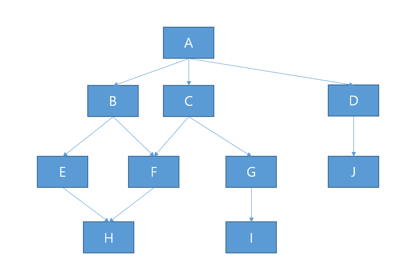

# 문제 20

## 문제

다음은 모듈의 관계를 나타낸 다이어그램이다. fan-in  개수가 2 이상인 모듈 명칭을 쓰시오.

<strong>정답 보기</strong>

F,H

모듈에서 화살표가 나가는 경우 팬아웃이고 모듈에서 화살표가 들어오는 경우 팬인이라고 합니다.

<strong>상세 해설</strong>

## 1. 문제에서 묻는 것
모듈 호출 관계도에서 **Fan-in이 2 이상**인 모듈을 모두 찾는 문제다.

## 2. 먼저 알아야 할 개념
### (1) Fan-in / Fan-out
| 용어 | 의미 | 세는 방법 |
|---|---|---|
| **Fan-in** | 그 모듈을 **호출(사용)하는 상위 모듈의 수** | 그 모듈로 **들어오는** 화살표 수 |
| **Fan-out** | 그 모듈이 **호출하는 하위 모듈의 수** | 그 모듈에서 **나가는** 화살표 수 |

### (2) 설계상 의미
- **Fan-in이 높다** → 여러 모듈이 **공통으로 사용**하는 모듈(**재사용성 높음**, 바람직)
- **Fan-out이 높다** → 한 모듈이 **많은 모듈에 의존**(복잡·결합도↑, 낮게 유지 권장)

## 3. 그림 분석 (화살표 방향 = 호출 방향)
| 화살표 |
|---|
| A → B, A → C, A → D |
| B → E, B → F |
| C → F, C → G |
| D → J |
| E → H, F → H |
| G → I |

**각 모듈로 들어오는 화살표 수(Fan-in)**
| 모듈 | 들어오는 화살표 | Fan-in |
|---|---|---:|
| A | (없음) | 0 |
| B | A | 1 |
| C | A | 1 |
| D | A | 1 |
| E | B | 1 |
| **F** | **B, C** | **2** |
| G | C | 1 |
| **H** | **E, F** | **2** |
| I | G | 1 |
| J | D | 1 |

Fan-in ≥ 2 → **F, H**

> **정답: F, H**

## 4. 암기 포인트
- **Fan-in = 들어오는 화살표 수**, **Fan-out = 나가는 화살표 수**.
- 같은 개념: 2022년 2회 20번.

---
