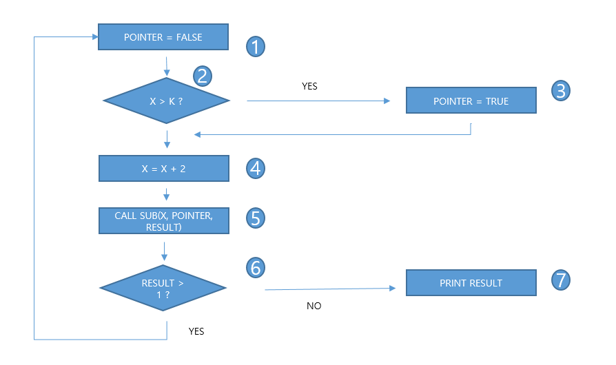

# 문제 07

## 문제

다음 아래 제어 흐름 그래프가 분기 커버리지를 만족하기 위한 테스팅 순서를 쓰시오.



<details>
<summary><strong>정답 보기</strong></summary>

1234561, 124567  or 1234567, 124561

결정 커버리지는 결정 포인트 내의 전체 조건식이 적어도 한 번은 참과 거짓의 결과를 수행해야 하기 때문에 첫 번째 분기문도 참, 거짓이 와야 하고, 두 번째 분기도 참, 거짓이 한 번씩 와야 한다.

</details>


<details>
<summary><strong>상세 해설</strong></summary>

## 1. 문제에서 묻는 것
제어 흐름 그래프에서 **분기(결정) 커버리지**를 만족하는 **테스트 경로**를 쓰는 문제다.

## 2. 먼저 알아야 할 개념
### (1) 제어 흐름 그래프
프로그램 실행 순서를 **노드(처리/판단)와 화살표**로 그린 그림. 마름모는 **분기점**이다.

### (2) 분기(결정) 커버리지
각 **분기점(판단)** 의 결과가 **참과 거짓 모두 최소 한 번씩** 나오도록, 즉 **모든 분기선(화살표)** 을 한 번 이상 통과하게 설계한다.
> 첫 번째 분기문도 참·거짓이, 두 번째 분기문도 참·거짓이 **한 번씩** 나와야 한다.

## 3. 그림 구조
```text
 ① POINTER=FALSE
     ↓
 ② X > K ?  ──YES──▶ ③ POINTER=TRUE ─┐
     │ NO                              │
     └────────────◀───────────────────┘
     ↓
 ④ X = X + 2
     ↓
 ⑤ CALL SUB(X, POINTER, RESULT)
     ↓
 ⑥ RESULT > 1 ? ──NO──▶ ⑦ PRINT RESULT
     │ YES
     └──▶ ① (반복)
```
| 판단 | 분기 | 경로 |
|---|---|---|
| ② | YES | 2→3 |
| ② | NO | 2→4 |
| ⑥ | YES | 6→1 |
| ⑥ | NO | 6→7 |

## 4. 테스트 경로 설계
**방법 A**
| 경로 | 지나는 분기 |
|---|---|
| `1 → 2 → 3 → 4 → 5 → 6 → 1` | ②(YES), ⑥(YES) |
| `1 → 2 → 4 → 5 → 6 → 7` | ②(NO), ⑥(NO) |

**방법 B**
| 경로 | 지나는 분기 |
|---|---|
| `1 → 2 → 3 → 4 → 5 → 6 → 7` | ②(YES), ⑥(NO) |
| `1 → 2 → 4 → 5 → 6 → 1` | ②(NO), ⑥(YES) |

> **정답: `1234561, 124567` 또는 `1234567, 124561`**

## 5. 암기 포인트
- 판단이 **2개**이면 **경로 2개**로 모든 분기를 커버할 수 있다. (2023년 1회 19번, 2025년 2회 11번과 같은 그림)

</details>

---
