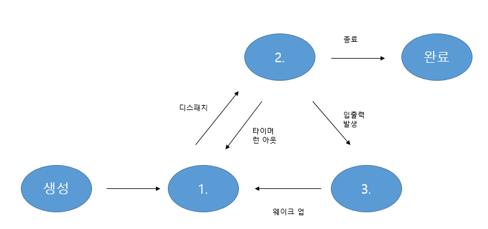

# 문제 13

## 문제

다음은 프로세스 상태 전이도이다. 1,2,3에 알맞은 상태를 쓰시오.



<details>
<summary><strong>정답 보기</strong></summary>

1. 준비

2. 실행

3. 대기

</details>


<details>
<summary><strong>상세 해설</strong></summary>

## 1. 문제에서 묻는 것
**프로세스 상태 전이도**의 빈칸(준비 / 실행 / 대기)을 채우는 문제다.

## 2. 먼저 알아야 할 개념
### (1) 프로세스(Process) 상태
프로그램이 실행 중인 상태. 운영체제는 프로세스를 **여러 상태 사이로 이동**시키며 CPU를 배분한다.
| 상태 | 영문 | 의미 |
|---|---|---|
| **생성** | New | 프로세스가 만들어짐 |
| **준비** | **Ready** | CPU를 **받을 순서를 기다리는** 상태(실행 준비 완료) |
| **실행** | **Running** | **CPU를 사용해** 실행 중 |
| **대기(블록)** | **Wait / Blocked** | **입출력(I/O) 완료** 등 **이벤트를 기다리는** 상태 |
| **완료(종료)** | Terminated | 실행 종료 |

### (2) 상태 전이 조건
| 전이 | 이름 | 설명 |
|---|---|---|
| 생성 → **준비** | 승인(Admit) | 프로세스가 큐에 들어감 |
| 준비 → **실행** | **디스패치(Dispatch)** | 스케줄러가 CPU를 할당 |
| 실행 → **준비** | **타이머 런 아웃(Timeout)** | **할당된 시간(타임 퀀텀)이 끝남** |
| 실행 → **대기** | **입출력 발생(I/O 요청)** | 입출력을 기다려야 해서 CPU 반납 |
| 대기 → **준비** | **웨이크 업(Wake up)** | 입출력 완료 |
| 실행 → 완료 | 종료 | |

```text
 생성 ─▶ [준비] ─디스패치─▶ [실행] ─종료─▶ 완료
            ▲  ◀─타이머 런아웃─┘   │
            │                      │ 입출력 발생
            └──── 웨이크 업 ─── [대기]◀┘
```
## 3. 그림 해석
| 번호 | 단서 | 정답 |
|---|---|---|
| **1** | 생성 직후 들어가며, **디스패치**로 나가고 **타이머 런아웃**·**웨이크 업**으로 돌아오는 상태 | **준비** |
| **2** | **디스패치**로 들어와 **종료**(완료), **입출력 발생**, **타이머 런아웃**으로 나가는 상태 | **실행** |
| **3** | **입출력 발생** 후 들어가 **웨이크 업**으로 나가는 상태 | **대기** |

> **정답: 1. 준비 2. 실행 3. 대기**

## 4. 암기 포인트
- 전이 이름: **디스패치(준비→실행)**, **타임아웃(실행→준비)**, **I/O 요청(실행→대기)**, **웨이크업(대기→준비)**.

</details>

---
