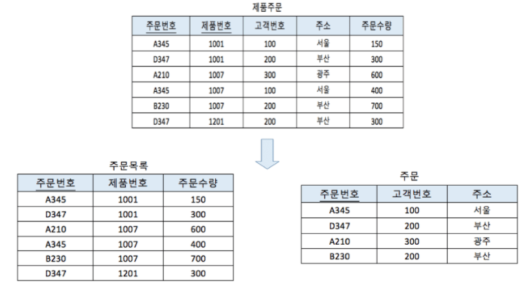

# 문제 04

## 문제

다음은 제 ( ) 정규형으로써, 부분 함수적 종속성을 제거하여, 완전 함수적 종속을 만족하는 정규형은?



<details>
<summary><strong>정답 보기</strong></summary>

제 2 정규형

- 기본키(주문번호 컬럼)이 제품번호에 의해 결정될 수 있기때문에 분해를 해야합니다.

- 부분 함수적 종속성 : 기본키의 부분집합이 결정자가 되버린 현상

제 1정규형 : 도메인이 원자값

제 2정규형 : 부분 함수적 종속 제거

제 3정규형 : 이행적 함수 종속 제거

BCNF : 결정자이면서 후보키가 아닌 것 제거

제 4정규형 : 다치 종속 제거

제 5정규형 : 조인 종속 제거

</details>


<details>
<summary><strong>상세 해설</strong></summary>

## 1. 문제에서 묻는 것
"**부분 함수적 종속성을 제거**하여 **완전 함수 종속**을 만족하는 정규형" → 제 몇 정규형인지 쓰는 문제다. (그림은 정규화 전/후 테이블)

## 2. 먼저 알아야 할 개념
### (1) 함수적 종속
`X → Y` : X 값이 정해지면 Y 값이 하나로 정해진다.

### (2) 정규형 단계
| 정규형 | 조건 | 제거 대상 |
|---|---|---|
| **1NF** | 모든 속성이 **원자값** | 반복 그룹 |
| **2NF** | 1NF + **부분 함수 종속 제거** (모든 비주요 속성이 **기본키 전체에 완전 종속**) | 기본키 **일부**에만 종속 |
| **3NF** | 2NF + **이행 함수 종속 제거** | A→B→C |
| **BCNF** | 3NF + **모든 결정자가 후보키** | 후보키가 아닌 결정자 |
| 4NF | 다치 종속 제거 | |
| 5NF | 조인 종속 제거 | |

### (3) 부분 함수 종속
기본키가 **(A, B)** 인데 어떤 속성이 **A만으로** 결정되는 상태.

## 3. 그림 분석
**정규화 전: 제품주문** — 기본키 **(주문번호, 제품번호)**
| 주문번호 | 제품번호 | 고객번호 | 주소 | 주문수량 |
|---|---:|---:|---|---:|
| A345 | 1001 | 100 | 서울 | 150 |
| D347 | 1001 | 200 | 부산 | 300 |
| A210 | 1007 | 300 | 광주 | 600 |
| A345 | 1007 | 100 | 서울 | 400 |
| B230 | 1007 | 200 | 부산 | 700 |
| D347 | 1201 | 200 | 부산 | 300 |

- **고객번호, 주소**는 **주문번호만으로 결정**된다(A345 → 100, 서울). → 기본키 (주문번호, 제품번호)의 **일부(주문번호)** 에만 종속 = **부분 함수 종속** ❌
- **주문수량**은 (주문번호, 제품번호) **둘 다** 있어야 결정 → 완전 함수 종속 ✅

**분해(정규화 후)**
| 테이블 | 속성 | 기본키 |
|---|---|---|
| **주문목록** | 주문번호, 제품번호, 주문수량 | (주문번호, 제품번호) — **완전 종속만** |
| **주문** | 주문번호, 고객번호, 주소 | 주문번호 |

```text
 제품주문(주문번호,제품번호,고객번호,주소,주문수량)
        ──▶ 주문목록(주문번호,제품번호,주문수량) + 주문(주문번호,고객번호,주소)
        (부분 함수 종속 제거 = 제2정규형)
```
> **정답: 제 2 정규형**

## 4. 암기 포인트
- **2NF = 부분 함수 종속 제거**, **3NF = 이행 함수 종속 제거**.
- 복합키의 **일부**에만 종속되는 속성은 **다른 테이블로 분리**한다.

</details>

---
