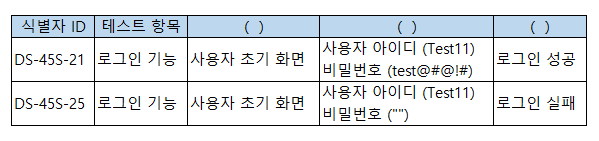

# 문제 08

## 문제

다음은 테스트케이스의 구성요소에 대한 설명이다. 괄호 ( ) 안에 들어갈 알맞는 보기를 고르시오.

(실제 기출문제에서는 답에 대한 보기가 주어집니다.)

<strong>정답 보기</strong>

1. 테스트 조건

2. 테스트 데이터

3. 예상 결과

테스트 케이스란 특정 프로그램의 부분 및 경로를 실행해보거나,  
요구사항에 준수하는지 확인하기 위해 개발된 입력 값, 조건, 예상된 결과 세트입니다.

케스트 케이스를 함으로써 오류감소 / 비용감소 / 의사소통의 효과가 나타납니다.

테스트 케이스의 설계 기법 종류로는  
블랙박스 기법의 명세기반 / 경험기반 기법과  
화이트박스 기법의 구조기반 기법이 있습니다.

<strong>상세 해설</strong>

## 핵심 개념

테스트 케이스는 특정 요구를 검증하기 위한 조건과 입력, 기대되는 결과를 정리한다.

## 풀이

조건은 검증할 상황, 데이터는 입력값, 예상 결과는 판정 기준이다.

## 오답 분석

실제 결과는 프로그램 실행 뒤 관찰하는 값이며, 사전에 정하는 예상 결과와 다르다.

## 암기 포인트

조건·데이터·예상 결과를 준비한다.

---
