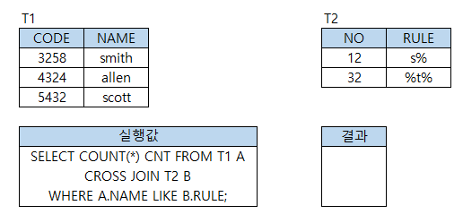

# 문제 13

## 문제

다음은, 테이블에서 조건값을 실행한 화면이다. 이에 대한 알맞는 결과값을 작성하시오.

<strong>정답 보기</strong>

4

cross join은 join을 해서 나올 수 있는 모든 행의 조합을 보여주는 것으로 각 결과를 곱해주면 됩니다.  
즉, S로 시작하는 A.NAME의 개수는 2개, T를 포함하는 A.NAME의 개수 또한 2개이므로 2\*2 = 4가 됩니다.

<strong>상세 해설</strong>

## 핵심 개념

CROSS JOIN은 두 결과 집합의 모든 조합을 만든다. 결과 행 수는 왼쪽 행 수와 오른쪽 행 수의 곱이다.

## 풀이

각 조건에서 2개씩 행이 선택되므로 2×2=4행이다.

## 오답 분석

조건별 합 2+2가 아니라 조합의 곱을 계산한다.

## 암기 포인트

CROSS JOIN 행 수는 두 집합 크기의 곱.

---
