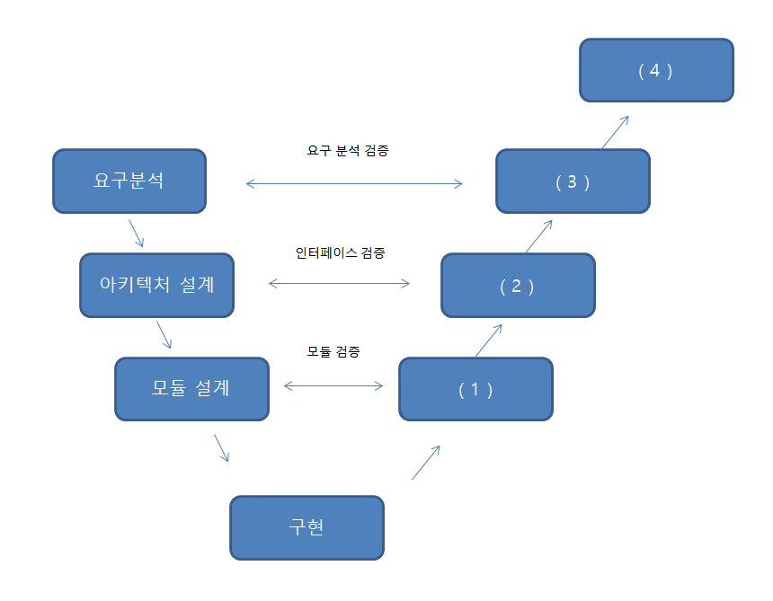

# 문제 20

## 문제

다음은 V모델에서의 테스트 단계에 대한 설명으로 괄호안에 들어갈 답을 작성하시오.



<details>
<summary><strong>정답 보기</strong></summary>

1. 단위 테스트

2. 통합 테스트

3. 시스템 테스트

4. 인수 테스트

</details>


<details>
<summary><strong>상세 해설</strong></summary>

## 1. 문제에서 묻는 것
**V 모델**의 각 개발 단계와 **대응되는 테스트 단계**의 이름(1~4)을 쓰는 문제다.

## 2. 먼저 알아야 할 개념
### (1) V 모델
개발 단계(왼쪽, 내려감)와 **그에 대응되는 테스트 단계(오른쪽, 올라감)** 를 **V자 형태**로 배치한 모델이다. **각 개발 산출물을 대응되는 테스트로 검증**한다.

```text
  요구분석 ◀──── 요구 분석 검증 ────▶ (3)시스템 테스트 ─▶ (4)인수 테스트
     ↓                                      ▲
  아키텍처 설계 ◀── 인터페이스 검증 ──▶ (2)통합 테스트
     ↓                                      ▲
  모듈 설계 ◀────── 모듈 검증 ───────▶ (1)단위 테스트
     ↓                                      ▲
            구현(코딩) ─────────────────────┘
```
### (2) 대응 관계
| 개발(설계) 단계 | 대응 테스트 | 검증 대상 |
|---|---|---|
| 모듈 설계(상세 설계) | **단위 테스트** | 모듈/함수가 설계대로 동작하는지 |
| 아키텍처 설계(고수준 설계) | **통합 테스트** | 모듈 간 **인터페이스**가 맞는지 |
| 요구분석(요구사항) | **시스템 테스트** | 전체 시스템이 **요구사항**을 만족하는지 |
| 사용자 요구 | **인수 테스트** | **사용자(고객)** 가 최종 수용 가능한지 |

## 3. 그림 분석
| 번호 | 위치 | 연결된 검증 | 정답 |
|---|---|---|---|
| (1) | 구현 바로 위, **모듈 설계 ↔ 모듈 검증** | 모듈 단위 | **단위 테스트** |
| (2) | **아키텍처 설계 ↔ 인터페이스 검증** | 모듈 간 인터페이스 | **통합 테스트** |
| (3) | **요구분석 ↔ 요구 분석 검증** | 전체 시스템·요구사항 | **시스템 테스트** |
| (4) | 최상단(마지막) | 사용자 인수 | **인수 테스트** |

> **정답: 1. 단위 테스트 2. 통합 테스트 3. 시스템 테스트 4. 인수 테스트**

## 4. 암기 포인트
- 아래부터 위로: **단위 → 통합 → 시스템 → 인수**.
- V 모델은 **개발 초기부터 테스트를 계획**한다는 점이 특징.

</details>

---
