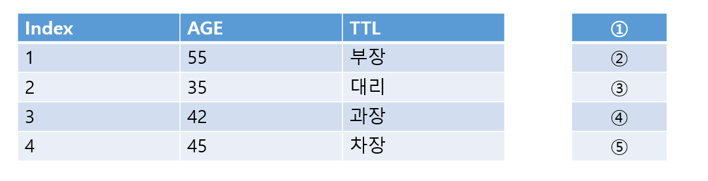

# 문제 12

## 문제

다음 테이블에서 πTTL(employee)에 대한 연산 결과 값을 작성하시오.

[employee테이블]

<strong>정답 보기</strong>

1. TTL

2. 부장

3. 대리

4. 과장

5. 차장

<strong>상세 해설</strong>

## 1. 문제에서 묻는 것
관계대수 **프로젝트(π)** 연산 `π_TTL(employee)`의 결과를 구하는 문제다.

## 2. 먼저 알아야 할 개념
### (1) 프로젝트(Project, π)
릴레이션에서 **지정한 열(속성)만 뽑는** 연산이다. 아래 첨자가 **열 이름**이다.
`π_TTL(employee)` = employee의 **TTL 열만**.

### (2) 순수 관계 연산자
| 연산 | 기호 | 선택 대상 |
|---|:---:|---|
| Select | σ | **행**(조건에 맞는) |
| **Project** | **π** | **열**(속성) |
| Join | ⋈ | 두 릴레이션 결합 |
| Division | ÷ | 모든 값과 연관 |

### (3) 중복 제거
관계대수는 **집합 연산**이므로 프로젝트 결과에서 **중복은 제거**된다.

## 3. 문제 데이터 (그림)
| Index | AGE | TTL |
|---:|---:|---|
| 1 | 55 | 부장 |
| 2 | 35 | 대리 |
| 3 | 42 | 과장 |
| 4 | 45 | 차장 |

오른쪽 빈 표: ①은 **열 이름(헤더)**, ②~⑤는 값 4개.

## 4. 풀이
TTL 열의 값: 부장, 대리, 과장, 차장 (중복 없음)
| 번호 | 값 |
|---|---|
| ① | **TTL** |
| ② | **부장** |
| ③ | **대리** |
| ④ | **과장** |
| ⑤ | **차장** |

> **정답: ① TTL ② 부장 ③ 대리 ④ 과장 ⑤ 차장**

---
