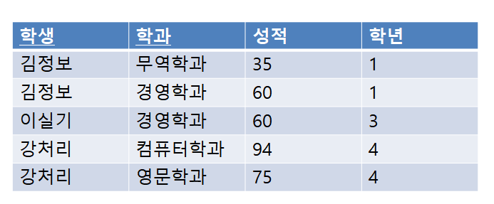

# 문제 18

## 문제

다음은 함수 종속성에 대한 설명이다. 해당 문제에 대한 알맞는 답을 보기에서 골라 작성하시오.  
(실제 기출문제에서는 답의 보기가 주어집니다.(오답 중, union 등..))



1. 성적은 {학생,학과}에 대해서 ( ) Functional Dependency이다.

2. 성적은 학과만 알아도 식별이 가능하므로, 이 경우에는 성적 속성은 기본키에 ( ) Functional Dependency이다.

3. 릴레이션에서 X, Y, Z라는 3 개의 속성이 있을 때 X→Y, Y→Z 이란 종속 관계가 있을 경우, X→Z가 성립될 경우

<details>
<summary><strong>정답 보기</strong></summary>

1. Full

2. Partial

3. Transitive

</details>


<details>
<summary><strong>상세 해설</strong></summary>

## 1. 문제에서 묻는 것
**함수적 종속의 종류**(완전, 부분, 이행)를 설명과 연결하는 문제다.

## 2. 먼저 알아야 할 개념
### (1) 함수적 종속(FD) `X → Y`
**X 값이 정해지면 Y 값이 하나로 정해진다.**

### (2) 종류
| 종류 | 의미 | 관련 정규형 |
|---|---|---|
| **완전 함수 종속(Full FD)** | Y가 **복합 기본키 전체**에 종속(일부만으로는 결정 안 됨) | 2NF 만족 |
| **부분 함수 종속(Partial FD)** | Y가 **기본키의 일부**에만 종속 | **2NF 위반** (제거 대상) |
| **이행 함수 종속(Transitive FD)** | X → Y, Y → Z 이면 **X → Z** (간접 종속) | **3NF 위반** (제거 대상) |

```text
 완전:   (학생, 학과) ──▶ 성적        (둘 다 알아야 성적 결정)
 부분:   (학생, 학과) ──▶ 학년        (학생만 알아도 학년 결정 → 키의 일부에 종속)
 이행:   X → Y → Z                    (X가 Y를 거쳐 Z를 결정)
```
## 3. 문제 데이터 (그림)
| 학생 | 학과 | 성적 | 학년 |
|---|---|---:|---:|
| 김정보 | 무역학과 | 35 | 1 |
| 김정보 | 경영학과 | 60 | 1 |
| 이실기 | 경영학과 | 60 | 3 |
| 강처리 | 컴퓨터학과 | 94 | 4 |
| 강처리 | 영문학과 | 75 | 4 |

기본키: **(학생, 학과)** (밑줄 속성). 같은 학생이 여러 학과 → 학생 단독으로는 행 식별 불가.

## 4. 문제 풀이
| 번호 | 설명 | 정답 |
|---|---|---|
| 1 | 성적은 **{학생, 학과} 둘 다** 있어야 결정(복합키 전체에 종속) | **Full** (완전) |
| 2 | 기본키의 **일부**에 종속(학생만으로 결정되는 속성) | **Partial** (부분) |
| 3 | X→Y, Y→Z 일 때 X→Z가 성립 | **Transitive** (이행) |

(2번은 원문 설명이 "성적은 학과만"이라 되어 있지만, **기본키의 일부에만 종속**된다는 뜻이므로 부분 함수 종속. 표에서 학년은 학생만 알아도 결정된다.)

> **정답: 1. Full 2. Partial 3. Transitive**

## 5. 암기 포인트
- **부분 종속 제거 = 2NF**, **이행 종속 제거 = 3NF**.
- 복합키의 **일부**만으로 결정되면 부분, **전체**가 필요하면 완전.

</details>

---
