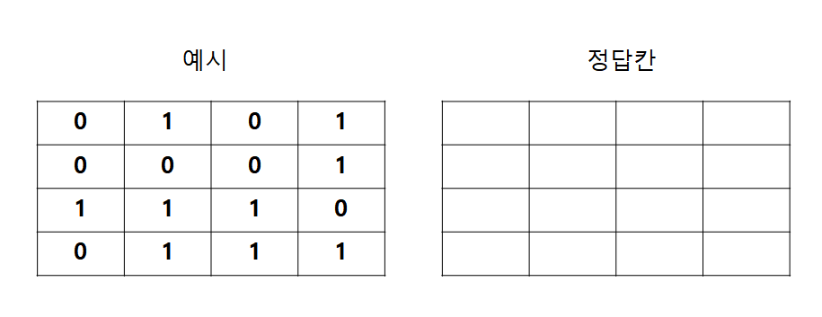

# 문제 01

## 문제

아래는 C언어의 2차원 배열 형태이다. field의 경우 2차원 배열 형태는 예시처럼 출력되므로, 이를 참고하여 mines의 2차원 배열 형태를 작성하시오.

```


1
2
3
4
5
6
7
8
9
10
11
12
13
14
15
16
17
18
19
20
21
22
23
24
25
26
27
28
29
30
31
32
33


void main{

field {{0,1,0,1},{0,0,0,1},{1,1,1,0},{0,1,1,1}};
mines {{0,0,0,0},{0,0,0,0},{0,0,0,0},{0,0,0,0}};

int w = 4, h = 4;
  for(y=0; y<h; y++) {
    for(x=0; x<w; x++) {
    if(field[y][x] == 0) continue;

      for(i=y-1; i<=y+1; i++) {
        for(j=x-1; j<=x+1; j++) {
          if(calculate(w,h,j,i) == 1) {
            mines[i][j] += 1;
          }
        }
      }
    }
  }
  for(y=0; y<h; y++){
    for(x=0; x<w; x++)
      printf("%d", mines[y][x]);
      printf("\n");
  }

}


int calculate(w,h,j,i) {
  if (i >= 0 && i < h && j >= 0 && j < w) return 1;
  return 0;
}


Colored by Color Scripter

cs


```



<details>
<summary><strong>정답 보기</strong></summary>

1, 1, 3, 2

3, 4, 5, 3

3, 5, 6, 4

3, 5, 5, 3

</details>


<details>
<summary><strong>상세 해설</strong></summary>

## 1. 문제에서 묻는 것
**지뢰찾기(Minesweeper)** 방식의 이중 반복문 코드를 실행했을 때, `mines` 배열의 최종 값을 구하는 문제다. 이웃한 8칸+자기 자신에 **1을 누적**하는 구조다.

## 2. 먼저 알아야 할 개념
### (1) 2차원 배열
`field[y][x]` : y행 x열. 배열의 값이 `1`이면 그 칸을 "지뢰 영향의 중심"으로 본다.
```text
 field =   x→ 0 1 2 3
         y=0  0 1 0 1
         y=1  0 0 0 1
         y=2  1 1 1 0
         y=3  0 1 1 1
```
### (2) 코드의 동작
```c
for (y..) for (x..)
   if (field[y][x] == 0) continue;           // 0이면 건너뜀
   for (i = y-1; i <= y+1; i++)               // 중심 칸 주변 3×3 범위
     for (j = x-1; j <= x+1; j++)
        if (calculate(w,h,j,i) == 1)          // 배열 범위 안이면
            mines[i][j] += 1;                 // 그 칸에 1 누적 (자기 자신 포함!)
```
- `calculate`: 좌표가 **배열 범위 안**일 때만 1 (범위 밖은 무시).
- 즉 field가 1인 **각 칸마다 3×3 영역(자기 자신 포함)에 +1**을 더한다.

## 3. 풀이: 1인 칸 8개의 3×3 영향 누적
field에서 1인 칸: (0,1), (0,3), (1,3), (2,0), (2,1), (2,2), (3,1), (3,2), (3,3)  *(표기 = (y,x))*

각 1인 칸이 영향을 주는 칸(범위 안만)을 칸별로 세어 정리하면:
| mines[y][x] | x=0 | x=1 | x=2 | x=3 |
|---|---:|---:|---:|---:|
| **y=0** | 1 | 1 | 3 | 2 |
| **y=1** | 3 | 4 | 5 | 3 |
| **y=2** | 3 | 5 | 6 | 4 |
| **y=3** | 3 | 5 | 5 | 3 |

**검산 예**: `mines[0][0]`에 영향을 주는 1칸은 주변 3×3 = (0,0),(0,1),(1,0),(1,1) 중 field=1인 칸 → (0,1) 하나 → **1**.
`mines[2][2]`: 주변 3×3(1~3행, 1~3열) 안에서 field가 1인 칸은 (1,3), (2,1), (2,2), (3,1), (3,2), (3,3) → **6개** → 6.
`mines[1][1]`: 주변 3×3(0~2행, 0~2열) 안의 1인 칸은 (0,1), (2,0), (2,1), (2,2) → **4개** → 4.

> **정답**
> ```
> 1 1 3 2
> 3 4 5 3
> 3 5 6 4
> 3 5 5 3
> ```
> (출력은 `printf("%d")`에 공백이 없어 실제로는 `1132`, `3453` … 처럼 붙어서 나온다.)

## 4. 암기 포인트
- 지뢰찾기 숫자 문제: **각 칸에 "주변 3×3 안의 1의 개수"** 를 쓰는 것과 같다(자기 자신 포함).
- 범위를 벗어나는 좌표는 `calculate()`로 걸러진다.

</details>

---
