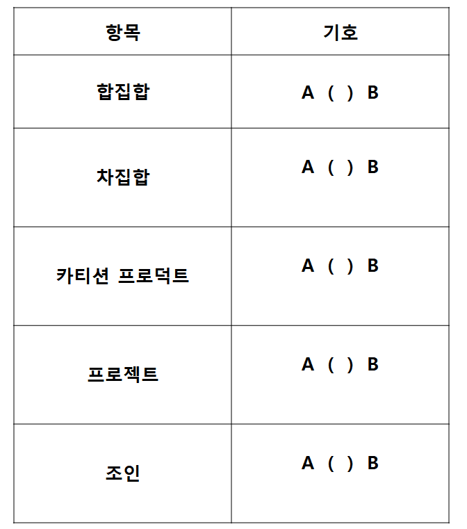

# 문제 02

## 문제

아래 예시를 보고 관계 대수에 대한 기호를 작성하시오.

<strong>정답 보기</strong>

U, -, X, π, ⋈

<strong>상세 해설</strong>

## 1. 문제에서 묻는 것
**관계대수 연산 5가지**(합집합, 차집합, 카티션 프로덕트, 프로젝트, 조인)에 해당하는 **기호**를 표의 괄호에 쓰는 문제다.

## 2. 먼저 알아야 할 개념
### (1) 관계대수
관계형 데이터베이스에서 **원하는 데이터를 꺼내는 연산 언어**. 크게 **일반 집합 연산자**와 **순수 관계 연산자**로 나뉜다.

### (2) 일반 집합 연산자
두 릴레이션 A, B를 **집합처럼** 다룬다.
| 연산 | 기호 | 의미 | 조건 |
|---|:---:|---|---|
| **합집합** | **∪** | A 또는 B에 있는 튜플(중복 제거) | 두 릴레이션이 **합병 가능**(속성 수·도메인 동일) |
| 교집합 | ∩ | 둘 다에 있는 튜플 | 합병 가능 |
| **차집합** | **−** | A에는 있고 B에는 없는 튜플 | 합병 가능 |
| **카티션 프로덕트** | **×** | A의 모든 튜플과 B의 모든 튜플의 **모든 조합** | 차수 = 합, 카디널리티 = 곱 |

### (3) 순수 관계 연산자
| 연산 | 기호 | 의미 |
|---|:---:|---|
| Select | σ | 조건에 맞는 **행** 선택 |
| **Project** | **π** | 원하는 **열**만 선택 |
| **Join** | **⋈** | 공통 속성으로 결합 |
| Division | ÷ | 모든 값과 연관된 튜플 |

## 3. 문제 풀이
| 항목 | 기호 | 표기 |
|---|:---:|---|
| 합집합 | **∪** | A ∪ B |
| 차집합 | **−** | A − B |
| 카티션 프로덕트 | **×** | A × B |
| 프로젝트 | **π** | π(A) — 열 선택 |
| 조인 | **⋈** | A ⋈ B |

> **정답: ∪, −, ×, π, ⋈**

## 4. 암기 포인트
- **∪(합) − (차) × (곱)**은 집합 연산자, **π는 열(Project)**, **⋈는 조인**.

---
