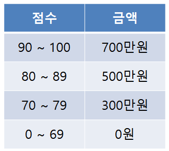
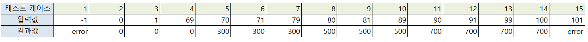

# 문제 06

## 문제

아래 표를 확인하여 보기에 알맞는 값을 고르시오.

(기호식 보기가 있습니다. ex: Boundary Value Partitioning, Equivalence Partitioning 등)





<details>
<summary><strong>정답 보기</strong></summary>

Boundary Value Analysis

</details>


<details>
<summary><strong>상세 해설</strong></summary>

## 1. 문제에서 묻는 것
표(점수별 금액)와 테스트 케이스 표를 보고, **어떤 블랙박스 테스트 기법**이 사용되었는지 보기에서 고르는 문제다.

## 2. 먼저 알아야 할 개념
### (1) 블랙박스 테스트 기법
| 기법 | 핵심 |
|---|---|
| **동치 분할(Equivalence Partitioning)** | 입력을 같은 결과를 내는 **구간**으로 나누고 **구간 대표값**만 테스트 |
| **경계값 분석(Boundary Value Analysis)** | 구간의 **경계(최솟값·최댓값과 그 바로 위/아래)** 를 집중 테스트 |

### (2) 경계값 분석의 원리
프로그램은 **조건이 바뀌는 지점(경계)** 에서 오류가 가장 잘 생긴다(`>=`를 `>`로 잘못 쓰는 등). 그래서 **경계와 그 양옆**을 시험한다.

## 3. 문제 데이터
**점수별 금액표**

| 점수 | 금액 |
|---|---|
| 90 ~ 100 | 700만원 |
| 80 ~ 89 | 500만원 |
| 70 ~ 79 | 300만원 |
| 0 ~ 69 | 0원 |

**테스트 케이스(입력 → 결과)**
| 케이스 | 1 | 2 | 3 | 4 | 5 | 6 | 7 | 8 | 9 | 10 | 11 | 12 | 13 | 14 | 15 |
|---|---:|---:|---:|---:|---:|---:|---:|---:|---:|---:|---:|---:|---:|---:|---:|
| 입력 | **-1** | **0** | 1 | 69 | **70** | 71 | 79 | **80** | 81 | 89 | **90** | 91 | 99 | **100** | **101** |
| 결과 | error | 0 | 0 | 0 | 300 | 300 | 300 | 500 | 500 | 500 | 700 | 700 | 700 | 700 | error |

## 4. 분석
```text
 입력값이 "경계"에 몰려 있음:
   -1 | 0  1 ... 69 | 70 71 ... 79 | 80 81 ... 89 | 90 91 ... 100 | 101
  (무효)| 0원 구간      | 300만 구간      | 500만 구간      | 700만 구간      |(무효)
   ↑ 경계 바로 아래/위/경계값을 모두 테스트
```
| 구간 | 선택된 입력 | 해석 |
|---|---|---|
| 유효 범위 하한 | **-1(error), 0, 1** | 최소값 -1, 최소값, 최소값 +1 |
| 구간 경계 | **69/70/71, 79/80/81, 89/90/91** | 구간이 바뀌는 지점의 양쪽 |
| 유효 범위 상한 | **99, 100, 101(error)** | 최대값 -1, 최대값, 최대값 +1 |

각 구간의 **대표값 1개만** 고른 것이 아니라 **경계(0, 70, 80, 90, 100)와 그 양옆**을 골랐으므로 **경계값 분석**이다.

> **정답: Boundary Value Analysis (경계값 분석)**

## 5. 암기 포인트
- 입력이 **구간 경계 ±1** 이면 경계값 분석, **구간별 대표 하나**면 동치 분할.
- 보기 중 "Boundary Value **Partitioning**"은 존재하지 않는 용어(함정).

</details>

---
