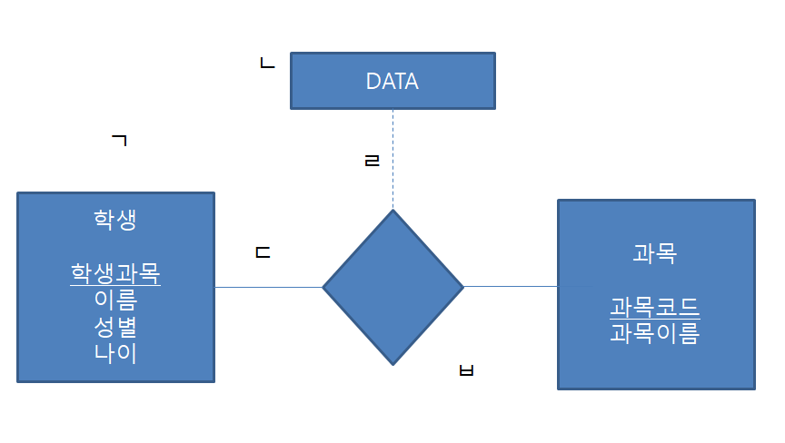

# 문제 18

## 문제

다음은 E-R다이어그램에 관한 설명이다. 괄호 안에 알맞는 답을 작성하시오.

(아래 그래프 기호는 정확히 기억이 나지 않아 임의로 작성한 것이니 참고만 해주세요.)



(    1    )  :  개체집합 - 관계집합 연결

(    2    )  :  개체 집합과의 연결

(    3    )  :  관계집합 - 관계집합의 속성 연결

(    4    )  :  두 개체집합 관계에서 생성되는 값을 저장하는 속성

(    5    )  :  같은 속성을 공유하는 개체들의 모임

<details>
<summary><strong>정답 보기</strong></summary>

1. 실선 (ㄷ)

2. 관계집합 (ㅂ)

3. 점선 (ㄹ)

4. 관계집합의 속성 (ㄴ)

5.  개체집합 (ㄱ)

</details>


<details>
<summary><strong>상세 해설</strong></summary>

## 1. 문제에서 묻는 것
**E-R 다이어그램**의 기호(개체집합, 관계집합, 속성, 선 종류)를 설명과 연결하는 문제다.

## 2. 먼저 알아야 할 개념
### (1) E-R 다이어그램
현실 세계를 **개체(Entity)** 와 **관계(Relationship)** 로 모델링해 그리는 **개념적 설계**의 도구.

### (2) 기본 기호
| 기호 | 모양 | 의미 |
|---|---|---|
| **개체집합** | **사각형** | 같은 속성을 공유하는 **개체들의 모임** (예: 학생, 과목) |
| **관계집합** | **마름모** | 개체집합들 사이의 **관계** (예: 수강) |
| **속성** | 타원 (이 문제에서는 상자로 표현) | 개체/관계의 **특성** |
| **실선** | ─── | **개체집합 ↔ 관계집합** 연결 |
| **점선** | ┄┄┄ | **관계집합 ↔ 관계집합의 속성** 연결 |
| 밑줄 | 속성에 밑줄 | **기본키(식별자)** |

### (3) 관계집합의 속성
**두 개체집합 사이의 관계에서 생성되는 값**을 저장하는 속성.
예) 학생–과목 사이의 **수강** 관계에는 **성적, 수강일자** 같은 속성이 붙는다. (학생에도 과목에도 속하지 않고 "관계"에서 생기는 값)

## 3. 그림 분석
```text
         ㄴ [DATA]               ← 관계집합의 속성 (관계에서 발생하는 값)
              ┆ ㄹ (점선)
 ㄱ [학생] ─ㄷ(실선)─ ◇ ㅂ(마름모) ─ [과목]
  (개체집합)           (관계집합)
```
| 기호 | 위치 | 의미 |
|---|---|---|
| ㄱ | 학생 사각형 | **개체집합** |
| ㄴ | DATA 상자 | **관계집합의 속성** |
| ㄷ | 학생–마름모 연결선(실선) | **실선** |
| ㄹ | DATA–마름모 연결선(점선) | **점선** |
| ㅂ | 마름모 | **관계집합** |

## 4. 문제 풀이
| 번호 | 설명 | 정답 |
|---|---|---|
| 1 | **개체집합 – 관계집합** 연결 | **실선 (ㄷ)** |
| 2 | **개체 집합과의 연결**(관계를 맺는 대상으로 개체들을 잇는 모양) | **관계집합 (ㅂ)** |
| 3 | **관계집합 – 관계집합의 속성** 연결 | **점선 (ㄹ)** |
| 4 | 두 개체집합 관계에서 **생성되는 값**을 저장하는 속성 | **관계집합의 속성 (ㄴ)** |
| 5 | **같은 속성을 공유하는 개체들의 모임** | **개체집합 (ㄱ)** |

> **정답: 1. 실선(ㄷ) 2. 관계집합(ㅂ) 3. 점선(ㄹ) 4. 관계집합의 속성(ㄴ) 5. 개체집합(ㄱ)**

## 5. 암기 포인트
- **사각형 = 개체, 마름모 = 관계, 실선 = 개체↔관계, 점선 = 관계↔관계 속성**.

</details>

---
