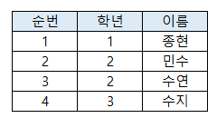

# 문제 13

## 문제

[학생] 테이블에서 학생 이름이 '민수'인 튜플을 삭제하는 쿼리를 작성하시오.



조건  
- 컬럼의 값이 문자열일 경우 작은 따움표 ('  ')를 표시하시오.  
- SQL 마지막에 세미콜론(;)은 표기하지 않아도 관계 없습니다.

<details>
<summary><strong>정답 보기</strong></summary>

delete from 학생 where 이름 = '민수';

</details>


<details>
<summary><strong>상세 해설</strong></summary>

## 1. 문제에서 묻는 것
[학생] 테이블에서 이름이 **'민수'인 튜플을 삭제**하는 SQL을 쓰는 문제다.

## 2. 먼저 알아야 할 개념
### (1) DELETE 문법
```sql
DELETE FROM 테이블명 WHERE 조건;
```
| 부분 | 의미 |
|---|---|
| `DELETE FROM 테이블` | 어느 테이블에서 행을 삭제할지 |
| `WHERE 조건` | **삭제할 행의 조건** (생략하면 **모든 행 삭제!**) |

### (2) 문자열 표기
문자열 값은 **작은따옴표**로 감싼다: `'민수'`.

### (3) 관련 명령
| 명령 | 동작 |
|---|---|
| **DELETE** | **행** 삭제(조건 지정 가능, 롤백 가능) |
| TRUNCATE | 모든 행 삭제(구조 유지, 빠름) |
| DROP | **테이블 자체** 삭제 |

## 3. 문제 데이터 (그림)
**학생**

| 순번 | 학년 | 이름 |
|---:|---:|---|
| 1 | 1 | 종현 |
| 2 | 2 | 민수 |
| 3 | 2 | 수연 |
| 4 | 3 | 수지 |

## 4. 풀이
삭제 대상: `이름 = '민수'` 인 행 (순번 2)
```sql
DELETE FROM 학생 WHERE 이름 = '민수';
```
결과 테이블: 순번 1(종현), 3(수연), 4(수지) 세 행만 남는다.

> **정답: `DELETE FROM 학생 WHERE 이름 = '민수';`**

## 5. 암기 포인트
- **WHERE를 빼면 전체 삭제**되니 반드시 확인.
- SQL 키워드는 대소문자 구분이 없다(`delete from ...` 도 정답).

</details>

---
