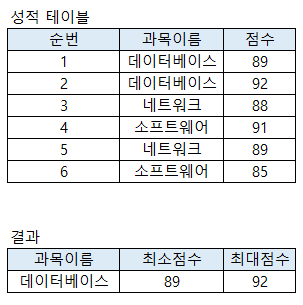

# 문제 16

## 문제

다음 성적 테이블에서 과목별 점수의 평균이 90점 이상인 '과목이름', '최소점수', '최대점수' 를 검색하고자 한다. [조건]을 참고하여 적합한 SQL문을 작성하시오.



조건:  
- where사용하지 말하야 한다.  
- SELECT절에 별칭을 사용하여 작성해야 한다.  
- SQL 구문 마지막에 세미콜론 생락 가능하다.  
- 반드시 GROUP BY와 having을 사용해야 한다.  
- 집계함수를 사용해야 한다.

<details>
<summary><strong>정답 보기</strong></summary>

SELECT  
&nbsp;&nbsp;과목이름  
&nbsp;&nbsp;,MIN(점수) AS 최소점수  
&nbsp;&nbsp;,MAX(점수) AS 최대점수  
From  
&nbsp;&nbsp;성적  
GROUP BY  
&nbsp;&nbsp;과목이름  
HAVING  
&nbsp;&nbsp;AVG(점수) &gt;= 90

</details>


<details>
<summary><strong>상세 해설</strong></summary>

## 1. 문제에서 묻는 것
**GROUP BY + HAVING + 집계 함수**를 사용해 "과목별 평균이 90점 이상인 과목의 최소/최대 점수"를 구하는 SQL을 쓰는 문제다. (WHERE 사용 금지, 별칭 사용)

## 2. 먼저 알아야 할 개념
### (1) 집계 함수
| 함수 | 의미 |
|---|---|
| `AVG(열)` | 평균 |
| `MIN(열)` / `MAX(열)` | 최솟값 / 최댓값 |
| `COUNT`, `SUM` | 개수, 합계 |

### (2) GROUP BY 와 HAVING
- **GROUP BY 열**: 같은 값끼리 **그룹**으로 묶어 그룹별로 집계.
- **HAVING 조건**: **그룹에 대한 조건**(집계 함수 사용 가능).
- (비교) **WHERE**: 그룹 만들기 **전에 행**을 거름, **집계 함수 사용 불가**.

```text
 실행 순서: FROM → WHERE(행 거름) → GROUP BY → HAVING(그룹 거름) → SELECT → ORDER BY
```
### (3) 별칭(Alias)
`MIN(점수) AS 최소점수` : 결과 열의 **이름을 지정**.

## 3. 문제 데이터 (그림)
**성적**

| 순번 | 과목이름 | 점수 |
|---:|---|---:|
| 1 | 데이터베이스 | 89 |
| 2 | 데이터베이스 | 92 |
| 3 | 네트워크 | 88 |
| 4 | 소프트웨어 | 91 |
| 5 | 네트워크 | 89 |
| 6 | 소프트웨어 | 85 |

## 4. 풀이 (과목별 그룹)
| 과목 | 점수들 | 평균 | 평균 ≥ 90? | 최소 | 최대 |
|---|---|---:|:---:|---:|---:|
| 데이터베이스 | 89, 92 | 90.5 | ✅ | 89 | 92 |
| 네트워크 | 88, 89 | 88.5 | ❌ | | |
| 소프트웨어 | 91, 85 | 88.0 | ❌ | | |

→ 조건을 만족하는 과목: **데이터베이스** (결과표와 일치: 최소 89, 최대 92)

```sql
SELECT 과목이름,
       MIN(점수) AS 최소점수,
       MAX(점수) AS 최대점수
FROM   성적
GROUP BY 과목이름
HAVING AVG(점수) >= 90;
```
> **정답: 위 SQL문**

## 5. 암기 포인트
- 집계 함수 조건은 **HAVING**, 일반 행 조건은 WHERE.
- SELECT에는 **GROUP BY에 쓴 열 + 집계 함수**만 쓸 수 있다.

</details>

---
