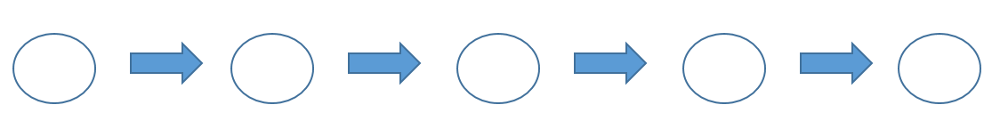

# 문제 10

## 문제

데이터베이스 설계 순서에 관한 내용이다. 보기를 이용하여 괄호안에 알맞은 내용을 작성하시오.



보기

구현, 요구조건 분석, 개념적 설계, 물리적 설계, 논리적 설계

<details>
<summary><strong>정답 보기</strong></summary>

요구조건 분석, 개념적 설계, 논리적 설계, 물리적 설계, 구현

</details>


<details>
<summary><strong>상세 해설</strong></summary>

## 1. 문제에서 묻는 것
**데이터베이스 설계 절차 5단계**의 순서에 맞게 보기를 배치하는 문제다.

## 2. 먼저 알아야 할 개념
DB 설계는 "무엇을 저장할지"에서 시작해 "어떻게 저장·구현할지"로 **점점 구체화**된다.

```text
 요구조건 분석 ─▶ 개념적 설계 ─▶ 논리적 설계 ─▶ 물리적 설계 ─▶ 구현
 (무엇을 원하나)  (개체·관계)     (테이블 구조)    (저장 방식)      (DBMS에 생성)
```
| 단계 | 하는 일 | 산출물 |
|---|---|---|
| **요구조건 분석** | 사용자 요구 수집·분석 | 요구사항 명세서 |
| **개념적 설계** | 개체(Entity)와 관계(Relationship)로 현실 모델링 | **E-R 다이어그램** |
| **논리적 설계** | 개념 모델을 **릴레이션(테이블)** 스키마로 변환, **정규화** | 논리 스키마 |
| **물리적 설계** | **인덱스, 저장 구조, 접근 경로** 등 성능 최적화 (DBMS 종속) | 물리 스키마 |
| **구현** | DDL로 테이블 생성, 데이터 입력 | 실제 DB |

## 3. 문제 풀이
| 순서 | 단계 |
|---:|---|
| 1 | 요구조건 분석 |
| 2 | 개념적 설계 |
| 3 | 논리적 설계 |
| 4 | 물리적 설계 |
| 5 | 구현 |

> **정답: 요구조건 분석 → 개념적 설계 → 논리적 설계 → 물리적 설계 → 구현**

## 4. 암기 포인트
- **요-개-논-물-구**.
- E-R 다이어그램 = 개념적 설계, 정규화 = 논리적 설계, 인덱스 = 물리적 설계.

</details>

---
