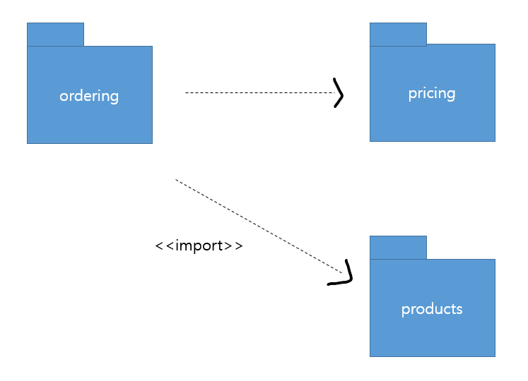

# 문제 15

## 문제

다음은 판매와 관련된 다이어그램이다. 해당 다이어그램의 명칭을 쓰시오.



<details>
<summary><strong>정답 보기</strong></summary>

패키지

</details>


<details>
<summary><strong>상세 해설</strong></summary>

## 1. 문제에서 묻는 것
그림(폴더 모양 상자와 `«import»` 점선 화살표)을 보고 **UML 다이어그램의 이름**을 쓰는 문제다.

## 2. 먼저 알아야 할 개념
### (1) 패키지(Package)
관련된 클래스·인터페이스들을 **폴더처럼 묶은 단위**. UML에서는 **윗부분에 작은 탭이 달린 폴더 모양**의 사각형으로 그린다.
```text
 ┌────┐
 ├────┴──────┐
 │  ordering │   ← 패키지 (폴더 모양)
 └───────────┘
```
### (2) 패키지 다이어그램
**패키지들 사이의 관계(의존)** 를 보여주는 **구조 다이어그램**이다. 시스템의 큰 구조와 모듈 간 의존성을 파악할 때 쓴다.

### (3) 패키지 간 의존 표기
| 표기 | 의미 |
|---|---|
| 점선 화살표 `┄┄▶` | **의존(Dependency)** — 화살표 방향으로 의존 |
| «import» | 대상 패키지 요소를 **가져와 사용**(공개) |
| «access» | 대상 패키지를 **참조만** 함 |
| «merge» | 두 패키지 **병합** |

## 3. 그림 해석
```text
  [ordering] ┄┄┄┄(의존)┄┄┄▶ [pricing]
      │ «import»
      ┗┄┄┄┄┄┄┄┄┄┄┄┄┄┄┄▶ [products]
```
- ordering 패키지가 pricing, products 패키지에 **의존**(주문이 가격·상품 정보를 사용)
- `«import»` 스테레오타입이 붙은 점선 화살표 = 패키지 가져오기

| 단서 | 해당 |
|---|---|
| **폴더 모양** 상자 | 패키지 |
| 패키지 간 **점선 화살표** + **«import»** | 패키지 다이어그램 |

> **정답: 패키지 다이어그램 (Package Diagram)**

</details>

---
