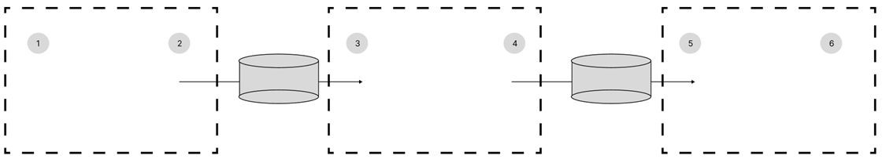

# 문제 05

## 문제

아래 그림에서의 네트워크에서 라우터을 통한 할당 가능한  2번, 4번, 5번의 IP를 작성하시오.

1) 192.168.35.3/24  
3) 129.200.10.16/22  
6) 192.168.36.24/24

보기

192.168.35.0

192.168.35.72

192.168.36.0

192.168.36.249

129.200.8.0

129.200.8.249

<strong>정답 보기</strong>

2)192.168.35.72  
4)129.200.8.249  
5)192.168.36.249

<strong>상세 해설</strong>

## 핵심 개념

호스트 주소가 해당 서브넷의 네트워크 주소나 브로드캐스트 주소가 아니면 할당 가능하다.

## 풀이

192.168.35.3/24는 192.168.35.0/24에 속하므로 .72가 호스트 주소다. 129.200.10.16/22의 네트워크는 129.200.8.0/22이며 .249는 유효 호스트다. 192.168.36.24/24에서 .249도 유효 호스트다. 각 네트워크 주소 자체는 할당할 수 없다.

## 오답 분석

보기의 .0 주소들은 각 서브넷 네트워크 주소여서 호스트에 줄 수 없다.

## 암기 포인트

네트워크 주소와 브로드캐스트 주소는 호스트 할당 불가.

---
