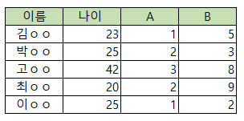

# 문제 04

## 문제

다음 릴레이션의 Cardinality와 Degree를 작성하시오.



Cardinality : (  ①  )

&nbsp;Degree      : (  ②  )

<details>
<summary><strong>정답 보기</strong></summary>

① : 5

② : 4

</details>


<details>
<summary><strong>상세 해설</strong></summary>

## 1. 문제에서 묻는 것
표(릴레이션)의 **카디널리티(Cardinality)** 와 **차수(Degree)** 를 구하는 문제다.

## 2. 먼저 알아야 할 개념
| 용어 | 의미 | 세는 방법 |
|---|---|---|
| **카디널리티(Cardinality)** | **튜플(행)의 개수** | 데이터 행을 센다 (**헤더 제외**) |
| **차수(Degree)** | **속성(열)의 개수** | 열 이름을 센다 |

```text
          속성(열) 4개 → 차수 = 4
        ┌──────┬──────┬────┬────┐
 헤더 → │ 이름 │ 나이 │ A  │ B  │   ← 헤더(속성 이름)는 튜플이 아님
        ├──────┼──────┼────┼────┤
        │ 김○○ │  23  │ 1  │ 5  │ ┐
        │ 박○○ │  25  │ 2  │ 3  │ │
        │ 고○○ │  42  │ 3  │ 8  │ │ 튜플 5개 → 카디널리티 = 5
        │ 최○○ │  20  │ 2  │ 9  │ │
        │ 이○○ │  25  │ 1  │ 2  │ ┘
        └──────┴──────┴────┴────┘
```
## 3. 문제 풀이
| 구하는 것 | 센 대상 | 결과 |
|---|---|:---:|
| 카디널리티 | 데이터 행: 김, 박, 고, 최, 이 | **5** |
| 차수 | 열: 이름, 나이, A, B | **4** |

> **정답: ① 5 ② 4**

## 4. 암기 포인트
- **차수 = 열(Column) 수, 카디널리티 = 행(Row) 수.** 헤더 행은 카디널리티에 포함하지 않는다.
- 차(열)·카(행) 순서로 헷갈리기 쉬우니 "차수=세로줄 개수"처럼 그림으로 기억.

</details>

---
