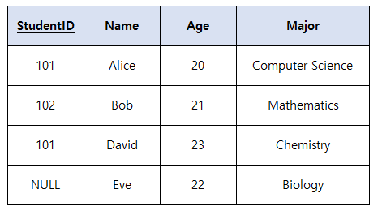

# 문제 08

## 문제

다음은 무결성제약조건에 대한 문제이다. 아래 표에서 어떠한 (       ) 무결성을 위반하였는지 작성하시오.

<strong>정답 보기</strong>

개체

<strong>상세 해설</strong>

## 1. 문제에서 묻는 것
표(그림)의 데이터가 **어떤 무결성 제약조건**을 위반했는지 묻는 문제다.

## 2. 먼저 알아야 할 개념
### (1) 무결성 제약조건 3가지
| 종류 | 규칙 | 위반 예 |
|---|---|---|
| **개체 무결성** | **기본키는 NULL이 될 수 없고 중복될 수 없다** | 기본키 값이 NULL이거나 같은 값이 2번 |
| 참조 무결성 | 외래키 값은 참조 대상의 기본키에 **존재**해야 함 | 없는 학과 코드를 참조 |
| 도메인 무결성 | 속성 값은 **정의된 범위·형식** 안 | 나이에 음수/문자 입력 |

### (2) 표에서 기본키 식별
표 머리글에서 밑줄이 그어진 열이 **기본키(PK)** 다. 여기서는 **StudentID**에 밑줄이 있다.

## 3. 문제 데이터 (그림)
| **StudentID** (PK) | Name | Age | Major |
|---|---|---:|---|
| 101 | Alice | 20 | Computer Science |
| 102 | Bob | 21 | Mathematics |
| **101** | David | 23 | Chemistry |
| **NULL** | Eve | 22 | Biology |

## 4. 위반 내용 분석
| 행 | StudentID | 문제점 |
|---|---|---|
| David | **101** | Alice와 **중복** → 기본키는 유일해야 함 ❌ |
| Eve | **NULL** | 기본키는 **NULL 불가** ❌ |

→ **기본키 규칙(NULL 금지 + 중복 금지)** 을 어김 = **개체 무결성** 위반.

참조 무결성(외래키)이나 도메인 무결성(값의 범위)과는 관련이 없다.

> **정답: 개체 (개체 무결성)**

## 5. 암기 포인트
- 기본키가 **NULL 또는 중복** → 개체 무결성 위반.

---
