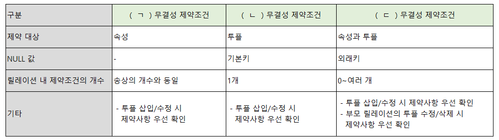

# 문제 02

## 문제

다음은 제약조건과 관련된 문제이다. 괄호안에 알맞는 용어를 보기에 골라 작성하시오.



[보기]

개체, 참조, 도메인

<details>
<summary><strong>정답 보기</strong></summary>

ㄱ. 도메인

ㄴ. 개체

ㄷ. 참조

</details>


<details>
<summary><strong>상세 해설</strong></summary>

## 1. 문제에서 묻는 것
표(그림)의 세 가지 **무결성 제약조건**(ㄱ, ㄴ, ㄷ)에 **개체 / 참조 / 도메인** 중 어느 것이 들어가는지 묻는 문제다.

## 2. 먼저 알아야 할 개념
### (1) 무결성(Integrity)
데이터가 **정확하고 일관된 상태**를 유지하는 성질. DB는 규칙(제약조건)을 걸어 **잘못된 데이터가 들어오지 못하게** 막는다.

### (2) 3가지 무결성 제약조건
| 종류 | 대상 | 규칙 | 예 |
|---|---|---|---|
| **도메인 무결성** | **속성(열)** | 값이 **정의된 도메인(자료형·범위·형식)** 안에 있어야 함 | 성별은 '남'/'여'만, 나이는 0 이상 |
| **개체 무결성** | **튜플(행)** | **기본키는 NULL 불가, 중복 불가** | 학번이 비어 있거나 중복이면 안 됨 |
| **참조 무결성** | **속성과 튜플(관계)** | **외래키 값은 참조 대상 기본키에 존재하거나 NULL** | 주문의 고객번호는 고객 테이블에 있어야 함 |

```text
 학생 테이블                       수강 테이블
 ┌──────┬──────┐                 ┌────────┬─────────┐
 │ 학번PK│ 이름 │ ◀──── 참조 ─────│ 학번 FK │ 과목    │
 └──────┴──────┘                 └────────┴─────────┘
 개체 무결성: 학번 NULL/중복 불가     참조 무결성: 수강.학번은 학생.학번에 있어야 함
```
## 3. 문제 풀이 (표 분석)
| 구분 | ( ㄱ ) | ( ㄴ ) | ( ㄷ ) |
|---|---|---|---|
| 제약 대상 | **속성** | **투플** | **속성과 투플** |
| NULL 값 | - | **기본키** (NULL 불가) | **외래키** (NULL 허용 가능) |
| 릴레이션 내 제약조건 개수 | **속성의 개수와 동일** | **1개** (기본키 1개) | 0~여러 개 |
| 기타 | 투플 삽입/수정 시 우선 확인 | 투플 삽입/수정 시 우선 확인 | **부모 릴레이션의 투플 수정/삭제 시 확인** |

| 칸 | 근거 | 정답 |
|---|---|---|
| ㄱ | 제약 대상이 **속성**, 속성 개수만큼 존재 | **도메인** |
| ㄴ | 제약 대상 **투플**, **기본키**, 개수 1개 | **개체** |
| ㄷ | **외래키**, 부모 릴레이션 수정/삭제 시 확인 | **참조** |

> **정답: ㄱ. 도메인 / ㄴ. 개체 / ㄷ. 참조**

## 4. 암기 포인트
- **개체 = 기본키(NULL·중복 금지)**, **참조 = 외래키**, **도메인 = 값의 범위**.
- 속성별로 하나씩 존재하는 것은 도메인, 기본키는 릴레이션당 1개.

</details>

---
