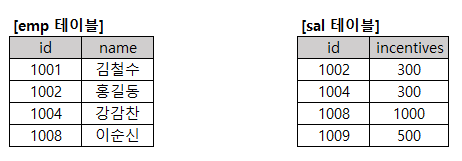

# 문제 07

## 문제

다음은 SQL 문제이다. 아래 두 테이블을 참고하여 보기에 쿼리 실행 결과를 작성하시오.



[보기]

SELECT name, incentive FROM emp, sal WHERE emp.id = sal.id and incentives &gt;= 500

<details>
<summary><strong>정답 보기</strong></summary>

name  |  incentives  
이순신 | 1000

</details>


<details>
<summary><strong>상세 해설</strong></summary>

## 1. 문제에서 묻는 것
두 테이블을 **`id`로 연결(JOIN)** 하고, **incentives ≥ 500**인 행의 `name`, `incentives`를 구하는 문제다.

## 2. 먼저 알아야 할 개념
### (1) FROM에 테이블 2개 + WHERE 조건 = JOIN
```sql
SELECT name, incentive
FROM   emp, sal            -- 두 테이블의 모든 조합(카티션 곱)을 만들고
WHERE  emp.id = sal.id     -- id가 같은 행만 남김 (= INNER JOIN)
  AND  incentives >= 500;  -- 그중 incentives가 500 이상만
```
같은 결과를 표준 문법으로 쓰면 `FROM emp JOIN sal ON emp.id = sal.id` 이다.

### (2) 실행 순서
`FROM`(조합) → `WHERE`(id 일치 + 500 이상 필터) → `SELECT`(열 선택)

### (3) INNER JOIN 결과는 "양쪽에 모두 있는 id"만
한쪽에만 있는 id는 결과에서 빠진다.

## 3. 문제 데이터 (그림)
**emp**

| id | name |
|---:|---|
| 1001 | 김철수 |
| 1002 | 홍길동 |
| 1004 | 강감찬 |
| 1008 | 이순신 |

**sal**

| id | incentives |
|---:|---:|
| 1002 | 300 |
| 1004 | 300 |
| 1008 | 1000 |
| 1009 | 500 |

## 4. 풀이
**① `emp.id = sal.id` 로 연결**
| id | name | incentives | 비고 |
|---:|---|---:|---|
| 1002 | 홍길동 | 300 | |
| 1004 | 강감찬 | 300 | |
| 1008 | 이순신 | 1000 | |
| 1001 | 김철수 | – | sal에 없음 → 제외 |
| 1009 | – | 500 | emp에 없음 → 제외 |

**② `incentives >= 500` 필터**
| name | incentives | 500 이상? |
|---|---:|:---:|
| 홍길동 | 300 | X |
| 강감찬 | 300 | X |
| **이순신** | **1000** | ✅ |

(id 1009의 500은 조건은 맞지만 emp에 id 1009가 없어 JOIN에서 이미 제외된다.)

| name | incentives |
|---|---:|
| 이순신 | 1000 |

> **정답: 이순신 | 1000**

## 5. 암기 포인트
- JOIN 조건(`emp.id = sal.id`)이 먼저 걸러내는 행이 있다는 점이 함정: **500인 1009는 결과에 없다**.
- (참고) 문제의 `SELECT`에는 `incentive`, `WHERE`에는 `incentives`라고 적혀 있으나 원문 표기 오타로 보고 열 이름 `incentives`로 간주한다.

</details>

---
