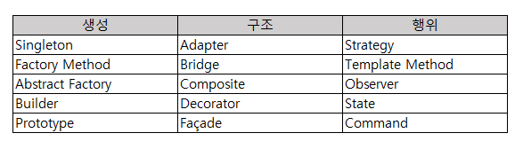

# 문제 14

## 문제

아래는 디자인 패턴에 대한 설명이다. 알맞는 답을 보기에 골라 작성하시오.

서로 다른 인터페이스를 가진 클래스들을 연결해 사용 가능하게 한다.

기존 클래스(Adaptee)를 원하는 인터페이스(Target)에 맞게 변환하는 어댑터(Adapter)를 만든다.

기존 클래스를 감싸서(wrapper) 인터페이스를 변환해주는 역할을 한다.



<details>
<summary><strong>정답 보기</strong></summary>

Adapter

</details>


<details>
<summary><strong>상세 해설</strong></summary>

## 1. 문제에서 묻는 것
"서로 다른 인터페이스를 가진 클래스를 **연결**, 기존 클래스(Adaptee)를 원하는 인터페이스(Target)에 맞게 **변환**하는 **Adapter**, **wrapper**" → 어떤 패턴인지 보기(표)에서 고르는 문제다.

## 2. 먼저 알아야 할 개념
### (1) 디자인 패턴과 GoF 분류 (그림의 표)
| 생성 (객체 생성) | 구조 (객체 조합) | 행위 (객체 협력) |
|---|---|---|
| Singleton | **Adapter** | Strategy |
| Factory Method | Bridge | Template Method |
| Abstract Factory | Composite | Observer |
| Builder | Decorator | State |
| Prototype | Façade | Command |

### (2) 어댑터(Adapter) 패턴
"**돼지코(전원 어댑터)**" 와 같다. 한국 플러그(기존 클래스)를 미국 콘센트(원하는 인터페이스)에 꽂으려고 **중간에서 모양을 바꿔 준다.**
```text
 Client ──요구하는 Target 인터페이스──▶ [ Adapter ] ──내부에서 변환──▶ Adaptee(기존 클래스)
                                       (wrapper: 감싸서 인터페이스 변환)
```
| 용어 | 역할 |
|---|---|
| **Target** | 클라이언트가 **원하는 인터페이스** |
| **Adaptee** | 이미 있는 **기존 클래스**(인터페이스 불일치) |
| **Adapter** | Adaptee를 **감싸서** Target 형태로 변환 |

기존 코드를 **수정하지 않고** 재사용할 수 있다.

### (3) 혼동 쉬운 구조 패턴
| 패턴 | 목적 |
|---|---|
| **Adapter** | **인터페이스 변환**(호환성) |
| Bridge | 기능 계층과 구현 계층 **분리** |
| Decorator | 기능을 **동적으로 추가** |
| Façade | 복잡한 서브시스템에 **단순한 창구** |
| Proxy | 접근 **제어**(대리) |

## 3. 문제 풀이
| 단서 | 해당 |
|---|---|
| 서로 다른 **인터페이스**를 가진 클래스를 연결 | Adapter |
| Adaptee를 Target에 맞게 **변환**하는 Adapter | Adapter |
| 기존 클래스를 **감싸서(wrapper)** 인터페이스 변환 | Adapter |

> **정답: Adapter (어댑터)** (표의 **구조** 패턴)

</details>

---
