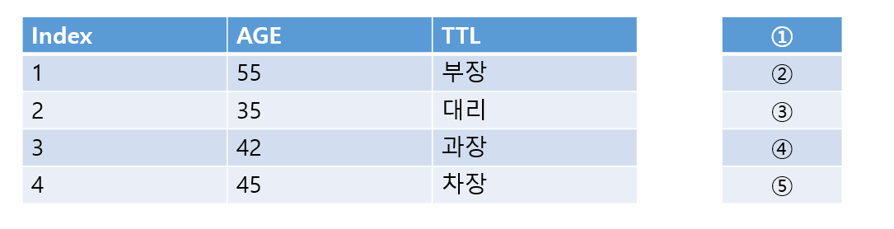

# 문제 20

## 문제

다음 테이블에서 πTTL(employee)에 대한 연산 결과 값을 작성하시오.

[employee테이블]

<strong>정답 보기</strong>

1. TTL

2. 부장

3. 대리

4. 과장

5. 차장

<strong>상세 해설</strong>

## 1. 문제에서 묻는 것
관계대수 **프로젝트(Project, π)** 연산 `π_TTL(employee)`의 결과를 구하는 문제다.

## 2. 먼저 알아야 할 개념
### (1) 관계대수의 순수 관계 연산자
| 연산 | 기호 | 의미 | 비유 |
|---|---|---|---|
| 셀렉트 | σ | 조건에 맞는 **행(튜플)** 선택 | 필터 |
| **프로젝트** | **π** | 지정한 **열(속성)** 만 선택 (**중복 제거**) | 원하는 열만 복사 |
| 조인 | ⋈ | 두 릴레이션을 공통 속성으로 결합 | |
| 디비전 | ÷ | 모든 값과 연관된 튜플 찾기 | |

### (2) 프로젝트(π) 표기
`π_속성이름(릴레이션)` — 아래 첨자가 **선택할 열**이다. `π_TTL(employee)` = employee 테이블에서 **TTL 열만** 꺼낸다.

### (3) 중복 제거
관계대수는 **집합 개념**이라 프로젝트 결과에 같은 값이 여러 번 나오면 **한 번만** 남긴다. (SQL의 `SELECT DISTINCT`와 비슷)

## 3. 문제 데이터 (그림)
| Index | AGE | TTL |
|---:|---:|---|
| 1 | 55 | 부장 |
| 2 | 35 | 대리 |
| 3 | 42 | 과장 |
| 4 | 45 | 차장 |

오른쪽 빈 표(①~⑤)는 **결과 릴레이션**으로, ①이 **헤더(열 이름)**, ②~⑤가 **값 4개**이다.

## 4. 풀이
`π_TTL(employee)` → TTL 열만 추출 (값이 모두 달라 중복 제거 영향 없음)

| 번호 | 내용 |
|---|---|
| ① | **TTL** (열 이름) |
| ② | **부장** |
| ③ | **대리** |
| ④ | **과장** |
| ⑤ | **차장** |

| TTL |
|---|
| 부장 |
| 대리 |
| 과장 |
| 차장 |

> **정답: ① TTL ② 부장 ③ 대리 ④ 과장 ⑤ 차장**

## 5. 암기 포인트
- **π = 열 선택(Project)**, **σ = 행 선택(Select)** — 이름과 기호 모두 헷갈리기 쉬움.
- 아래 첨자가 속성이면 π, 조건식이면 σ.

---
