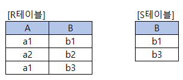

# 문제 14

## 문제

다음 아래의 테이블을 확인하여 R%S의 결과를 테이블 형태로 기재하시오.

<strong>정답 보기</strong>

| A |
|---|
| a1 |

<strong>상세 해설</strong>

## 1. 문제에서 묻는 것
관계대수의 **디비전(Division, ÷, %) 연산** `R ÷ S` 결과를 구하는 문제다. (문제에서는 `%`로 표기)

## 2. 먼저 알아야 할 개념
### (1) 관계대수
릴레이션(테이블)에서 **원하는 데이터를 꺼내는 연산 언어**. 순수 관계 연산자는 4개다.

| 연산 | 기호 | 의미 |
|---|---|---|
| 셀렉트 | σ | **행** 선택 |
| 프로젝트 | π | **열** 선택 |
| 조인 | ⋈ | 공통 속성으로 **결합** |
| **디비전** | **÷** | "**S의 모든 값과 짝을 이루는**" R의 튜플을 찾음 |

### (2) 디비전의 의미
`R(A, B) ÷ S(B)`: S에 있는 **B 값을 전부** 가지고 있는 **A 값**만 남긴다. 결과에는 `A`만 나온다(B 열은 제거).

비유: "**모든 필수과목(S)을 수강한 학생(A)** 을 찾아라".

## 3. 문제 데이터 (그림)
**R(A, B)**

| A | B |
|---|---|
| a1 | b1 |
| a2 | b2 |
| a1 | b3 |

**S(B)**

| B |
|---|
| b1 |
| b3 |

→ S가 요구하는 값: **{b1, b3}** 전부

## 4. 풀이: A 값별로 B 집합을 정리
| A | R에서 짝을 이루는 B | {b1, b3}을 모두 포함? |
|---|---|:---:|
| **a1** | {b1, b3} | ✅ 둘 다 있음 |
| a2 | {b2} | ❌ b1, b3 없음 |

→ 결과는 `a1`만.

| A |
|---|
| a1 |

> **정답: 위 표 (A = a1)**

## 5. 암기 포인트
- 디비전 결과 열 = **R의 속성에서 S의 속성을 뺀 나머지**(여기서는 A).
- "~을 **모두** 가진" 이라는 표현이 나오면 디비전.

---
