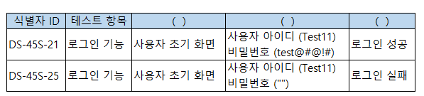

# 문제 19

## 문제

다음은 테스트케이스의 구성요소에 대한 설명이다. 괄호 ( ) 안에 들어갈 알맞는 보기를 고르시오.

[보기]

ㄱ. 테스트 조건 ㄴ. 테스트 환경  ㄷ. 테스트 유형  ㄹ. 테스트 데이터

ㅁ. 예상 결과 ㅂ. 수행 단계 ㅅ. 성공/실패 기준

<strong>정답 보기</strong>

(왼쪽순으로)

ㄱ

ㄹ

ㅁ

<strong>상세 해설</strong>

## 1. 문제에서 묻는 것
**테스트 케이스** 표의 빈 열 3개(조건 / 입력 / 결과)에 해당하는 **구성요소 이름**을 고르는 문제다.

## 2. 먼저 알아야 할 개념
### (1) 테스트 케이스(Test Case)
소프트웨어를 테스트할 때 "**무엇을, 어떻게 입력해서, 어떤 결과가 나와야 정상인지**"를 **문서로 정리**한 것이다.

### (2) 구성요소
| 구성요소 | 의미 |
|---|---|
| 식별자 ID | 테스트 케이스를 구분하는 번호 |
| 테스트 항목 | 무엇을 테스트하나 (예: 로그인 기능) |
| **테스트 조건** | 테스트를 **실행하기 위한 전제·상황** (예: 사용자 초기 화면) |
| **테스트 데이터** | 테스트에 **입력하는 값** (예: 아이디, 비밀번호) |
| **예상 결과** | 정상이라면 **나와야 하는 결과** (예: 로그인 성공) |
| 수행 단계 | 실행 절차 |
| 성공/실패 기준 | 통과 여부 판정 기준 |
| 테스트 환경 | 실행 환경(OS, 브라우저 등) |

## 3. 문제 데이터 (그림)
| 식별자 ID | 테스트 항목 | **( ㉠ )** | **( ㉡ )** | **( ㉢ )** |
|---|---|---|---|---|
| DS-45S-21 | 로그인 기능 | 사용자 초기 화면 | 사용자 아이디(Test11) / 비밀번호(test@#@!#) | 로그인 성공 |
| DS-45S-25 | 로그인 기능 | 사용자 초기 화면 | 사용자 아이디(Test11) / 비밀번호("") | 로그인 실패 |

## 4. 풀이
| 열 | 내용 | 구성요소 |
|---|---|---|
| ㉠ (첫 번째 빈칸) | **사용자 초기 화면** — 테스트를 시작하는 상황·전제 | **ㄱ. 테스트 조건** |
| ㉡ (두 번째) | **아이디·비밀번호** 같은 **입력값** | **ㄹ. 테스트 데이터** |
| ㉢ (세 번째) | **로그인 성공/실패** — 기대하는 결과 | **ㅁ. 예상 결과** |

흐름: `조건(초기 화면에서) → 데이터(이 값을 입력하면) → 예상 결과(성공/실패여야 함)`

> **정답: ㄱ(테스트 조건), ㄹ(테스트 데이터), ㅁ(예상 결과)**

## 5. 암기 포인트
- 입력 = **테스트 데이터**, 기대 출력 = **예상 결과**, 전제 = **테스트 조건**.
- 두 번째 케이스는 **빈 비밀번호 입력 → 실패**를 확인하는 **비정상(예외) 케이스**다. 정상/비정상 케이스를 모두 만들어야 한다.

---
