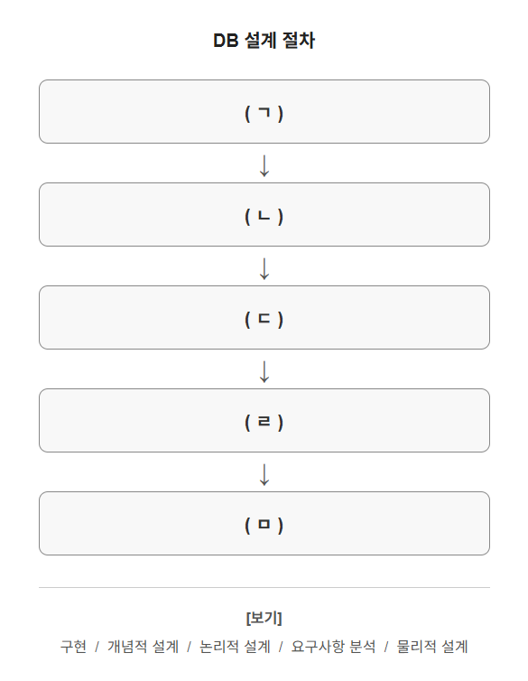

# 문제 03

## 문제

데이터베이스(DB) 설계 절차를 순서대로 나타낸 것이다. 각 빈칸에 들어갈 알맞은 용어를 쓰시오.



<details>
<summary><strong>정답 보기</strong></summary>

ㄱ.요구사항 분석

ㄴ.개념적 설계

ㄷ.논리적 설계

ㄹ.물리적 설계

ㅁ.구현

</details>


<details>
<summary><strong>상세 해설</strong></summary>

## 1. 문제에서 묻는 것
**데이터베이스 설계 절차 5단계**의 순서를 맞히는 문제다.

## 2. 먼저 알아야 할 개념
DB 설계는 "무엇을 저장할지"에서 시작해 "실제로 어떻게 저장·구현할지"로 **점점 구체화**된다.

```text
 ㄱ 요구사항 분석 ─▶ ㄴ 개념적 설계 ─▶ ㄷ 논리적 설계 ─▶ ㄹ 물리적 설계 ─▶ ㅁ 구현
   (무엇을?)         (개체/관계)       (테이블 구조)      (저장 방식)       (DBMS에 생성)
```
| 단계 | 하는 일 | 산출물 | DBMS 의존 |
|---|---|---|---|
| **요구사항 분석** | 사용자가 무엇을 원하는지 수집·분석 | 요구사항 명세서 | 무관 |
| **개념적 설계** | 현실 세계를 **개체(Entity)와 관계(Relationship)** 로 모델링 | **E-R 다이어그램** | 독립 |
| **논리적 설계** | 개념 모델을 **릴레이션(테이블) 스키마**로 변환, **정규화**, 키·무결성 정의 | 논리 스키마 | 데이터 모델(관계형) 의존, DBMS 제품은 독립 |
| **물리적 설계** | 인덱스, 파티션, 저장 구조, 접근 경로 등 **성능·저장 최적화** | 물리 스키마 | **DBMS 의존** |
| **구현** | DDL로 테이블 생성, 데이터 입력, 프로그램 작성 | 실제 DB | – |

## 3. 문제 풀이
보기: 구현 / 개념적 설계 / 논리적 설계 / 요구사항 분석 / 물리적 설계

| 칸 | 단계 |
|---|---|
| ㄱ | 요구사항 분석 |
| ㄴ | 개념적 설계 |
| ㄷ | 논리적 설계 |
| ㄹ | 물리적 설계 |
| ㅁ | 구현 |

> **정답: ㄱ 요구사항 분석 → ㄴ 개념적 설계 → ㄷ 논리적 설계 → ㄹ 물리적 설계 → ㅁ 구현**

## 4. 암기 포인트
- **요-개-논-물-구**.
- E-R 다이어그램은 **개념적 설계**, 정규화·스키마 변환은 **논리적 설계**, 인덱스 설계는 **물리적 설계**.

</details>

---
