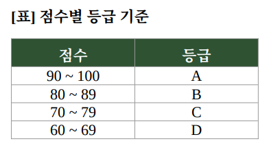

# 문제 01

## 문제

다음은 블랙박스 테스트 기법에 대한 설명이다. 괄호 (   ) 안에 들어갈 말을 보기에서 골라 쓰시오.

(   )은 프로그램의 입력 조건을 유효한 값과 유효하지 않은 값의 영역으로 나누고, 각 영역을  
대표할 수 있는 값을 선정하여 테스트 케이스를 설계하는 명세 기반(블랙박스) 테스트 기법이다.



위 표에서 테스트 값으로 60을 입력하였을 때, 예상 결과와 실제 결과가 모두 등급 D로  
일치하였다. 이는 (   ) 기법을 적용하여 각 등급 구간의 대표값을 테스트한 사례이다.

보기

ㄱ. 동치분할 (Equivalence Partitioning)  
ㄴ. 경계값분석 (Boundary Value Analysis)  
ㄷ. 결정테이블 테스트 (Decision Table Testing)  
ㄹ. 상태전이 테스트 (State Transition Testing)

<details>
<summary><strong>정답 보기</strong></summary>

ㄱ. 동치분할 (Equivalence Partitioning)

</details>


<details>
<summary><strong>상세 해설</strong></summary>

## 1. 문제에서 묻는 것
"입력 조건을 **유효/무효 영역으로 나누고, 영역마다 대표값을 골라** 테스트한다"는 설명에 맞는 **블랙박스 기법**을 고르는 문제다.

## 2. 먼저 알아야 할 개념
### (1) 블랙박스 테스트란?
프로그램의 **내부 코드는 보지 않고**, "이 입력을 넣으면 이런 결과가 나와야 한다"는 **명세(요구사항)만 기준**으로 검사하는 방식이다. 코드를 보지 않으므로 "상자 안이 검은색"이라는 뜻이다.

### (2) 왜 기법이 필요한가?
점수가 0~100점이면 입력 가능한 값만 101개다. 전부 넣어 볼 수는 없으므로 **"결과가 같게 처리되는 값끼리 묶어서 한 개씩만 검사"** 하는 요령이 필요하다. 이것이 동치 분할이다.

### (3) 보기 4가지 비교
| 기법 | 한 줄 정의 | 이 문제와 맞나? |
|---|---|---|
| **동치 분할** | 입력을 같은 결과가 나오는 **영역(동치류)** 으로 나누고 영역당 **대표값 1개**를 검사 | ✅ |
| 경계값 분석 | 영역의 **경계(89, 90, 91…)** 를 집중 검사 | ❌ 대표값이 아니라 경계값 |
| 결정 테이블 | 여러 **조건의 조합**과 그에 따른 동작을 표로 정리 | ❌ |
| 상태 전이 | 시스템의 **상태 변화**(로그인→로그아웃 등)를 검사 | ❌ |

## 3. 문제에 적용
[표] 점수별 등급 기준

| 점수 구간 | 등급 | 영역 |
|---|---|---|
| 90~100 | A | 영역 1 |
| 80~89 | B | 영역 2 |
| 70~79 | C | 영역 3 |
| 60~69 | D | 영역 4 |

```text
 0 ──────── 59 | 60 ── 69 | 70 ── 79 | 80 ── 89 | 90 ── 100
   (F 등)         D(영역4)    C(영역3)    B(영역2)    A(영역1)
                    ▲ 60을 대표값으로 검사
```
- 문제에서 60을 넣어 D가 나왔으니 "D 구간(60~69)은 정상"이라고 **그 구간 전체를 대표해서** 확인한 셈이다.
- 만약 **경계값 분석**이라면 59와 60, 69와 70처럼 **구간이 바뀌는 지점**을 함께 넣어야 한다. (60은 D 구간의 하한 경계값이기도 하지만, 문제는 "각 영역의 대표값"이라고 명시했다.)

## 4. 핵심 정리
- **동치 분할 = 영역을 나누고 영역당 대표값 1개** → "대표값"이라는 단어가 나오면 동치 분할.
- **경계값 분석 = 경계 근처(±1) 값** → "경계"가 나오면 경계값 분석.
- 둘은 보통 **함께 사용**한다(동치 분할로 영역을 나누고 경계값으로 보완).

> **정답: ㄱ. 동치분할 (Equivalence Partitioning)**

</details>

---
