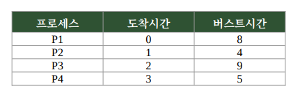

# 문제 08

## 문제

다음 프로세스들을 SRT(Shortest Remaining Time) 스케줄링 기법으로 처리할 때, 평균 대기시간을 구하시오. (단위: ms)



<details>
<summary><strong>정답 보기</strong></summary>

6.5ms

</details>


<details>
<summary><strong>상세 해설</strong></summary>

## 1. 문제에서 묻는 것
**SRT(Shortest Remaining Time)** 스케줄링으로 4개의 프로세스를 처리할 때의 **평균 대기시간**을 구하는 문제다.

## 2. 먼저 알아야 할 개념
### (1) CPU 스케줄링
CPU는 한 번에 한 프로세스만 실행할 수 있다. 여러 프로세스가 기다릴 때 **누구를 먼저 실행할지 정하는 규칙**이 스케줄링이다.

### (2) 용어
| 용어 | 뜻 |
|---|---|
| 도착시간 | 프로세스가 대기 큐에 들어온 시각 |
| 버스트시간 | CPU로 실행해야 하는 총 시간 |
| 대기시간 | 큐에서 **기다린 시간** = 종료시각 − 도착시각 − 버스트시간 |

### (3) SRT
- **SJF(최단 작업 우선)의 선점형** 버전이다.
- **남은 실행 시간이 가장 짧은** 프로세스에 CPU를 준다.
- 새 프로세스가 도착할 때마다 비교해서, 남은 시간이 더 짧은 쪽이 **현재 실행 중인 프로세스를 밀어낸다(선점)**.

## 3. 문제 데이터 (그림)
| 프로세스 | 도착시간 | 버스트시간 |
|---|---:|---:|
| P1 | 0 | 8 |
| P2 | 1 | 4 |
| P3 | 2 | 9 |
| P4 | 3 | 5 |

## 4. 간트 차트 만들기
| 시각 | 상황 | 선택 |
|---|---|---|
| 0 | P1만 도착 | **P1** 실행 시작 |
| 1 | P2 도착 (남은: P1=7, P2=4) | P2가 더 짧음 → **선점**, P2 실행 |
| 2 | P3 도착 (P2 남은 3, P3=9) | P2 계속 |
| 3 | P4 도착 (P2 남은 2, P4=5) | P2 계속 |
| 5 | P2 종료 (남은: P1=7, P3=9, P4=5) | 가장 짧은 **P4** |
| 10 | P4 종료 (남은: P1=7, P3=9) | **P1** |
| 17 | P1 종료 | **P3** |
| 26 | P3 종료 | |

```text
시각: 0   1         5          10             17               26
      |P1 |   P2    |    P4    |      P1      |       P3       |
```

## 5. 대기시간 계산
| 프로세스 | 종료시각 | 종료−도착−버스트 | 대기시간 |
|---|---:|---|---:|
| P1 | 17 | 17 − 0 − 8 | **9** |
| P2 | 5 | 5 − 1 − 4 | **0** |
| P3 | 26 | 26 − 2 − 9 | **15** |
| P4 | 10 | 10 − 3 − 5 | **2** |

평균 대기시간 = (9 + 0 + 15 + 2) ÷ 4 = 26 ÷ 4 = **6.5ms**

> **정답: 6.5ms**

## 6. 암기 포인트
- SJF = 비선점 / **SRT = 선점**. 둘 다 **짧은 작업 우선**이지만 SRT는 "남은 시간" 기준이다.
- 단점: 긴 작업이 계속 밀리는 **기아(Starvation)** 현상 (P3가 가장 늦게 끝남).

</details>

---
