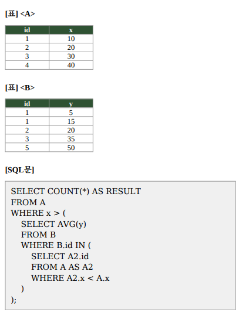

# 문제 13

## 문제

다음 &lt;A&gt;, &lt;B&gt; 테이블과 SQL문을 참고하여, SQL문을 실행했을 때 출력되는 RESULT 값을 구하시오.



<details>
<summary><strong>정답 보기</strong></summary>

3

</details>


<details>
<summary><strong>상세 해설</strong></summary>

## 1. 문제에서 묻는 것
**중첩 서브쿼리(상관 서브쿼리)** 가 있는 SQL에서 `COUNT(*)`가 얼마인지 구하는 문제다. 안쪽부터 차근차근 풀면 된다.

## 2. 먼저 알아야 할 개념
### (1) 서브쿼리
쿼리 안에 들어 있는 또 다른 `SELECT`. 안쪽 쿼리 결과를 바깥 쿼리의 조건에 사용한다.

### (2) 상관 서브쿼리
안쪽 쿼리가 **바깥 쿼리의 현재 행 값**(여기서는 `A.x`)을 사용하는 형태. 그러면 **바깥 행마다 안쪽 쿼리를 다시 계산**해야 한다.

### (3) 사용하는 문법
| 문법 | 의미 |
|---|---|
| `IN (집합)` | 값이 집합 안에 있으면 참 |
| `AVG(y)` | 평균. **NULL은 제외**하고 계산, 대상이 없으면 `NULL` |
| `x > NULL` | 결과가 **알 수 없음(UNKNOWN)** → WHERE에서 **거짓 처리** |
| `COUNT(*)` | 조건에 맞는 행의 수 |

## 3. 문제 데이터 (그림)
**A**

| id | x |
|---:|---:|
| 1 | 10 |
| 2 | 20 |
| 3 | 30 |
| 4 | 40 |

**B**

| id | y |
|---:|---:|
| 1 | 5 |
| 1 | 15 |
| 2 | 20 |
| 3 | 35 |
| 5 | 50 |

```sql
SELECT COUNT(*) AS RESULT
FROM A
WHERE x > (
   SELECT AVG(y) FROM B
   WHERE B.id IN (
      SELECT A2.id FROM A AS A2 WHERE A2.x < A.x
   )
);
```

## 4. 풀이: A의 행을 하나씩 검사
각 행마다 ① 안쪽 `A2.x < A.x` → ② `B.id IN (...)` → ③ `AVG(y)` → ④ `x > 평균` 순서로 계산한다.

| A 행 (id, x) | ① `A2.x < x` 인 A2.id | ② 해당 id를 가진 B의 y | ③ 평균 | ④ x > 평균? |
|---|---|---|---:|:---:|
| (1, 10) | 없음 (10보다 작은 x 없음) | 없음 | `NULL` | 알 수 없음 → **제외** |
| (2, 20) | {1} | 5, 15 | 10 | 20 > 10 ✅ |
| (3, 30) | {1, 2} | 5, 15, 20 | 13.33 | 30 > 13.33 ✅ |
| (4, 40) | {1, 2, 3} | 5, 15, 20, 35 | 18.75 | 40 > 18.75 ✅ |

조건을 만족하는 행은 3개 → `COUNT(*)` = **3**

> **정답: 3**

## 5. 암기 포인트
- 상관 서브쿼리는 **바깥 행 하나씩 대입**해 가며 푼다.
- `AVG()`는 NULL 무시, 집합이 비면 NULL. NULL과의 비교는 항상 거짓처럼 동작한다.
- B에 있는 `id=5`는 A에 없는 값이라 결과에 영향이 없다.

</details>

---
