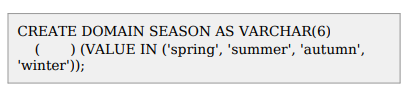

# 문제 19

## 문제

다음은 SEASON이라는 도메인을 정의하면서, 입력 가능한 값을 봄/여름/가을/겨울로 제한하는 SQL문이다. 괄호 안에 들어갈 알맞은 키워드를 쓰시오



<details>
<summary><strong>정답 보기</strong></summary>

CHECK

</details>


<details>
<summary><strong>상세 해설</strong></summary>

## 1. 문제에서 묻는 것
`CREATE DOMAIN` 문에서 **입력 가능한 값을 제한**하는 키워드(괄호 안)를 쓰는 문제다.

## 2. 먼저 알아야 할 개념
### (1) 도메인(Domain)
한 속성(열)이 가질 수 있는 **값의 집합(유형·범위)** 이다. 예) 계절 = {spring, summer, autumn, winter}, 학년 = {1,2,3,4}.

### (2) 도메인 무결성
저장되는 값이 **정의된 도메인을 벗어나지 않게** 하는 규칙. SQL에서는 `CHECK` 제약으로 구현한다.

### (3) 무결성 제약조건 3가지
| 종류 | 내용 |
|---|---|
| 개체 무결성 | 기본키는 **NULL·중복 불가** |
| 참조 무결성 | 외래키는 참조 대상 기본키에 **존재하는 값(또는 NULL)** |
| **도메인 무결성** | 속성 값이 **정의된 값의 범위·형식**을 만족 |

### (4) `CHECK`
```sql
CREATE DOMAIN 이름 AS 자료형
    CHECK (조건);        -- 조건을 만족하지 않는 값은 저장 거부
```
## 3. 문제 풀이 (그림 코드)
```sql
CREATE DOMAIN SEASON AS VARCHAR(6)
    ( CHECK ) (VALUE IN ('spring', 'summer', 'autumn', 'winter'));
```
- `VALUE`는 입력되는 값을 가리키는 예약어.
- `IN (...)` 안의 값만 허용 → 이외 값('rain' 등)은 **오류**.

| 입력 | 결과 |
|---|---|
| 'spring' | 허용 |
| 'rain' | **CHECK 위반, 거부** |

> **정답: CHECK**

## 4. 암기 포인트
- 값의 범위 제한 = `CHECK`, 중복 금지 = `UNIQUE`, 빈 값 금지 = `NOT NULL`, 기본 값 = `DEFAULT`.
- 도메인 제약은 정의 시 `CHECK`로 건다.

</details>

---
