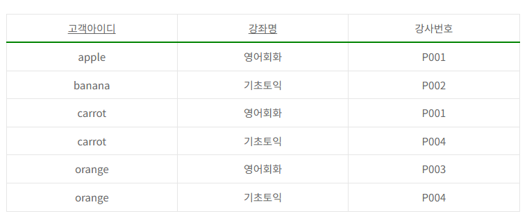

# 문제 20

## 문제

아래 표에서 나타나고 있는 정규형을 작성하시오.

<strong>정답 보기</strong>

제 3정규형

<strong>상세 해설</strong>

## 1. 문제에서 묻는 것
표(수강 정보)를 보고 **어떤 정규형까지 만족하는 상태인지** 판단하는 문제다.

## 2. 먼저 알아야 할 개념
### (1) 정규화란?
테이블을 **중복이 없게** 나누는 과정. 중복이 있으면 수정할 때 한 군데만 고쳐 **데이터가 어긋나는 이상 현상(삽입·삭제·갱신 이상)** 이 생긴다.

### (2) 함수적 종속(FD)
`X → Y` : **X 값이 정해지면 Y 값이 하나로 정해진다**. X를 **결정자**, Y를 **종속자**라 한다.
- 예) 학번 → 이름 (학번을 알면 이름이 정해짐)

### (3) 정규형 단계
| 정규형 | 조건 | 제거하는 것 |
|---|---|---|
| **1NF** | 모든 값이 **원자값**(더 쪼갤 수 없음) | 반복 그룹 |
| **2NF** | 1NF + **부분 함수 종속 제거** | 기본키 **일부**에만 종속 |
| **3NF** | 2NF + **이행 함수 종속 제거** | A→B, B→C 로 A→C 가 되는 구조 |
| **BCNF** | 3NF + **모든 결정자가 후보키** | 후보키가 아닌 결정자 |

## 3. 문제 데이터 (그림)
| 고객아이디 | 강좌명 | 강사번호 |
|---|---|---|
| apple | 영어회화 | P001 |
| banana | 기초토익 | P002 |
| carrot | 영어회화 | P001 |
| carrot | 기초토익 | P004 |
| orange | 영어회화 | P003 |
| orange | 기초토익 | P004 |

## 4. 분석
**① 기본키 찾기** : 고객 한 명이 여러 강좌를 듣는다(carrot, orange). 그러므로 `고객아이디`만으로는 행을 식별할 수 없고 **(고객아이디, 강좌명)** 이 키다.

**② 함수적 종속 찾기**
| 종속 | 성립? | 근거 |
|---|:---:|---|
| (고객아이디, 강좌명) → 강사번호 | ✅ | 기본키 |
| 고객아이디 → 강사번호 | ❌ | carrot은 P001, P004 |
| 강좌명 → 강사번호 | ❌ | 영어회화는 P001, P003 |
| **강사번호 → 강좌명** | ✅ | P001=영어회화, P002=기초토익, P003=영어회화, P004=기초토익 |

**③ 단계별 판단**
| 정규형 | 만족? | 이유 |
|---|:---:|---|
| 1NF | ✅ | 모든 칸이 단일 값 |
| 2NF | ✅ | 비주요 속성(강사번호)이 **키 일부(고객아이디 또는 강좌명)** 에만 종속되는 경우가 없음 |
| **3NF** | ✅ | 비주요 속성이 다른 **비주요 속성**에 이행 종속하지 않음. (`강사번호→강좌명`은 종속되는 쪽 `강좌명`이 **키의 일부(주요 속성)** 라서 3NF에서는 허용) |
| BCNF | ❌ | 결정자 `강사번호`가 **후보키가 아님** |

따라서 "현재 만족하는 정규형"은 **3NF** (BCNF는 아님).

> **정답: 제3정규형**

## 5. 암기 포인트
- 단계: **원자값(1NF) → 부분종속 제거(2NF) → 이행종속 제거(3NF) → 결정자=후보키(BCNF)**
- 3NF이지만 BCNF가 아닌 대표 사례: "후보키가 겹치고, 비후보키 결정자가 있는" 표 (학생-과목-교수 문제).
- BCNF로 만들려면 `강사번호 → 강좌명` 테이블을 분리한다.

---
