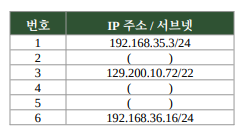
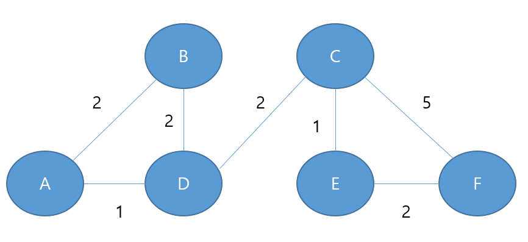
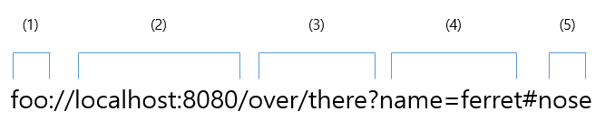

# 네트워크 — 기출 기반 요약정리

> 범위: **2020년 1회 ~ 2026년 2회 (21개 회차) 중 이 영역 37문제**. 출제 빈도 → 개념 요약 → 기출 키워드 → 기출 원문 순서. 해설은 각 문제 파일에서 확인.

## A. 출제 빈도 (많이 나온 순)

| 카테고리 | 횟수 | 출제 회차-번호 (최신순) |
|---|:--:|---|
| 서브넷 마스크 | 8 | 26-2-10, 26-2-16, 26-1-11, 25-2-06, 25-1-09, 24-1-05, 22-3-05, 22-2-09 |
| 라우팅 프로토콜 | 6 | 26-2-04, 24-2-11, 24-1-07, 23-3-18, 22-2-14, 20-3-03 |
| 패킷 교환 | 4 | 24-2-08, 23-3-09, 23-1-05, 21-2-12 |
| 오류 검출 | 3 | 25-3-04, 25-1-03, 23-2-12 |
| 프로토콜 | 2 | 20-3-05, 20-1-03 |
| OSI 7계층 | 2 | 21-3-06, 20-1-18 |
| IPv6 | 2 | 21-1-11, 20-4-01 |
| NAT | 2 | 23-3-12, 20-4-08 |
| ARP/RARP | 2 | 25-1-06, 21-1-01 |
| 무선 네트워크 | 2 | 24-3-20, 21-2-01 |
| HDLC | 2 | 26-1-06, 23-2-13 |
| ICMP | 1 | 20-3-06 |
| URL 구조 | 1 | 24-3-09 |

---

# B. 개념 요약
## 1. OSI 7계층 (기출: 계층별 역할 매칭)
| 계층 | 이름 | 역할 | PDU | 장비·프로토콜 |
|:-:|---|---|---|---|
| 7 | 응용 | 사용자 서비스 | 데이터 | HTTP, FTP, SMTP, Telnet, SSH |
| 6 | **표현** | **형식 변환·압축·암호화** | 데이터 | JPEG, MPEG, SSL |
| 5 | 세션 | 연결 설정·유지·종료·동기화 | 데이터 | NetBIOS, RPC |
| 4 | 전송 | **종단 간 신뢰성**, 흐름·오류 제어 | 세그먼트 | TCP, UDP |
| 3 | **네트워크** | **경로 설정(라우팅)·IP 주소** | 패킷 | IP, ARP, RARP, ICMP, 라우터 |
| 2 | **데이터링크** | **MAC 주소, 인접 노드 간 오류·흐름 제어** | 프레임 | Ethernet, PPP, **HDLC**, 스위치 |
| 1 | **물리** | **비트를 전기 신호로 전송** | 비트 | 케이블, 허브, 리피터 |

암기: 물-데-네-전-세-표-응.

## 2. 주소 체계
### IPv4 vs IPv6
| 항목 | IPv4 | IPv6 |
|---|---|---|
| 길이 | **32비트** (8비트×4) | **128비트** (16비트×8) |
| 표기 | 10진수, 점(.) | 16진수, 콜론(:) |
| 특징 | 주소 고갈, NAT 필요 | 주소 풍부, IPsec 기본, 헤더 단순, 자동 설정, 애니캐스트 |

### 서브넷 마스크 계산 (기출 8회 — 절대 빈출)
1. 마스크의 **1의 개수 = 프리픽스(/n)**: 255.255.255.192 = /26, .224 = /27, .240 = /28, 255.255.254.0 = /23, 255.255.252.0 = /22
2. **블록 크기 = 256 − 해당 옥텟 마스크값** (192→64, 224→32, 254→2, 252→4)
3. **네트워크 주소 = IP AND 마스크** (= 블록 시작값), **브로드캐스트 = 블록 끝값**
4. **사용 가능 호스트 수 = 2^(호스트비트) − 2**
5. 서브넷 분할: N개 필요 → 2^n ≥ N인 n비트를 프리픽스에 더함(FLSM)

| 프리픽스 | 마스크(마지막 옥텟) | 블록 | 호스트 수 |
|---|---|---:|---:|
| /24 | 0 | 256 | 254 |
| /25 | 128 | 128 | 126 |
| /26 | 192 | 64 | 62 |
| /27 | 224 | 32 | 30 |
| /28 | 240 | 16 | 14 |
| /29 | 248 | 8 | 6 |
| /30 | 252 | 4 | 2 |

예) 223.13.234.132 /26 → 128~191 → 네트워크 **.128**, 호스트 **62**. 192.168.11.20 /23 → 3번째 옥텟 10~11 → **192.168.10.0/23**.
- 같은 네트워크 판별: 네트워크 주소가 같으면 같은 네트워크. 호스트 주소로 **네트워크 주소(전부 0)·브로드캐스트(전부 1)** 는 못 씀.

### 주소 변환·보조 프로토콜
| 용어 | 정답 단서 |
|---|---|
| **ARP** | **IP → MAC** (브로드캐스트로 질의) |
| **RARP** | **MAC → IP** (역순 주소 결정) |
| **ICMP** | IP 패킷 처리 중 **오류 보고**, ping(Echo)·traceroute(TTL) |
| **NAT** | 사설 IP ↔ 공인 IP(포트) **변환**, PAT(포트 변환)로 하나의 공인 IP 공유 |
| DHCP / DNS | IP 자동 할당 / 도메인 ↔ IP |

### 주요 포트
FTP 20/21, **SSH 22**, Telnet 23, SMTP 25, DNS 53, **HTTP 80**, POP3 110, **HTTPS 443**.

## 3. 라우팅 프로토콜 (기출 6회)
| 구분 | 프로토콜 | 단서 |
|---|---|---|
| **IGP** (AS 내부) | **RIP** | **거리 벡터**, **홉 수 기준(최대 15)**, 소규모, 30초마다 갱신 |
| IGP | **OSPF** | **링크 상태**, **다익스트라**, **대규모**, 비용(Cost), 홉 제한 없음, Area 분할, 멀티캐스트 |
| **EGP** (AS 간) | **BGP** | **경로 벡터**, 전체 경로 포함, 루프 제거, AS 수준 정책 |
- **AS(자율 시스템)**: 하나의 관리 주체가 운영하는 네트워크 집합(= 도메인).
- ⚠ **RIP는 링크 비용이 아니라 홉 수**로 최단 경로 결정 (2024년 2회 11번).

## 4. 교환 방식
| 방식 | 설명 |
|---|---|
| 회선 교환 | **전용 회선 점유**(전화), 대역폭 고정 |
| **패킷 교환 — 가상회선** | **연결형**, 경로 사전 설정, **같은 경로·순서 보장**, ATM·X.25 |
| **패킷 교환 — 데이터그램** | **비연결형**, 패킷마다 **개별 경로**, **순서 재정렬**, IP(인터넷), 장애 경로 우회 |
- **ATM**: **53바이트 고정 길이 셀**, 가상 채널, 통계적 다중화, 고속망.

## 5. 오류 제어
| 구분 | 방식 | 능력 |
|---|---|---|
| 검출 | **패리티**(1비트 검사 비트) | **1비트 오류 검출** |
| 검출 | **CRC** | **다항식 나눗셈**(생성 다항식), **버스트 오류**에 강함 |
| 검출 | 체크섬 | 합 이용 |
| 검출+정정 | **해밍 코드** | **1비트 오류 위치 파악·정정** (Bell 연구소) |
- **FEC**(전진 오류 수정): **재전송 없이 수신 측이 정정** (해밍).
- **BEC/ARQ**(후진): **오류 검출 시 재전송 요구** (패리티·CRC; 정지-대기, Go-Back-N, Selective Repeat).

## 6. HDLC (2계층, 비트 중심)
| 프레임 | 제어부 시작 | 역할 |
|---|:-:|---|
| **정보(I)** | `0` | **사용자 데이터**, Seq·Next·P/F |
| **감독(S)** | `10` | **흐름·오류 제어**, 응답, Next만 |
| **비번호(U)** | `11` | 순서 번호 없이 **링크 설정·해제, 모드 설정** |
| 모드 | | **NRM**(주국 허락 후 전송) / **ARM(비동기 응답)**: 종국이 **허락 없이** 전송 / **ABM(비동기 균형)**: **두 국이 동등한 혼합국** |

## 7. 무선 네트워크
| 방식 | 중앙 장비 | 특징 |
|---|:-:|---|
| **인프라** | 필요(AP·기지국) | 중앙 집중, Wi-Fi·이동통신 |
| **Ad-hoc (애드혹)** | **불필요** | **임시 구성, 토폴로지 동적 변화, 단말이 중계**, 긴급 구조·군사 |
| Mesh | 일부 | **다중 경로 그물망**, 신뢰성, 백본 |

## 8. 프로토콜 일반
- **프로토콜**: 데이터 교환을 위한 **통신 규약**. 3요소: **구문(Syntax)·의미(Semantics)·타이밍(Timing)**.
- **URL 구조**: `scheme://authority/path?query#fragment` — scheme=프로토콜, authority=사용자정보·호스트·포트, path=자원 경로, **query=`?`뒤 추가 데이터**, **fragment=`#`뒤 문서 내 위치**.

---

# C. 기출 키워드 → 정답 (한눈에)

| 회차-번호 | 카테고리 | 정답 |
|---|---|---|
| [26-2-10](../2026년 2회/10.md) | 서브넷 마스크 | (예시): 2. 192.168.35.72 / 4. 129.200.8.249 / 5. 192.168.36.249 (범위 안의 값이면 다른 답도 정답이다.) |
| [26-2-16](../2026년 2회/16.md) | 서브넷 마스크 | 28 |
| [26-1-11](../2026년 1회/11.md) | 서브넷 마스크 | a. 192.168.10.0/23 / b. 192.168.12.0/23 |
| [25-2-06](../2025년 2회/06.md) | 서브넷 마스크 | ① 128 ② 62 |
| [25-1-09](../2025년 1회/09.md) | 서브넷 마스크 | ㄱ, ㄴ, ㄷ, ㄹ, ㅁ (전부) |
| [24-1-05](../2024년 1회/05.md) | 서브넷 마스크 | 2) 192.168.35.72 / 4) 129.200.8.249 / 5) 192.168.36.249 |
| [22-3-05](../2022년 3회/05.md) | 서브넷 마스크 | `192.168.1.127` |
| [22-2-09](../2022년 2회/09.md) | 서브넷 마스크 | (1) 128 (2) 62 |
| [26-2-04](../2026년 2회/04.md) | 라우팅 프로토콜 | OSPF (Open Shortest Path First) |
| [24-2-11](../2024년 2회/11.md) | 라우팅 프로토콜 | `A → D → C → F` |
| [24-1-07](../2024년 1회/07.md) | 라우팅 프로토콜 | OSPF (Open Shortest Path First) |
| [23-3-18](../2023년 3회/18.md) | 라우팅 프로토콜 | RIP (Routing Information Protocol) |
| [22-2-14](../2022년 2회/14.md) | 라우팅 프로토콜 | 1. IGP 2. EGP 3. OSPF 4. BGP |
| [20-3-03](../2020년 3회/03.md) | 라우팅 프로토콜 | OSPF (Open Shortest Path First) |
| [24-2-08](../2024년 2회/08.md) | 패킷 교환 | ① 가상회선 ② 데이터그램 |
| [23-3-09](../2023년 3회/09.md) | 패킷 교환 | ATM (Asynchronous Transfer Mode) |
| [23-1-05](../2023년 1회/05.md) | 패킷 교환 | ( ) = 가상회선, ( ) = 데이터그램 |
| [21-2-12](../2021년 2회/12.md) | 패킷 교환 | 1. 가상 회선 방식 2. 데이터그램 방식 |
| [25-3-04](../2025년 3회/04.md) | 오류 검출 | ① Hamming ② FEC ③ BEC ④ Parity ⑤ CRC |
| [25-1-03](../2025년 1회/03.md) | 오류 검출 | CRC (Cyclic Redundancy Check) |
| [23-2-12](../2023년 2회/12.md) | 오류 검출 | 1. hamming 2. FEC 3. BEC 4. parity 5. CRC |
| [20-3-05](../2020년 3회/05.md) | 프로토콜 | 프로토콜 (Protocol) |
| [20-1-03](../2020년 1회/03.md) | 프로토콜 | 구문(Syntax), 의미(Semantics), 순서(Timing) |
| [21-3-06](../2021년 3회/06.md) | OSI 7계층 | 1. 데이터링크 2. 네트워크 3. 표현 |
| [20-1-18](../2020년 1회/18.md) | OSI 7계층 | 물리 계층 (Physical Layer, 1계층) |
| [21-1-11](../2021년 1회/11.md) | IPv6 | 1. 128 2. 8 |
| [20-4-01](../2020년 4회/01.md) | IPv6 | IPv6 |
| [23-3-12](../2023년 3회/12.md) | NAT | NAT (Network Address Translation, 네트워크 주소 변환) (원문 정답에 "Transformation"이라 적혀 있으나 표준 용어는 Tra… |
| [20-4-08](../2020년 4회/08.md) | NAT | NAT (Network Address Translation) (원문 정답에는 "Transformation"으로 표기되어 있으나 표준 용어는 Translation.… |
| [25-1-06](../2025년 1회/06.md) | ARP/RARP | (1) ARP (2) RARP |
| [21-1-01](../2021년 1회/01.md) | ARP/RARP | RARP (Reverse Address Resolution Protocol) |
| [24-3-20](../2024년 3회/20.md) | 무선 네트워크 | ㄹ. Ad-hoc Network |
| [21-2-01](../2021년 2회/01.md) | 무선 네트워크 | 애드혹 네트워크 (Ad-hoc Network) |
| [26-1-06](../2026년 1회/06.md) | HDLC | 1. 정보 / 2. 감독 / 3. 비번호 / 4. 비동기 균형 모드 / 5. 비동기 응답 모드 |
| [23-2-13](../2023년 2회/13.md) | HDLC | 1. ㄷ 2. ㄴ 3. ㅂ 4. ㅊ 5. ㅋ |
| [20-3-06](../2020년 3회/06.md) | ICMP | ICMP (Internet Control Message Protocol) |
| [24-3-09](../2024년 3회/09.md) | URL 구조 | `43125` |

---

# D. 기출문제 원문

## 서브넷 마스크 (8회)

### 2026년 2회 10번

[해설 보기](../2026년 2회/10.md)

다음은 네트워크 A, B, C에 속한 호스트의 IP 주소 목록이다. 괄호 안에 들어갈 수 있는 IP 주소를 각각 하나씩 쓰시오.

**정답:** (예시): 2. 192.168.35.72 / 4. 129.200.8.249 / 5. 192.168.36.249 (범위 안의 값이면 다른 답도 정답이다.)

### 2026년 2회 16번

[해설 보기](../2026년 2회/16.md)

다음은 IP 주소 서브네팅(Subnetting)에 대한 설명이다. 물음에 답하시오.

10.0.0.0/27 네트워크를 동일한 크기의 2개 서브넷으로 분할하였다.

- 첫 번째 서브넷: 10.0.0.0 ~ 10.0.0.15

- 두 번째 서브넷: 10.0.0.16 ~ 10.0.0.31

이때 10.0.0.1이 속한 서브넷의 프리픽스 길이(비트 수)를 구하시오.

**정답:** 28

### 2026년 1회 11번

[해설 보기](../2026년 1회/11.md)

두 호스트 a, b의 IP 주소와 서브넷 마스크가 주어졌을 때, 각 호스트가 속한 네트워크 주소를 CIDR 표기법으로 쓰시오.

조건

· 호스트 a의 IP 주소: 192.168.11.20  
· 호스트 b의 IP 주소: 192.168.12.200  
· 서브넷 마스크: 255.255.254.0

구하는 것

a. 호스트 a (192.168.11.20) 가 속한 네트워크 주소  
b. 호스트 b (192.168.12.200) 가 속한 네트워크 주소

**정답:** a. 192.168.10.0/23 / b. 192.168.12.0/23

### 2025년 2회 06번

[해설 보기](../2025년 2회/06.md)

다음은 IP 주소와 서브넷 마스크에 관한 문제이다. 주어진 정보를 참고하여 괄호 안에 들어갈 알맞은 값을 쓰시오.

호스트의 IP 주소가 223.13.234.132이고 서브넷 마스크가 255.255.255.192일 때 다음 물음에 답하시오.

이 호스트가 속한 네트워크 주소는 223.13.234.( ① )이다.

이 네트워크에서 사용 가능한 호스트 수는 ( ② )개이다.

(단, 네트워크 주소와 브로드캐스트 주소는 제외한다.)

**정답:** ① 128 ② 62

### 2025년 1회 09번

[해설 보기](../2025년 1회/09.md)

IP 주소가 192.168.35.10, 서브넷 255.255.252.0인 PC에서 브로드캐스팅으로 다른 IP로 정보를 전달한다고 할 때 수신할 수 있는 알맞는 IP를 보기에서 골라 모두 작성하시오.

[보기]

ㄱ. 192.168.34.1  
ㄴ. 192.168.32.19  
ㄷ. 192.168.35.200  
ㄹ. 192.168.33.138  
ㅁ. 192.168.35.50

**정답:** ㄱ, ㄴ, ㄷ, ㄹ, ㅁ (전부)

### 2024년 1회 05번

[해설 보기](../2024년 1회/05.md)

아래 그림에서의 네트워크에서 라우터을 통한 할당 가능한  2번, 4번, 5번의 IP를 작성하시오.

1) 192.168.35.3/24  
3) 129.200.10.16/22  
6) 192.168.36.24/24

보기

192.168.35.0

192.168.35.72

192.168.36.0

192.168.36.249

129.200.8.0

129.200.8.249

**정답:** 2) 192.168.35.72 / 4) 129.200.8.249 / 5) 192.168.36.249

### 2022년 3회 05번

[해설 보기](../2022년 3회/05.md)

아래 코드에 대한 출력 값을 작성하시오.

첫번째 네트워크 주소가 192.168.1.0/24일때 FLSM 3개로 분할했을때  
두번째 네트워크 브로드캐스드 IP를 10진수로 변환한 값을 작성하시오.

**정답:** `192.168.1.127`

### 2022년 2회 09번

[해설 보기](../2022년 2회/09.md)

IP 주소가 139.127.19.132이고 서브넷마스크 255.255.255.192일 때 아래의 답을 작성하시오.  
(10진수로 표기)

(1) 괄호안에 들어갈 네트워크 주소 : 139.127.19.( )

(2) 해당 네트워크 주소와 브로드캐스트 주소를 제외한 호스트 개수

**정답:** (1) 128 (2) 62

## 라우팅 프로토콜 (6회)

### 2026년 2회 04번

[해설 보기](../2026년 2회/04.md)

다음은 라우팅 프로토콜에 대한 설명이다. 괄호 안에 들어갈 알맞은 용어를 쓰시오.

( )는 링크 상태(Link State) 알고리즘을 사용하는 대표적인 내부 라우팅 프로토콜(IGP)이다. 다익스트라(Dijkstra) 알고리즘을 이용하여 최단 경로를 탐색하며, 대규모 네트워크에 적합하고 멀티캐스트를 지원한다.

**정답:** OSPF (Open Shortest Path First)

### 2024년 2회 11번

[해설 보기](../2024년 2회/11.md)

아래 그림을 바탕으로 RIP을 구성하여 최단 경로 비용을 계산하여 흐름에 맞게 작성하시오.

예제

A  →

**정답:** `A → D → C → F`

### 2024년 1회 07번

[해설 보기](../2024년 1회/07.md)

아래의 내용에서 설명하는 네트워크 용어를 영문 약자로 작성하시오.

1. 대표적인 링크 상태 라우팅 프로토콜이다. 이것은 인터넷에서 연결된 링크의 상태를 감시하여 최적의 경로를 선택한다는것이다.

2. 단일 자율 시스템 내에서 라우팅 정보를 배포하는 데 사용되는 내부 게이트웨이 프로토콜이다.

3. 모든 대상에 도달하기 위한 최단 경로를 구축하고 계산하며 최단 경로는 Dijkstra 알고리즘을 사용하여 계산된다.

**정답:** OSPF (Open Shortest Path First)

### 2023년 3회 18번

[해설 보기](../2023년 3회/18.md)

다음은 프로토콜 종류에 관한 설명이다. 알맞는 답을 작성하시오.

- 최소 Hop count를 파악하여 라우팅하는 프로토콜이다.

- 거리와 방향으로 길을 찾아가는 Distance Vector 다이나믹 프로토콜이다.

- 최단거리 즉, Hop count가 적은 경로를 택하여 라우팅하는 프로토콜로 Routing Table에 인접 라우터 정보를 저장하여 경로를 결정한다.

- 최대 Hop count는 15로 거리가 짧기 때문에 IGP로 많이 이용하는 프로토콜이다.

**정답:** RIP (Routing Information Protocol)

### 2022년 2회 14번

[해설 보기](../2022년 2회/14.md)

다음 설명에 대해 보기에 주어진 답을 골라 작성하시오.  
(실제 기출문제에서는 답의 보기가 주어집니다.(오답 중, ARP, RARP 등..))

1. 라우터로 상호 접속이 되어있는 여러 개의 네트워크 집합으로 도메인 혹은 자율시스템(Autonomous System, AS)이라고 한다.

같은 도메인 내에 존재하는 라우터는 도메인 내부 라우터가 되고 도메인 외부에 존재하는 라우터는 도메인 외부 라우터가 되는데, 여기서 도메인 내부 경로 설정을 가르킨다.

2. 시스템 사이에 경로 설정 정보 등을 교환하기 위해 사용하는 프로토콜로써,  
다른 도메인 사이에 라우팅 시 정리된 관리가 거의 없고 많은 경우에 신용도가 매우 낮아 빠른 수행보다는 보안과 제어가 본래의 목적이다.

3. IP 라우팅 프로토콜의 한 종류로써 RIP(routing information protocol)보다 규모가 큰 네트워크에서도 사용할 수 있다.  
규모가 크고 복잡한 TCP/IP 네트워크에서 RIP의 단점을 개선한 라우팅 프로토콜로써 RIP에 비해 자세한 제어가 가능하고, 관리 정보의 트래픽도 줄일 수 있다.

4. 서로 다른 자율 시스템(AS)의 라우터 간에 라우팅 정보를 교환하는 데 사용되는 외부 게이트웨이 프로토콜(EGP)이다.  
각 목적지에 대한 전체 경로가 포함되며, 다른 시스템과 교환하는 네트워크 도달 가능성 정보의 데이터베이스를 유지한다.  
네트워크 도달 가능성 정보를 사용하여 AS 연결 그래프를 구성하며, 이를 통해 라우팅 루프를 제거하고 AS 수준에서 정책 결정을 실행할 수 있다.

**정답:** 1. IGP 2. EGP 3. OSPF 4. BGP

### 2020년 3회 03번

[해설 보기](../2020년 3회/03.md)

대표적인 내부 라우팅 프로토콜로 다익스트라 알고리즘을 이용한 대규모 네트워크에 적합한 링크 상태 라우팅 프로토콜로 불리는 라우팅 프로토콜은 무엇인가?

**정답:** OSPF (Open Shortest Path First)

## 패킷 교환 (4회)

### 2024년 2회 08번

[해설 보기](../2024년 2회/08.md)

패킷 교환 방식 중에 연결형과 비연결형에 해당하는 방식을 작성하시오.

① 연결형 교환 방식

② 비연결형 교환 방식

**정답:** ① 가상회선 ② 데이터그램

### 2023년 3회 09번

[해설 보기](../2023년 3회/09.md)

다음 설명에 대해 괄호 안에 알맞는 용어를 작성하시오. (영어 약자로 작성하시오.)

- (     )은/는 자료를 일정한 크기로 정하여 순서대로 전송하는 자료의 전송 방식이다.

- 셀이라 부르는 고정 길이 패킷을 이용하여 처리가 단순하고 고속망에 적합하며, 연속적으로 셀을 보낼 때  
다중화를 하지 않고 셀단위로 동기가 이루어지지만 경우에 따라 동기식 시간 분할 다중화를 사용하기도 한다.

- 가상 채널 (Virtual Channel) 기반의 연결 지향 서비스로 셀이라 부르는 고정 길이(53바이트) 패킷을 사용하며 통계적 다중화 방식을 이용한다.

**정답:** ATM (Asynchronous Transfer Mode)

### 2023년 1회 05번

[해설 보기](../2023년 1회/05.md)

아래 내용을 확인하여 괄호 안에 용어를 표안에 알맞는 값을 고르시오.

(보기가 있습니다. ex: 패킷  등)

| 구분 | 내용 |
|---|---|
| (   ) | - 회선교환 방식과 데이터그램 방식의 장점을 결합한 통신 기술이다.  - 처음 패킷으로 최적의 경로를 고정하고 경로가 고정되면 그 다음은 패킷으로 나누어 고속으로 전송할 수 있다.  - 통신기술에는 ATM이 있으며, 정해진 시간 안이나 다량의 데이터를 연속으로 보낼 때 적합하다. |
| (   ) | - 패킷교환 방식으로 동작하면서 IP 주소를 사용하는 인터넷을 의미한다.   - 각 전송패킷을 미리 정해진 경로 없이 독립적으로 처리하여 교환하는 방식이다   - 특정 교환기의 고장 시 모든 패킷을 잃어버리는 가상회선과 달리, 그 경로를 피해서 전송할 수 있으므로 더욱 신뢰가 가능하다.   - 짧은 메시지의 패킷들을 전송할 때 효과적이고 재정렬 기능이 필요하다. |

**정답:** ( ) = 가상회선, ( ) = 데이터그램

### 2021년 2회 12번

[해설 보기](../2021년 2회/12.md)

패킷교환방식 중에서, 번호에 해당하는 방식을 적으시오.

1. 목적지 호스트와 미리 연결한 후, 통신하는 연결형 교환 방식

2. 헤더에 붙어서 개별적으로 전달하는 비연결형 교환 방식

**정답:** 1. 가상 회선 방식 2. 데이터그램 방식

## 오류 검출 (3회)

### 2025년 3회 04번

[해설 보기](../2025년 3회/04.md)

다음은 오류검출 방식을 설명하는 내용이다. 설명의 빈칸 (①)~(⑤) 에 들어갈 알맞은 용어를 &lt;보기&gt;에서 고르시오.

(①) 코드는 전송 데이터에 여러 개의 검사 비트를 추가하여 오류를 검출하고 수정까지 가능한 방법이다.

이 코드는 재전송 없이 수신 측에서 자체 수정하는 (②) 방식에 속한다.

이에 반해 오류 발생 시 송신 측에 재전송을 요구하는 방식은 (③)이라 하며, 여기에 포함되는 대표적 검출 기법으로 (④) 검사와 (⑤) 검사가 있다.

(④) 검사는 데이터 블록 끝에 1비트 검사 비트를 추가하여 오류를 검출한다.

(⑤) 검사는 송신측과 수신측이 동일한 특정 다항식을 사용하여 오류를 검출한다.

[보기]

㉠ CRC ㉡ FEC ㉢ BEC ㉣ NAK ㉤ Parity ㉥ MD5 ㉦ BCD ㉧ Hamming

**정답:** ① Hamming ② FEC ③ BEC ④ Parity ⑤ CRC

### 2025년 1회 03번

[해설 보기](../2025년 1회/03.md)

아래의 내용에서 설명 글의 괄호안의 용어를 영문 약자로 작성하시오.

(        ) 은/는 3글자의 영어 약자로 이루어진 오류 기법으로 데이터를 전송하거나 저장할 때 데이터의 오류를 감지하는 데 사용되는 오류 검출 코드이다.

(        ) 은/는 데이터에 체크섬을 추가하여 데이터를 전송하거나 저장한 후, 수신 또는 읽을 때 이 체크섬을 다시 계산하여 데이터가 변경되었는지 확인하는 기법이다.

(        ) 은/는 데이터 전송의 안정성을 높이는 데 중요한 역할을 한다.

데이터는 이진수(0과 1)로 표현되며 정해진 다항식(x³ + x + 1)을 기반으로 데이터를 2진수 나눗셈하고나머지를 (       ) 값으로 삼는다.

**정답:** CRC (Cyclic Redundancy Check)

### 2023년 2회 12번

[해설 보기](../2023년 2회/12.md)

다음 내용에서 설명하는 문제에 대해 보기에 알맞는 답을 골라 작성하시오.

( 1 ) Code는 데이터 전송시 1 비트의 에러를 정정할 수 있는, 오류정정부호의 일종으로 미국의 Bell 연구소의 Hamming에 의해 고안되었다. 선형블록부호 및 순회부호에 속에 속한다.

( 2 ) 은/는 송신측이 전송할 문자나 프레임에 부가적 정보(Redundancy)를 첨가하여 전송하고 수신측이 이 부가적 정보를 이용하여 에러검출 및 에러정정을 하는 방식이다.

( 3 ) 은/는 데이터 전송 과정에서 오류가 발생하면 송신 측에 재전송을 요구하는 방식이다. 오류를 검출하는 방법은 Parity검사와 CRC, 블록 합 검사 등이 있다.

( 4 ) 은/는 데이터가 저장장치 내의 한 장소에서 다른 장소로 이동되거나, 컴퓨터들간에 전송될 때, 데이터가 유실 또는 손상되었는지 여부를 점검하는 기술과 관련된 용어이다.

( 5 ) 은/는 네트워크 등을 통하여 데이터를 전송할 때 전송된 데이터에 오류가 있는지를 확인하기 위한 체크값을 결정하는 방식을 말한다.

보기

EAC, FEC, hamming, CRC, PDS, parity, BEC

**정답:** 1. hamming 2. FEC 3. BEC 4. parity 5. CRC

## 프로토콜 (2회)

### 2020년 3회 05번

[해설 보기](../2020년 3회/05.md)

심리학자 톰 마릴은 컴퓨터가 메세지를 전달하고, 메세지가 제대로 도착했는지 확인하며, 도착하지 않았을 경우 메세지를 재전송하는 일련의 방법을 '기술적 은어'를 뜻하는 (      )이라는 용어로 정의했다. 괄호 (    ) 안에 들어갈 용어를 쓰시오.

**정답:** 프로토콜 (Protocol)

### 2020년 1회 03번

[해설 보기](../2020년 1회/03.md)

프로토콜의 기본 요소 3가지를 쓰시오.

**정답:** 구문(Syntax), 의미(Semantics), 순서(Timing)

## OSI 7계층 (2회)

### 2021년 3회 06번

[해설 보기](../2021년 3회/06.md)

OSI 7 Layer의 설명으로 해당되는 설명의 답을 작성하시오.

1. 물리계층을 통해 송수신되는 정보의 오류와 흐름을 관리하여 안전한 정보의 전달을 수행할 수 있도록 도와주는 역할

2. 데이터를 목적지까지 가장 안전하고 빠르게 전달하는 기능

3. 수신자에서 데이터의 압축을 풀수 있는 방식으로 된 데이터 압축

**정답:** 1. 데이터링크 2. 네트워크 3. 표현

### 2020년 1회 18번

[해설 보기](../2020년 1회/18.md)

OSI 계층 중 비트를 전송하는 계층은 무엇인가?

**정답:** 물리 계층 (Physical Layer, 1계층)

## IPv6 (2회)

### 2021년 1회 11번

[해설 보기](../2021년 1회/11.md)

다음은 빈칸에 들어갈 알맞은 용어를 쓰시오.

- IPv6는 (   1.   )  비트 길이를 가진다.

- IPv4는 길이 32bit이며, (   2.  ) 비트씩 네 부분으로 나눈다.

**정답:** 1. 128 2. 8

### 2020년 4회 01번

[해설 보기](../2020년 4회/01.md)

현재 IPv4의 확장형으로 IPv4가 가지고 있는 주소 고갈, 보안성, 이동성 지원 등의 문제점을 해결하기 위해서 개발된 128비트 주소체계를 갖는 차세대 인터넷 프로토콜은 무엇인가?

**정답:** IPv6

## NAT (2회)

### 2023년 3회 12번

[해설 보기](../2023년 3회/12.md)

IP 패킷에서 외부의 공인 IP주소와 포트 주소에 해당하는 내부 IP주소를 재기록하여 라우터를 통해 네트워크 트래픽을 주고받는 기술은 무엇인가?

**정답:** NAT (Network Address Translation, 네트워크 주소 변환) (원문 정답에 "Transformation"이라 적혀 있으나 표준 용어는 Tra…

### 2020년 4회 08번

[해설 보기](../2020년 4회/08.md)

IP 패킷에서 외부의 공인 IP주소와 포트 주소에 해당하는 내부 IP주소를 재기록하여 라우터를 통해 네트워크 트래픽을 주고받는 기술은 무엇인가?

**정답:** NAT (Network Address Translation) (원문 정답에는 "Transformation"으로 표기되어 있으나 표준 용어는 Translation.…

## ARP/RARP (2회)

### 2025년 1회 06번

[해설 보기](../2025년 1회/06.md)

아래 내용은 ARP/RARP에 대한 설명이다. 각 설명에 해당하는 것을 작성하시오.

( 1 ) 은/는 네트워크상에서 IP 주소를 MAC 주소로 변환하는 프로토콜이고,

( 2 ) 은/는 MAC 주소를 IP 주소로 변환하는 프로토콜이다.

**정답:** (1) ARP (2) RARP

### 2021년 1회 01번

[해설 보기](../2021년 1회/01.md)

물리 네트워크(MAC) 주소에 해당하는 IP 주소를 알려주는 프로토콜로 역순 주소 결정 프로토콜을 무엇이라고 하는지 쓰시오.

**정답:** RARP (Reverse Address Resolution Protocol)

## 무선 네트워크 (2회)

### 2024년 3회 20번

[해설 보기](../2024년 3회/20.md)

다음은 네트워크에 대한 문제이다.  아래 내용을 보고 알맞는 용어를 작성하시오.

&nbsp;- 중앙 관리나 고정된 인프라 없이 임시로 구성되는 네트워크이다.  
&nbsp;- 일반적으로 무선 통신을 통해 노드들이 직접 연결되어 데이터를 주고받는다.  
&nbsp;- 긴급 구조, 긴급 회의, 군사적인 상황 등에서 유용하게 활용될 수 있다.

ㄱ.Infrastructure Network        ㄴ. Firmware Network        ㄷ. Peer-to-Peer Network        ㄹ. Ad-hoc Network         ㅁ. Mesh Network        ㅂ.Sensor Network        ㅅ.Virtual Private Network

**정답:** ㄹ. Ad-hoc Network

### 2021년 2회 01번

[해설 보기](../2021년 2회/01.md)

네트워크 장치를 필요로하지 않고 네트워크 토폴로지가 동적으로 변화되는 특징이 있으며 응용 분야로는 긴급 구조, 긴급 회의, 전쟁터에서의 군사 네트워크에 활용되는 네트워크는?

**정답:** 애드혹 네트워크 (Ad-hoc Network)

## HDLC (2회)

### 2026년 1회 06번

[해설 보기](../2026년 1회/06.md)

HDLC는 비트 중심의 데이터 링크 제어 프로토콜로, 프레임 단위로 데이터를 전송하며 흐름 제어 및 오류 복구 기능을 제공한다. 다음 설명을 읽고 알맞은 용어를 쓰시오.

HDLC 구성 요소

1. HDLC 프레임의 구성 단위로, 실제 사용자 데이터를 전송하는 프레임

2. 데이터 링크의 흐름을 관리하고 오류 제어 및 통신 상태를 감시하는 프레임

3. 순서 번호 없이 링크 설정, 해제, 모드 설정 등 제어 기능을 수행하는 프레임

4. 두 국(Station)이 동등한 위치에서 서로 명령과 응답을 주고받는 모드

5. 종국(Secondary)이 주국(Primary)의 허가 없이도 자발적으로 응답을 전송할 수 있는 모드

**정답:** 1. 정보 / 2. 감독 / 3. 비번호 / 4. 비동기 균형 모드 / 5. 비동기 응답 모드

### 2023년 2회 13번

[해설 보기](../2023년 2회/13.md)

다음은 HDLC 프로토콜에 대한 설명이다. 보기 안에 알맞는 답을 골라 작성하시오.

( 1 ) 프레임은 Seq, Next, P/F의 필드를 가진다. 또한 맨 처음 비트를 0으로 가진다. Seq는 송신용 순서번호를 가지고 있다. Next는 응답용 순서번호를 가진다. P/F는 P가 1로 설정된 경우 주국에서 종국에 데이터 전송을 허용하는 것을 의미하고 F가 1로 설정된 경우 종국에서 주국으로 데이터 전송을 하는 것을 의미한다.

( 2 ) 프레임은 맨 앞의 필드가 1로 되어 있어 정보 프레임이 아니라는 것을 나타내고 다음 비트가 0이 나와있다. Type의 경우에는 2비트를 가지고 있어 4가지의 종류로 나누어진다.  데이터를 보내는 역할이 아니라 응답의 기능을 수행하므로 Seq에 대한 값은 필요가 없고 다음 프레임을 요구하는 Next만 존재한다.

( 3 ) 프레임은 순서 번호가 없는 프레임을 의미한다. 첫 번째 비트와 두 번째 비트가 모두 1로 설정되어 있다. 여러 종류를 가지고 있는데 Type의 2비트와 Modifier의 3비트를 합쳐 5비트를 통해 종류를 나눈다.

( 4 ) 은/는 두 호스트 모두 혼합국으로 동작한다. 양쪽에서 명령과 응답을 전송할 수 있다.

( 5 ) 은/는 불균형 모드로 주국의 허락 없이 종국에서 데이터를 전송할 수 있다.

보기

ㄱ. 연결제어     ㄴ. 감독     ㄷ. 정보     ㄹ. 양방향 응답     ㅁ. 익명     ㅂ. 비번호  
ㅅ. 릴레이    ㅇ. 동기균형     ㅈ. 동기응답    ㅊ. 비동기균형     ㅋ. 비동기응답

**정답:** 1. ㄷ 2. ㄴ 3. ㅂ 4. ㅊ 5. ㅋ

## ICMP (1회)

### 2020년 3회 06번

[해설 보기](../2020년 3회/06.md)

TCP/IP에서 오류가 발생하면 (      ) 메세지를 보내서 오류가 발생했음을 알린다. 괄호 (     )안에 들어갈 용어를 쓰시오.

**정답:** ICMP (Internet Control Message Protocol)

## URL 구조 (1회)

### 2024년 3회 09번

[해설 보기](../2024년 3회/09.md)

다음은 URL 구조에 관한 문제이다 . 아래  보기의 순서대로 URL에 해당하는 번호를 작성하시오.

보기

query : 서버에 전달할 추가 데이터  
path : 서버 내의 특정 자원을 가리키는 경로

scheme : 리소스에 접근하는 방법이나 프로토콜

authority : 사용자 정보, 호스트명, 포트 번호

fragment : 특정 문서 내의 위치

**정답:** `43125`
