# SQL — 기출 기반 요약정리

> 범위: **2020년 1회 ~ 2026년 2회 (21개 회차) 중 이 영역 36문제**. 출제 빈도 → 개념 요약 → 기출 키워드 → 기출 원문 순서. 해설은 각 문제 파일에서 확인.

## A. 출제 빈도 (많이 나온 순)

| 카테고리 | 횟수 | 출제 회차-번호 (최신순) |
|---|:--:|---|
| SQL | 35 | 26-2-12, 26-2-13, 26-2-14, 26-1-09, 26-1-10, 26-1-18, 25-3-10, 25-3-20, 25-1-07, 24-3-03, 24-2-03, 24-1-13 … |
| DCL | 1 | 21-3-03 |

---

# B. 개념 요약
## 1. SQL 분류
| 분류 | 명령 | 기능 |
|---|---|---|
| **DDL** | CREATE, **ALTER**, DROP, TRUNCATE | 구조 정의·변경 |
| **DML** | **SELECT**, **INSERT**, **UPDATE**, **DELETE** | 데이터 조작 |
| **DCL** | **GRANT**(권한 부여), **REVOKE**(회수) | 접근 권한 |
| **TCL** | COMMIT, ROLLBACK, SAVEPOINT | 트랜잭션 제어 |

## 2. SELECT 기본 구조와 실행 순서
```sql
SELECT 열 FROM 테이블 WHERE 행조건 GROUP BY 그룹열 HAVING 그룹조건 ORDER BY 열 [ASC|DESC];
```
**실행 순서: FROM → WHERE → GROUP BY → HAVING → SELECT → ORDER BY**
- **WHERE = 행 조건(집계 함수 ✕)**, **HAVING = 그룹 조건(집계 함수 ○)**
- ORDER BY 기본 **ASC(오름차순)**, **DESC = 내림차순**.

## 3. 조건 연산 (기출 단골)
| 문법 | 설명 |
|---|---|
| **LIKE** | `%` = **0개 이상 문자**, `_` = **1개 문자**. `'이%'`=이로 시작, `'%t%'`=t 포함, `'s%'`=s로 시작 |
| **IN (a,b)** | `= a OR = b` |
| BETWEEN a AND b | a 이상 b 이하(양 끝 포함) |
| **AND가 OR보다 우선** | `A AND B OR C` ⇒ `(A AND B) OR C` — 기출 2회 |
| **NULL** | `= NULL` ✕ → `IS NULL`. **NULL 비교는 UNKNOWN → WHERE에서 탈락** |
| **>ALL / >ANY** | **>ALL = 최댓값보다 큼**, >ANY = 최솟값보다 큼, `=ANY` = IN |

## 4. 집계 함수
`COUNT(*)`(전체 행, NULL 포함) / **`COUNT(열)`(NULL 제외)** / `COUNT(DISTINCT 열)`(중복 제외 개수) / SUM·AVG·MAX·MIN(NULL 무시).
- **집계 함수만 쓰고 GROUP BY가 없으면 결과는 1행.**
- 기출 패턴: STUDENT(컴퓨터과 50, 인터넷과 100, 사무자동화과 50) → `SELECT DEPT`=200행, `DISTINCT`=3행, `COUNT(DISTINCT) WHERE 한 과`=1행 (2020·2022·2024).

## 5. GROUP BY / HAVING (기출: 과목별 평균 90 이상)
```sql
SELECT 과목이름, MIN(점수) AS 최소점수, MAX(점수) AS 최대점수
FROM 성적 GROUP BY 과목이름 HAVING AVG(점수) >= 90;
```
SELECT에는 **GROUP BY 열 + 집계 함수**만. 별칭은 `AS`.

## 6. JOIN
| 종류 | 결과 |
|---|---|
| **INNER JOIN** | 양쪽 일치 행만 |
| **LEFT OUTER** | 왼쪽 전체 + 오른쪽 일치(없으면 NULL) |
| **RIGHT OUTER** | **오른쪽 전체** + 왼쪽 일치(없으면 NULL) |
| FULL OUTER | 양쪽 전체 |
| **CROSS JOIN** | **카티션 곱**(행 수 곱) |
- `FROM A JOIN B ON a.열 = b.열` (또는 `FROM A, B WHERE a.열=b.열`).
- **`OUTER JOIN ... WHERE 반대쪽.키 IS NULL` = 한쪽에만 있는 데이터(차집합)**. (기출 2026-2: RIGHT JOIN, A.id IS NULL → 2)
- 일치 행이 여러 개이면 **행이 늘어난다**.
- CROSS JOIN + LIKE: 각 조합을 개별 판정 (기출 smith/allen/scott → **4**).

## 7. 서브쿼리 풀이 요령
1. **가장 안쪽부터** 계산 → 바깥으로. 2. 상관 서브쿼리(바깥 행 값 사용)는 **바깥 행을 하나씩 대입**. 3. `AVG()`는 NULL 무시, 대상이 없으면 NULL. 4. `IN (서브쿼리)`는 결과 목록과 비교. 5. 집합 연산: **UNION(중복 제거)**, UNION ALL(중복 포함), INTERSECT, MINUS.

## 8. 데이터 조작·정의 문법 (기출 빈칸)
| 작업 | 문법 |
|---|---|
| 삽입 | `INSERT INTO 테이블(열…) VALUES (값…);` / `INSERT INTO … SELECT …;` (문자열은 **작은따옴표**) |
| 수정 | `UPDATE 테이블 SET 열=값 WHERE 조건;` |
| 삭제 | `DELETE FROM 테이블 WHERE 조건;` (**WHERE 없으면 전체**) |
| 열 추가 | `ALTER TABLE 테이블 ADD 열 자료형;` |
| 인덱스 | `CREATE [UNIQUE] INDEX 이름 ON 테이블(열);` |
| 뷰 삭제 | `DROP VIEW 이름 CASCADE;` (**CASCADE** = 참조 객체까지 연쇄 삭제, RESTRICT = 거부) |
| 도메인 | `CREATE DOMAIN 이름 AS VARCHAR(6) CHECK (VALUE IN (...));` |
| 외래키 | `CONSTRAINT 이름 FOREIGN KEY(열) REFERENCES 대상테이블(열) [ON DELETE CASCADE]` |
| 권한 | `GRANT 권한 ON 객체 TO 사용자;` / `REVOKE …` |
| 정렬·패턴 | `WHERE 성명 LIKE '이%' ORDER BY 학번 DESC` |
- **외래키 `ON DELETE CASCADE`**: 부모 행을 지우면 **자식 행도 자동 삭제** (기출: 부서 20 삭제 → 직원 3명 삭제 → 4명 남음).

---

# C. 기출 키워드 → 정답 (한눈에)

| 회차-번호 | 카테고리 | 정답 |
|---|---|---|
| [26-2-12](../2026년 2회/12.md) | SQL | 1. 이%  2. DESC |
| [26-2-13](../2026년 2회/13.md) | SQL | 3 |
| [26-2-14](../2026년 2회/14.md) | SQL | 2 |
| [26-1-09](../2026년 1회/09.md) | SQL | 1. 200 / 2. 3 / 3. 1 |
| [26-1-10](../2026년 1회/10.md) | SQL | ① CONSTRAINT ② FOREIGN ③ TEAM_ID ④ REFERENCES ⑤ TEAM_ID2 |
| [26-1-18](../2026년 1회/18.md) | SQL | `2` |
| [25-3-10](../2025년 3회/10.md) | SQL | `4` |
| [25-3-20](../2025년 3회/20.md) | SQL | `4` |
| [25-1-07](../2025년 1회/07.md) | SQL | 이순신 \| 1000 |
| [24-3-03](../2024년 3회/03.md) | SQL | `1` |
| [24-2-03](../2024년 2회/03.md) | SQL | ① VALUES ② SELECT ③ FROM ④ SET |
| [24-1-13](../2024년 1회/13.md) | SQL | 위 표 (B = a, b) |
| [24-1-18](../2024년 1회/18.md) | SQL | `1` |
| [23-3-06](../2023년 3회/06.md) | SQL | 4, 3, 2, 1 (위에서부터) |
| [23-2-04](../2023년 2회/04.md) | SQL | 위 SQL문 (원문 정답 표기의 `INSTER`는 `INSERT` 의 오타) |
| [23-2-17](../2023년 2회/17.md) | SQL | CASCADE (대소문자 무관) |
| [23-1-13](../2023년 1회/13.md) | SQL | `DELETE FROM 학생 WHERE 이름 = '민수';` |
| [23-1-16](../2023년 1회/16.md) | SQL | 위 SQL문 |
| [22-3-07](../2022년 3회/07.md) | SQL | (1) 3 (2) 4 |
| [22-3-12](../2022년 3회/12.md) | SQL | 1) 200 2) 3 3) 1 |
| [22-2-03](../2022년 2회/03.md) | SQL | ALL |
| [22-2-04](../2022년 2회/04.md) | SQL | `4` |
| [22-1-04](../2022년 1회/04.md) | SQL | 1. ORDER 2. score 3. DESC |
| [21-3-13](../2021년 3회/13.md) | SQL | `4` |
| [21-2-05](../2021년 2회/05.md) | SQL | 1. UPDATE 2. SET |
| [21-2-06](../2021년 2회/06.md) | SQL | 1. ON 2. 학과 |
| [21-2-10](../2021년 2회/10.md) | SQL | 1. `이%` 2. `DESC` (패턴은 문자열이므로 SQL에서는 작은따옴표로 감싼 `'이%'`로 쓴다.) |
| [21-1-06](../2021년 1회/06.md) | SQL | `1` |
| [20-4-16](../2020년 4회/16.md) | SQL | `SELECT 학과, COUNT(학과) AS '학과별튜플수' FROM 학생 GROUP BY 학과;` |
| [20-3-08](../2020년 3회/08.md) | SQL | 위 SQL문 |
| [20-3-09](../2020년 3회/09.md) | SQL | `DELETE FROM 학생 WHERE 이름 = '민수';` |
| [20-3-20](../2020년 3회/20.md) | SQL | 1. ALTER 2. ADD |
| [20-2-06](../2020년 2회/06.md) | SQL | `SELECT 학번, 이름 FROM 학생 WHERE 학년 IN (3,4);` |
| [20-2-12](../2020년 2회/12.md) | SQL | `CREATE INDEX IDX_NAME ON 학생(NAME);` |
| [20-1-06](../2020년 1회/06.md) | SQL | 1) 200 2) 3 3) 1 |
| [21-3-03](../2021년 3회/03.md) | DCL |  |

---

# D. 기출문제 원문

## SQL (35회)

### 2026년 2회 12번

[해설 보기](../2026년 2회/12.md)

다음 &lt;학생&gt; 테이블에서 성이 '이'씨인 학생의 정보를 조회하되, 학번을 기준으로 내림차순 정렬하여 출력하고자 한다. SQL문의 괄호 안에 들어갈 알맞은 내용을 각각 쓰시오.

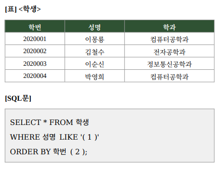

**정답:** 1. 이%  2. DESC

### 2026년 2회 13번

[해설 보기](../2026년 2회/13.md)

다음 &lt;A&gt;, &lt;B&gt; 테이블과 SQL문을 참고하여, SQL문을 실행했을 때 출력되는 RESULT 값을 구하시오.


**정답:** 3

### 2026년 2회 14번

[해설 보기](../2026년 2회/14.md)

다음 &lt;A&gt;, &lt;B&gt; 테이블과 SQL문을 참고하여, SQL문을 실행했을 때 출력되는 결과값을 구하시오.

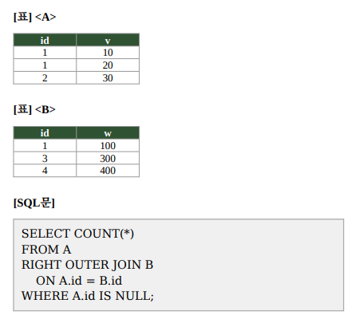

**정답:** 2

### 2026년 1회 09번

[해설 보기](../2026년 1회/09.md)

아래 조건을 참고하여 각 SQL 구문을 실행했을 때 반환되는 행(Row)의 수를 쓰시오.  
(단, DEPT 칼럼은 학과명이다.)

테이블 조건

STUDENT 테이블에는 다음 세 학과의 학생 정보가 저장되어 있다.  
컴퓨터과  50명  · 인터넷과  100명  · 사무자동화과  50

SQL 구문

1. SELECT DEPT FROM STUDENT;  
2. SELECT DISTINCT DEPT FROM STUDENT;  
3. SELECT COUNT(DISTINCT DEPT) FROM STUDENT  
&nbsp;&nbsp;&nbsp;&nbsp;WHERE DEPT = '컴퓨터과';

**정답:** 1. 200 / 2. 3 / 3. 1

### 2026년 1회 10번

[해설 보기](../2026년 1회/10.md)

아래는 선수(PLAYER) 정보를 관리하는 테이블을 정의하는 SQL 문이다. 팀(TEAM) 테이블의 특정 칼럼을 참조하는 외래키 제약 조건을 추가하려 할 때, 괄호 ①~⑤에 들어갈 적절한 예약어(keyword) 또는 칼럼명을 아래 조건을 참고하여 쓰시오.

조건

외래키 제약 조건의 이름은 TEAM\_TF 로 지정한다.  
PLAYER 테이블의 TEAM\_ID 칼럼이 외래키 역할을 한다.  
TEAM 테이블의 TEAM\_ID2 칼럼을 참조 대상으로 한다.

SQL 문

CREATE TABLE PLAYER (  
&nbsp;&nbsp;PLAYER\_ID  CHAR(7)     NOT NULL,  
&nbsp;&nbsp;PLAYER\_NAME VARCHAR2(20) NOT NULL,  
&nbsp;&nbsp;TEAM\_ID   CHAR(3)     NOT NULL,  
&nbsp;&nbsp;PRIMARY KEY (PLAYER\_ID),  
&nbsp;&nbsp;( 1 ) TEAM\_TF  
&nbsp;&nbsp;( 2 ) KEY ( 3 )  
&nbsp;&nbsp;( 4 ) TEAM ( 5 )  
);

**정답:** ① CONSTRAINT ② FOREIGN ③ TEAM_ID ④ REFERENCES ⑤ TEAM_ID2

### 2026년 1회 18번

[해설 보기](../2026년 1회/18.md)

다음은 SQL에 대한 문제이다. 아래 코드를 확인하여 알맞는 출력값을 작성하시오.

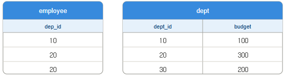

SELECT COUNT(\*)  
FROM employee e  
JOIN dept d ON e.dep\_id = d.dept\_id  
WHERE d.budget &gt; (  
&nbsp;&nbsp;&nbsp;&nbsp;SELECT AVG(budget) FROM dept  
);

**정답:** `2`

### 2025년 3회 10번

[해설 보기](../2025년 3회/10.md)

다음은 테이블에서 조건값을 실행한 화면이다. 이에 대한 알맞는 결과값을 작성하시오.

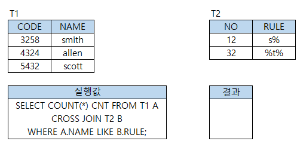

**정답:** `4`

### 2025년 3회 20번

[해설 보기](../2025년 3회/20.md)

다음은 SQL에 관한 문제이다. 아래 A테이블을 참고하여 쿼리의 결과를 작성하시오.

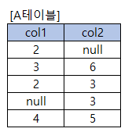

[ SQL ]

SELECT count(col2) FROM A WHERE col1 IN (2, 3) OR col2 IN (3, 5)

**정답:** `4`

### 2025년 1회 07번

[해설 보기](../2025년 1회/07.md)

다음은 SQL 문제이다. 아래 두 테이블을 참고하여 보기에 쿼리 실행 결과를 작성하시오.


[보기]

SELECT name, incentive FROM emp, sal WHERE emp.id = sal.id and incentives &gt;= 500

**정답:** 이순신 \| 1000

### 2024년 3회 03번

[해설 보기](../2024년 3회/03.md)

아래의 employee테이블과 project테이블을 참고하여 보기의 SQL명령어에 알맞는 출력 값을 작성하시오.

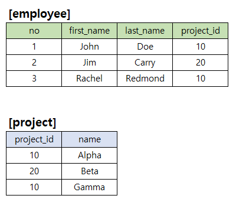

보기

```
SELECT
    count(*)
FROM employee AS e JOIN project AS p ON e.project_id = p.project_id
WHERE p.name IN (
    SELECT name FROM project p WHERE p.project_id IN (
        SELECT project_id FROM employee GROUP BY project_id HAVING count(*) < 2
    )
);
```

**정답:** `1`

### 2024년 2회 03번

[해설 보기](../2024년 2회/03.md)

다음은 SQL에 관한 문제이다. 아래 SQL 구문의 빈칸을 작성하시오.

테이블

사원 [사원번호(PK), 이름, 나이, 부서]

부서 [사원번호(PK), 이름, 주소, 나이]

신입 사원이 들어와서 사원 테이블에 추가

INSERT INTO 사원 (사원번호, 이름, 주소, 부서)   [      ①     ] (32431, '정실기', '서울', '영업');

위에 신입사원을 검색하면서 부서 테이블에 추가

INSERT INTO 부서 (사원번호, 이름, 나이, 부서)

[    ②     ] 사원번호, 이름, 나이, 23 FROM 사원 WHERE 이름 = '정실기';

전체 사원 테이블 조회

SELECT  \*   [    ③   ]   사원;

퇴사로 인해 부서에 해당하는 값을 '퇴사'로 변경

UPDATE 사원   [      ④     ]   부서  =  '퇴사'  WHERE 사원번호  = 32431;

**정답:** ① VALUES ② SELECT ③ FROM ④ SET

### 2024년 1회 13번

[해설 보기](../2024년 1회/13.md)

아래 보기의 SQL 문장과 테이블을 참고하여 출력 값을 표로 작성하시오.

```
SELECT
    B
FROM
    R1
WHERE
    C IN (SELECT C FROM R2 WHERE D="k");
```

보기

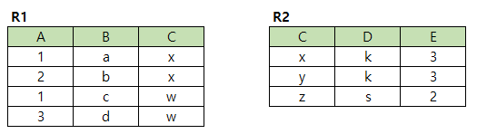

**정답:** 위 표 (B = a, b)

### 2024년 1회 18번

[해설 보기](../2024년 1회/18.md)

아래의 SQL 코드와 테이블을 참고하여 결과 값을 작성하시오.

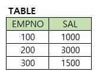

```
SELECT
    COUNT(*)
FROM
    TABLE
WHERE
    EMPNO > 100
AND
    SAL >= 3000 OR EMPNO = 200
```

**정답:** `1`

### 2023년 3회 06번

[해설 보기](../2023년 3회/06.md)

다음 빈칸에 들어갈 UNION 연산의 결과값을 작성하시오.

[테이블]

T1

| 3 |
|---|
| 1 |
| 4 |

T2

| 2 |
|---|
| 4 |
| 3 |

[쿼리]

SELECT A FROM  T1

UNION

SELECT A FROM  T2

ORDER BY A DESC;

결과 테이블

|  |
|---|
|  |
|  |
|  |

**정답:** 4, 3, 2, 1 (위에서부터)

### 2023년 2회 04번

[해설 보기](../2023년 2회/04.md)

다음은 테이블에 데이터를 삽입하기 위한 과정이다. 보기의 조건식에 맞게 데이터 삽입을 위한 SQL문을 작성하시오.

보기

CREATE TABLE 학생 (  
&nbsp;&nbsp;학번 int,  
&nbsp;&nbsp;이름 varchar(20),  
&nbsp;&nbsp;학년 int,  
&nbsp;&nbsp;전공 varchar(30),  
&nbsp;&nbsp;전화번호varchar(20)  
);

결과값

[학생]

| 학번 | 이름 | 학년 | 전공 | 전화번호 |
|---|---|---|---|---|
| 9830287 | 뉴진스 | 3 | 경영학개론 | 010-1234-1234 |

조건

문자열일 경우 작은따음표  
(작은따음표가 아니라 다른 단어로 명시되었습니다.)

**정답:** 위 SQL문 (원문 정답 표기의 `INSTER`는 `INSERT` 의 오타)

### 2023년 2회 17번

[해설 보기](../2023년 2회/17.md)

다음 보기의 SQL문에서 괄호안에 알맞는 단어를 작성하시오.

보기

DROP VIEW 학생 (         )

- 학생 테이블을 참조하는 다른 VIEW나 제약 조건까지 모두 삭제되어야 한다.

**정답:** CASCADE (대소문자 무관)

### 2023년 1회 13번

[해설 보기](../2023년 1회/13.md)

[학생] 테이블에서 학생 이름이 '민수'인 튜플을 삭제하는 쿼리를 작성하시오.


조건  
- 컬럼의 값이 문자열일 경우 작은 따움표 ('  ')를 표시하시오.  
- SQL 마지막에 세미콜론(;)은 표기하지 않아도 관계 없습니다.

**정답:** `DELETE FROM 학생 WHERE 이름 = '민수';`

### 2023년 1회 16번

[해설 보기](../2023년 1회/16.md)

다음 성적 테이블에서 과목별 점수의 평균이 90점 이상인 '과목이름', '최소점수', '최대점수' 를 검색하고자 한다. [조건]을 참고하여 적합한 SQL문을 작성하시오.


조건:  
- where사용하지 말하야 한다.  
- SELECT절에 별칭을 사용하여 작성해야 한다.  
- SQL 구문 마지막에 세미콜론 생락 가능하다.  
- 반드시 GROUP BY와 having을 사용해야 한다.  
- 집계함수를 사용해야 한다.

**정답:** 위 SQL문

### 2022년 3회 07번

[해설 보기](../2022년 3회/07.md)

아래 데이터 명령어를 적용할 경우 알맞는 출력값을 작성하시오.

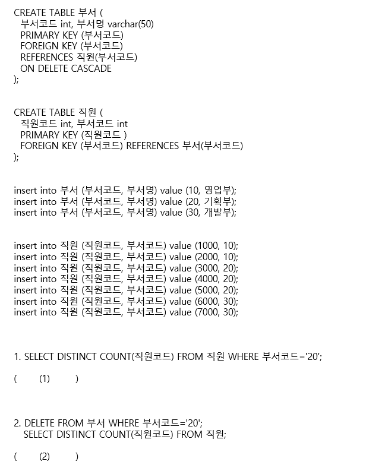

**정답:** (1) 3 (2) 4

### 2022년 3회 12번

[해설 보기](../2022년 3회/12.md)

STUDENT 테이블에서 컴퓨터과 학생 50명, 전기과 학생 100명, 인터넷과 학생 50명의 정보가 저장되어 있을 때, 다음 SQL문의 실행 결과에 따른 튜플의 수는? (단, DEPT 칼럼은 학과명이다.)

1) SELECT DERP FROM STUDENT;

2) SELECT DISTINCT DEPT FROM STUDENT;

3) SELECT COUNT(DISTINCT DEPT) FROM STUDENT WHERE DEPT = '인터넷과';

**정답:** 1) 200 2) 3 3) 1

### 2022년 2회 03번

[해설 보기](../2022년 2회/03.md)

H회사의 전체 제품 단가 보다 큰 제품 출력을 하고자 한다. 괄호안에 들어갈 알맞는 용어를 작성하시오.

[제품테이블]

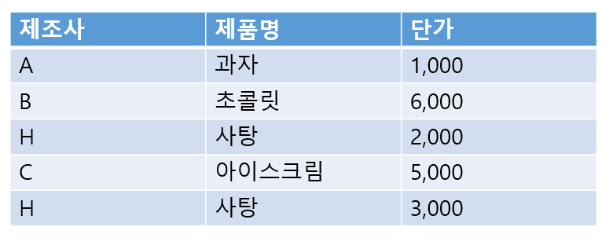

SELECT 제조사, 제품명, 단가  
FROM 제품  
WHERE 단가 &gt; ( ) (SELECT 단가 FROM 제품 WHERE 제조사='H')

**정답:** ALL

### 2022년 2회 04번

[해설 보기](../2022년 2회/04.md)

다음 SQL 결과에 알맞는 답을 작성하시오.

[TABLE]

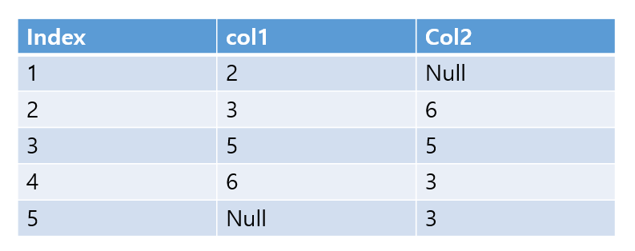

SELECT count(col2)  
FROM TABLE  
WHERE col1 in(2,3) or col2 in(3,5);

**정답:** `4`

### 2022년 1회 04번

[해설 보기](../2022년 1회/04.md)

다음 SQL 결과에 알맞는 쿼리을 작성하시오.

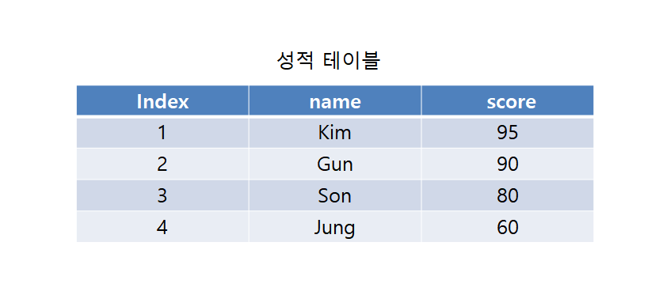

SELECT name, score FROM 성적 ( 1 ) BY ( 2 ) ( 3 )

**정답:** 1. ORDER 2. score 3. DESC

### 2021년 3회 13번

[해설 보기](../2021년 3회/13.md)

다음은, 테이블에서 조건값을 실행한 화면이다. 이에 대한 알맞는 결과값을 작성하시오.


**정답:** `4`

### 2021년 2회 05번

[해설 보기](../2021년 2회/05.md)

다음은 테이블을 수정할때의 상황입니다. SQL 보기에서 괄호안에 알맞는 문장을 작성하시오.

(    1   ) 테이블명  (     2    )  컬럼 = 값 WHERE 점수 &gt;= 90;

**정답:** 1. UPDATE 2. SET

### 2021년 2회 06번

[해설 보기](../2021년 2회/06.md)

다음 SQL 보기에서 JOIN할 경우 괄호안에 알맞는 문장을 작성하시오.

SELECT .... FROM 학생정보 a JOIN 학과정보 b (   1   ) a.학과 = b.(   2   )

**정답:** 1. ON 2. 학과

### 2021년 2회 10번

[해설 보기](../2021년 2회/10.md)

SQL문에서 괄호안에 알맞은 답안을 작성하시오. (실제 시험에는 결과 이미지가 있습니다.)

('이름'이란 컬럼에 '이'로 시작하는 문자열을 '내림차순'하는 쿼리 결과 내용입니다.)

SELECT .... FROM ... WHERE '이름' LIKE (   1   )  ORDER BY  '컬럼명'  (    2    )

**정답:** 1. `이%` 2. `DESC` (패턴은 문자열이므로 SQL에서는 작은따옴표로 감싼 `'이%'`로 쓴다.)

### 2021년 1회 06번

[해설 보기](../2021년 1회/06.md)

다음 SQL 실행 결과를 숫자만 쓰시오.

| EMPNO | SAL |
|---|---|
| 100 | 1000 |
| 200 | 3000 |
| 300 | 1500 |

SELECT COUNT(\*) FROM 급여

WHERE EMPNO &gt; 100 AND SAL &gt;= 3000 OR EMPNO = 200;

**정답:** `1`

### 2020년 4회 16번

[해설 보기](../2020년 4회/16.md)

다음 조건을 만족하면서 학과별로 튜플 수가 얼마인지 구하는 SQL문을 작성하시오.

- 대소문자를 구분하지 않는다.

- WHERE 구문을 사용하지 않는다.

- GROUP BY 를 사용한다.

- 세미콜론(;)은 생략 가능하다.

- 별칭(AS)을 사용해야 한다. (별칭 사용 시 별칭은 작은 따옴표를 써야 함)

- 집계 함수를 사용해야 한다.

[학생]

| 학과 | 학생 |
|---|---|
| 전기 | 이순신 |
| 컴퓨터 | 안중근 |
| 컴퓨터 | 윤봉길 |
| 전자 | 이봉창 |
| 전자 | 강우규 |

[결과]

| 학과 | 학과별튜플수 |
|---|---|
| 전기 | 1 |
| 컴퓨터 | 2 |
| 전자 | 2 |

**정답:** `SELECT 학과, COUNT(학과) AS '학과별튜플수' FROM 학생 GROUP BY 학과;`

### 2020년 3회 08번

[해설 보기](../2020년 3회/08.md)

다음 조건을 만족하면서, 과목별 점수의 평균이 90이 상인 과목이름, 최소점수, 최대점수를 구하는 SQL문을 작성하시오.

- 대소문자를 구분하지 않는다.

- WHERE 구분을 사용하지 않는다.

- GROUP BY, HAVING구문을 반드시 사용한다.

- 세미콜론(;)은 생략 가능하다.

- 별칭(AS)을 사용해야 한다.

[성적]

| 과목코드 | 과목이름 | 학점 | 점수 |
|---|---|---|---|
| 1000 | 컴퓨터과학 | A+ | 95 |
| 2000 | 운영체제 | B+ | 85 |
| 1000 | 컴퓨터과학 | B+ | 85 |
| 2000 | 운영체제 | B | 80 |

[결과]

| 과목이름 | 최소점수 | 최대점수 |
|---|---|---|
| 컴퓨터과학 | 85 | 95 |

**정답:** 위 SQL문

### 2020년 3회 09번

[해설 보기](../2020년 3회/09.md)

학생 테이블에서 이름이 민수인 튜플을 삭제하는 SQL문을 작성하시오

[학생]

| 학번 | 이름 | 점수 | 과목이름 |
|---|---|---|---|
| 1000 | 김정미 | 90 | 알고리즘 |
| 2000 | 강은미 | 95 | 데이터베이스 |
| 3000 | 홍길동 | 90 | 전산수학 |
| 4000 | 민수 | 95 | 운영체제 |

**정답:** `DELETE FROM 학생 WHERE 이름 = '민수';`

### 2020년 3회 20번

[해설 보기](../2020년 3회/20.md)

학생 테이블에 주소 속성을 추가하는 SQL문을 작성하시오.

(    1.   ) TABLE 학생   (   2.  ) 주소 VARCHAR(20);

**정답:** 1. ALTER 2. ADD

### 2020년 2회 06번

[해설 보기](../2020년 2회/06.md)

학생 테이블은 학번, 이름, 학년, 수강과목, 점수, 연락처를 속성으로 가진다. 아래 조건을 만족하는 SQL문을 작성하시오.

1) 학생 테이블에서 3,4학년인 학번, 이름을 조회한다.

2) IN 연산자 사용해야 한다.

[학생]

| 학번 | 이름 | 학년 | 수강과목 | 점수 | 연락처 |
|---|---|---|---|---|---|
| 1000 | 김이름 | 1 | 수학 | 90 | 010-1111-2222 |
| 2000 | 장이름 | 2 | 과학 | 95 | 010-2222-2222 |
| 3000 | 허이름 | 3 | 미술 | 90 | 010-3333-3333 |
| 4000 | 조이름 | 4 | 음악 | 95 | 010-4444-4444 |

**정답:** `SELECT 학번, 이름 FROM 학생 WHERE 학년 IN (3,4);`

### 2020년 2회 12번

[해설 보기](../2020년 2회/12.md)

학생 테이블의 name속성에 IDX\_NAME 이름으로 인덱스 생성하는 SQL문을 작성하시오.

| STID | NAME | SCORE | DEPTID |
|---|---|---|---|
| 1000 | 김이름 | 90 | 1 |
| 2000 | 허이름 | 95 | 2 |
| 3000 | 조이름 | 90 | 3 |
| 4000 | 장이름 | 95 | 4 |

**정답:** `CREATE INDEX IDX_NAME ON 학생(NAME);`

### 2020년 1회 06번

[해설 보기](../2020년 1회/06.md)

STUDENT 테이블에서 컴퓨터과 학생 50명, 인터넷과 학생 100명, 사무자동화과 학생 50명의 정보가 저장되어 있을 때, 다음 SQL문의 실행 결과에 따른 튜플의 수는? (단, DEPT 칼럼은 학과명이다.)

1) SELECT DERP FROM STUDENT;

2) SELECT DISTINCT DEPT FROM STUDENT;

3) SELECT COUNT(DISTINCT DEPT) FROM STUDENT WHERE DEPT = '컴퓨터과';

**정답:** 1) 200 2) 3 3) 1

## DCL (1회)

### 2021년 3회 03번

[해설 보기](../2021년 3회/03.md)

Grant의 기능에 대해 간략하게 약술하시오.

**정답:** 
