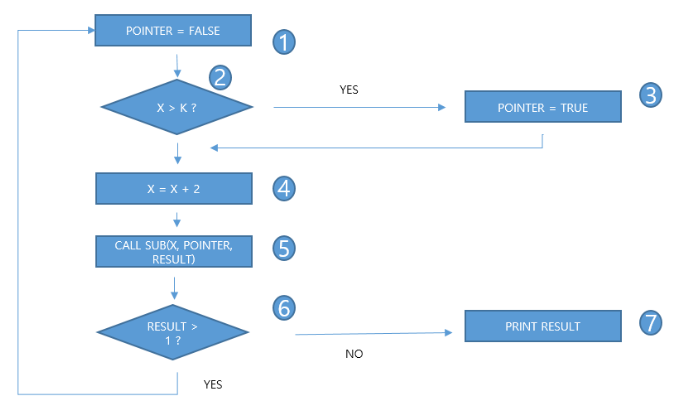
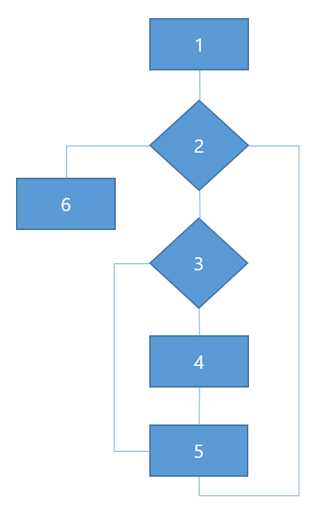
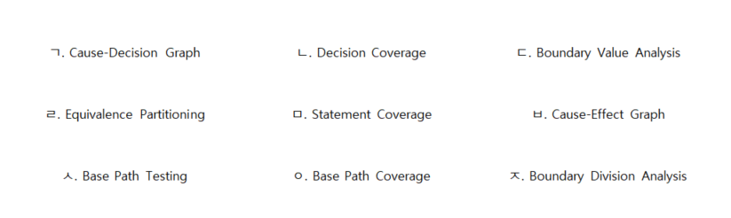

# 소프트웨어 테스트 — 기출 기반 요약정리

> 범위: **2020년 1회 ~ 2026년 2회 (21개 회차) 중 이 영역 33문제**. 출제 빈도 → 개념 요약 → 기출 키워드 → 기출 원문 순서. 해설은 각 문제 파일에서 확인.

## A. 출제 빈도 (많이 나온 순)

| 카테고리 | 횟수 | 출제 회차-번호 (최신순) |
|---|:--:|---|
| 커버리지 | 9 | 25-3-02, 25-2-11, 25-1-15, 24-3-13, 24-1-14, 23-2-06, 23-1-19, 21-2-09, 20-3-07 |
| 블랙박스 테스트 | 8 | 26-2-01, 23-3-16, 22-3-06, 22-1-13, 21-3-09, 21-1-09, 20-4-15, 20-3-12 |
| 통합테스트 | 4 | 26-1-19, 23-2-20, 21-3-20, 21-2-20 |
| 코드 분석 도구 | 2 | 22-1-10, 20-2-09 |
| 테스트케이스 | 2 | 25-3-19, 21-3-08 |
| 테스트 원리 | 1 | 20-1-01 |
| 성능 지표 | 1 | 20-1-19 |
| 테스트 오라클 | 1 | 20-4-14 |
| 테스트 종류 | 1 | 21-1-10 |
| JUnit | 1 | 22-1-12 |
| V 모델 | 1 | 22-1-20 |
| 알파·베타 테스트 | 1 | 22-2-10 |
| 회귀 테스트 | 1 | 22-2-11 |

---

# B. 개념 요약
## 1. 테스트 기본
- **확인(Validation)**: 고객 요구를 만족하는가(올바른 제품) / **검증(Verification)**: 명세대로 정확히 구현했는가.
- **테스트 7원칙(기출: 살충제 패러독스)**

| 원칙 | 의미 |
|---|---|
| 완벽한 테스트 불가능 | 결함을 **줄일 수는 있어도 없다고 증명 불가** |
| **결함 집중** | 결함은 일부 모듈에 집중 |
| **파레토 법칙** | 코드 **20%**에서 결함 **80%** |
| **살충제 패러독스** | **같은 테스트를 반복하면 새 결함을 못 찾음** → 테스트 케이스 지속 보완 |
| 정황 의존 | 소프트웨어 특성에 따라 테스트 방법이 달라야 함 |
| 오류-부재의 궤변 | 결함이 없어도 요구를 못 만족하면 품질 낮음 |

## 2. 정적 vs 동적, 블랙박스 vs 화이트박스
| 구분 | 정적 분석 | 동적 분석 |
|---|---|---|
| 실행 | **실행 안 함**(소스 코드만) | **실행하며** |
| 찾는 것 | 코딩 표준 위반, **복잡도**, 잠재 결함 | **메모리 누수, 스레드 결함** |
| 도구 | pmd, cppcheck, checkstyle, SonarQube | Valgrind, 프로파일러 |

| 구분 | **블랙박스(명세 기반)** | **화이트박스(구조 기반)** |
|---|---|---|
| 관점 | 내부 모르고 입출력 검증 | 소스 코드 논리 검증 |
| 기법 | **동치 분할, 경계값 분석, 원인-결과 그래프, 오류 예측, 비교 검사, 결정 테이블, 상태 전이** | **문장·분기·조건·조건/결정·MC/DC·다중 조건 커버리지, 기본 경로 테스트** |
- ⚠ "원인-**결과**(Effect) 그래프"는 블랙박스, "Cause-**Decision** Graph"·"Boundary Division Analysis"는 가짜 용어.

## 3. 블랙박스 기법 (기출 8회)
| 기법 | 단서 | 예 |
|---|---|---|
| **동치(동등) 분할** | 입력을 **유효/무효 영역**으로 나눠 **영역별 대표값** | 점수 구간의 **중간값**(30, 65, 75, 85, 95, -10, 110) |
| **경계값 분석** | 구간 **경계**에서 오류 多, **경계 ±1** | -1, 0, 1, 69, 70, 71 … 100, 101 |
| **원인-결과 그래프** | 입력(원인)·출력(결과)의 **논리 관계 AND/OR/NOT** → 결정 테이블 | |
| 오류 예측 | **경험·감각** | |
| 비교 검사 | 여러 버전에 **같은 입력** | |

## 4. 화이트박스 커버리지 (기출 9회) — 약 → 강
| 커버리지 | 기준 |
|---|---|
| **문장(구문)** | **모든 문장** 1회 이상 실행 |
| **결정(분기)** | **결정 전체**가 T/F 각 1회 = **모든 분기선(화살표)** 통과 |
| **조건** | 결정 안 **개별 조건식**이 T/F 각 1회 (결정 결과 T/F가 모두 나온다는 **보장 없음**) |
| 조건/결정 | 결정 + 조건 **모두** |
| **변경 조건/결정(MC/DC)** | **각 조건이 단독으로 결과에 영향**을 주는 조합만 (n+1개 테스트) |
| **다중 조건** | 조건의 **모든 조합**(2ⁿ) |
- **제어 흐름 그래프 풀이**: 마름모(판단)마다 T/F 분기선을 모두 지나는 **최소 경로**를 만든다. 판단 2개 → 경로 2개. 기출 답: `1234561, 124567` 또는 `1234567, 124561`.
- **문장 커버리지** 순서: 모든 **노드**만 방문(조건이 참인 경로 필요).

## 5. 테스트 레벨 (V 모델)
```text
 요구분석 ◀── 요구 분석 검증 ──▶ 시스템 테스트 → 인수 테스트
 아키텍처 설계 ◀── 인터페이스 검증 ──▶ 통합 테스트
 모듈 설계 ◀── 모듈 검증 ──▶ 단위 테스트
            구현
```
| 레벨 | 설명 |
|---|---|
| 단위 | **개별 모듈·서브루틴** |
| **통합** | **모듈 간 인터페이스** (빅뱅 / 점증적: 하향식·상향식·샌드위치) |
| **시스템** | 실제와 같은 환경에서 **전체**가 요건 적합한지 |
| **인수** | 계약 요구 충족을 **사용자**가 확인 |
| **알파** | **개발사 내부**(개발자 관점) 먼저 / **베타**: **선발된 잠재 고객·실사용 환경**, **출시 직전** |
| **회귀(Regression)** | 수정 후 **새로 유입된 오류가 없는지** 기존 테스트 재시험 |

### 통합 테스트 — 스텁 vs 드라이버 (기출 4회)
| 방식 | 진행 | 필요 모듈 | 역할 |
|---|---|---|---|
| **하향식** | 상위→하위 | **스텁(Stub)** | **하위 모듈 대신**, 정해진 값만 반환 |
| **상향식** | 하위→상위 | **드라이버(Driver)** | **상위 모듈 대신**, 하위를 호출·입출력 확인 |
- **테스트 하네스** 구성: 드라이버, 스텁, 슈트, 케이스, 스크립트, 목 오브젝트.

## 6. 테스트 케이스·오라클
| 구성요소 | 예 |
|---|---|
| **테스트 조건** | 사용자 초기 화면 (전제) |
| **테스트 데이터** | 아이디·비밀번호 (**입력값**) |
| **예상 결과** | 로그인 성공/실패 |
| 수행 단계, 성공/실패 기준, 환경 | |

**테스트 오라클**(정답과 비교): **참** 오라클(모든 입력), **샘플링** 오라클(**몇 개 입력만**), **휴리스틱**(일부 + 추정), **일관성 검사**(변경 전후 동일).

## 7. 성능 지표·도구
| 지표 | 의미 |
|---|---|
| **처리량** | 주어진 시간에 처리하는 **트랜잭션 수** (시간당 페이지 수) |
| **응답 시간** | 입력 끝 → **응답 출력 개시**까지 |
| **경과 시간** | 입력 → **결과 출력 완료**까지 |
| 자원 사용률 | CPU·메모리·네트워크 |
- **JUnit**: Java **xUnit** 단위 테스트 프레임워크.

---

# C. 기출 키워드 → 정답 (한눈에)

| 회차-번호 | 카테고리 | 정답 |
|---|---|---|
| [25-3-02](../2025년 3회/02.md) | 커버리지 | ㅇ. 조건(Condition) |
| [25-2-11](../2025년 2회/11.md) | 커버리지 | `1234561, 124567` 또는 `1234567, 124561` |
| [25-1-15](../2025년 1회/15.md) | 커버리지 | (1) int a = 0 (2) a < m \|\| b[a] < x (3) b[a] < 0 (4) b[a] = -b[a]; (5) a++; (6) return 1… |
| [24-3-13](../2024년 3회/13.md) | 커버리지 | 1. 문장 / 2. 분기 / 3. 조건 |
| [24-1-14](../2024년 1회/14.md) | 커버리지 | ㄹ. 변경 조건/결정 커버리지 (MC/DC) |
| [23-2-06](../2023년 2회/06.md) | 커버리지 | ㅇ. 조건 커버리지 |
| [23-1-19](../2023년 1회/19.md) | 커버리지 | `1234561, 124567` 또는 `1234567, 124561` |
| [21-2-09](../2021년 2회/09.md) | 커버리지 | 1. 문장 2. 결정 3. 조건 |
| [20-3-07](../2020년 3회/07.md) | 커버리지 | `1234561, 124567` 또는 `1234567, 124561` |
| [26-2-01](../2026년 2회/01.md) | 블랙박스 테스트 | ㄱ. 동치분할 (Equivalence Partitioning) |
| [23-3-16](../2023년 3회/16.md) | 블랙박스 테스트 | ㄱ. Equivalence Partitioning (동치 분할) |
| [22-3-06](../2022년 3회/06.md) | 블랙박스 테스트 | Boundary Value Analysis (경계값 분석) |
| [22-1-13](../2022년 1회/13.md) | 블랙박스 테스트 | ㄷ, ㄹ, ㅂ |
| [21-3-09](../2021년 3회/09.md) | 블랙박스 테스트 | cause effect graph (원인-결과 그래프) |
| [21-1-09](../2021년 1회/09.md) | 블랙박스 테스트 | 1. 경계값 분석 2. 동등(동치) 분할 테스트 |
| [20-4-15](../2020년 4회/15.md) | 블랙박스 테스트 | 동등(동치) 분할 테스트 (Equivalence Partitioning) |
| [20-3-12](../2020년 3회/12.md) | 블랙박스 테스트 | 블랙박스 테스트 (명세 기반 테스트) |
| [26-1-19](../2026년 1회/19.md) | 통합테스트 | 1. 스텁 / 2. 드라이버 |
| [23-2-20](../2023년 2회/20.md) | 통합테스트 | 1. 스텁 / 2. 드라이버 |
| [21-3-20](../2021년 3회/20.md) | 통합테스트 | 1. 상향식 2. 테스트 드라이버 |
| [21-2-20](../2021년 2회/20.md) | 통합테스트 | 스텁 (Stub) |
| [22-1-10](../2022년 1회/10.md) | 코드 분석 도구 | 1. static 2. dynamic |
| [20-2-09](../2020년 2회/09.md) | 코드 분석 도구 | 정적 분석 도구 (Static Analysis Tool) |
| [25-3-19](../2025년 3회/19.md) | 테스트케이스 | ㄱ(테스트 조건), ㄹ(테스트 데이터), ㅁ(예상 결과) |
| [21-3-08](../2021년 3회/08.md) | 테스트케이스 | 1. 테스트 조건 2. 테스트 데이터 3. 예상 결과 |
| [20-1-01](../2020년 1회/01.md) | 테스트 원리 |  |
| [20-1-19](../2020년 1회/19.md) | 성능 지표 | 1. 처리량 2. 응답 시간 3. 경과 시간 |
| [20-4-14](../2020년 4회/14.md) | 테스트 오라클 | 샘플링 오라클 (Sampling Oracle) |
| [21-1-10](../2021년 1회/10.md) | 테스트 종류 | 1. 단위 테스트 2. 통합 테스트 |
| [22-1-12](../2022년 1회/12.md) | JUnit | JUnit |
| [22-1-20](../2022년 1회/20.md) | V 모델 | 1. 단위 테스트 2. 통합 테스트 3. 시스템 테스트 4. 인수 테스트 |
| [22-2-10](../2022년 2회/10.md) | 알파·베타 테스트 | 1. 베타 / 2. 알파 |
| [22-2-11](../2022년 2회/11.md) | 회귀 테스트 | Regression (회귀 테스트) |

---

# D. 기출문제 원문

## 커버리지 (9회)

### 2025년 3회 02번

[해설 보기](../2025년 3회/02.md)

다음은 소프트웨어 테스트 기법 중 하나에 대한 설명이다.

소프트웨어 테스트의 구조 기반(화이트박스) 기법 중 하나로,

결정 포인트(Decision Point) 내에 존재하는 모든 개별 조건식(Atomic Condition) 을 대상으로 하는 커버리지 기준이 있다.

하나의 결정문(예: if (A && B) 또는 if (X &gt; 10 || Y == 0)) 안에는

여러 개의 조건식이 포함될 수 있는데 이 커버리지는

각각의 조건식이 True와 False 두 가지 경우를 모두 한 번 이상 만족하도록

테스트 케이스를 설계해야 한다.

즉, 모든 개별 조건이 두 방향의 결과를 거쳐야 “커버되었다”고 판단하지만

그렇다고 해서 전체 결정식(Decision Expression) 의 결과(True/False)가

모두 수행된다고 보장하지는 않는다.

[보기]

ㄱ. 경로(Path)

ㄴ. 결정(Decision)

ㄷ. 조건/결정(Condition/Decision)

ㄹ. 변경 조건/결정(Modified Condition/Decision, MC/DC)

ㅁ. 다중 조건(Multiple Condition)

ㅂ. 문장(Statement)

ㅅ. 분기(Branch)

ㅇ. 조건(Condition)

ㅈ. 루프(Loop)

**정답:** ㅇ. 조건(Condition)

### 2025년 2회 11번

[해설 보기](../2025년 2회/11.md)

다음 아래 제어 흐름 그래프가 분기 커버리지를 만족하기 위한 테스팅 순서를 쓰시오.



**정답:** `1234561, 124567` 또는 `1234567, 124561`

### 2025년 1회 15번

[해설 보기](../2025년 1회/15.md)

문장(Statement) 커버리지 테스트를 수행하려고 한다. 코드를 아래의 제어 흐름도 빈칸에 연결되도록 작성하고 문장 커버리지 순서대로 작성하시오.

```
int Main(int b[], int m, int x) {
    int a = 0;
    while (a < m || b[a] < x) {
        if (b[a] < 0)
            b[a] = -b[a];
        a++;
    }
    return 1;
}
```

[흐름도]



1. (    ①    )    2. (    ②    )    3. (    ③    )    4. (    ④    )    5. (    ⑤    )  6. (    ⑥    )

문장 커버리지 순서 1 → 2  → (          ⑦           )

**정답:** (1) int a = 0 (2) a < m \|\| b[a] < x (3) b[a] < 0 (4) b[a] = -b[a]; (5) a++; (6) return 1…

### 2024년 3회 13번

[해설 보기](../2024년 3회/13.md)

다음은 테스트 커버리지에 대한 문제이다. 아래 내용에 알맞는 답을 보기에서 골라 작성하시오.

1. 테스트를 통해 프로그램의 모든 문장을 최소한 한 번씩 실행했는지를 측정  
2. 프로그램 내의 모든 분기(조건문)의 각 분기를 최소한 한 번씩 실행했는지를 측정  
3. 복합 조건 내의 각 개별 조건이 참과 거짓으로 평가되는 경우를 모두 테스트했는지를 측정

보기

ㄱ. 조건     ㄴ. 경로      ㄷ. 결정      ㄹ. 분기      ㅁ.함수          ㅂ. 문장      ㅅ. 루프

**정답:** 1. 문장 / 2. 분기 / 3. 조건

### 2024년 1회 14번

[해설 보기](../2024년 1회/14.md)

아래는 애플리케이션 테스트 관리에 대한 내용이다. 설명하는 답을 보기에서 골라 작성하시오.

1. 모든 분기와 조건의 조합을 고려하나 모든 조합을 테스트하는 대신에 테스트가 필요한 중요한 조합을 찾아내는데에 중점을 둔다.

2. 특정 조건을 수행할 때 다른 조건과는 상관없이 전체 결과에 영향을 미치는 조건만을 테스트한다.

3. 각각의 파라미터는 적어도 한 번은 최종 결과에 영향을 주어야 한다.

보기

ㄱ. 구문 커버리지      ㄴ. 결정 커버리지    ㄷ. 조건 커버리지    ㄹ. 변경 조건/결정 커버리지     ㅁ.다중 조건 커버리지      ㅂ.경로 커버리지    ㅅ.조건/결정 커버리지

**정답:** ㄹ. 변경 조건/결정 커버리지 (MC/DC)

### 2023년 2회 06번

[해설 보기](../2023년 2회/06.md)

다음은 테스트 커버리지에 대한 내용이다. 내용을 보고 보기에 알맞는 기호를 고르시오.

- 프로그램 내에 있는 결정포인트 내의 모든 각 개별 조건식에 대한 모든 가능한 결과(참/거짓)에 대해 적어도 한번 수행한다.  
- 소프트웨어 테스트 수행시 소스코드를 어느 수준까지 수행하였는가를 나타내는 기준을 나타낸다.  
- 실제 업무에서는 다양한 툴을 사용하여 테스팅 수행한다.  
- True/False에충분한 영향을 줄 수 없는 경우가 발생 가능한 한계점을 지닌다.

보기

ㄱ. 구문 커버리지  ㄴ. 경로 커버리지  ㄷ. 조건/결정 커버리지   ㄹ. 변형 조건/결정 커버리지

ㅂ. 다중 조건 커버리지  ㅅ. 결정 커버리지  ㅇ. 조건 커버리지

**정답:** ㅇ. 조건 커버리지

### 2023년 1회 19번

[해설 보기](../2023년 1회/19.md)

다음 아래 제어 흐름 그래프가 분기 커버리지를 만족하기 위한 테스팅 순서를 쓰시오.


**정답:** `1234561, 124567` 또는 `1234567, 124561`

### 2021년 2회 09번

[해설 보기](../2021년 2회/09.md)

화이트박스 테스트 검중 중에, 각 번호에 해당하는 단어 선택해주시오. (실제 시험문제에서는 보기가 주어집니다.)

1. 최소 한번은 모든 문장 수행

2. 결정(Decision) 검증기준이라고도 하며, 조건별 참 / 거짓

3. 2번과 달리 전체 조건식을 무시하며, 조건 상관없이 개별 조건 참 / 거짓

**정답:** 1. 문장 2. 결정 3. 조건

### 2020년 3회 07번

[해설 보기](../2020년 3회/07.md)

다음 아래 제어 흐름 그래프가 분기 커버리지를 만족하기 위한 테스팅 순서를 쓰시오.


**정답:** `1234561, 124567` 또는 `1234567, 124561`

## 블랙박스 테스트 (8회)

### 2026년 2회 01번

[해설 보기](../2026년 2회/01.md)

다음은 블랙박스 테스트 기법에 대한 설명이다. 괄호 (   ) 안에 들어갈 말을 보기에서 골라 쓰시오.

(   )은 프로그램의 입력 조건을 유효한 값과 유효하지 않은 값의 영역으로 나누고, 각 영역을  
대표할 수 있는 값을 선정하여 테스트 케이스를 설계하는 명세 기반(블랙박스) 테스트 기법이다.


위 표에서 테스트 값으로 60을 입력하였을 때, 예상 결과와 실제 결과가 모두 등급 D로  
일치하였다. 이는 (   ) 기법을 적용하여 각 등급 구간의 대표값을 테스트한 사례이다.

보기

ㄱ. 동치분할 (Equivalence Partitioning)  
ㄴ. 경계값분석 (Boundary Value Analysis)  
ㄷ. 결정테이블 테스트 (Decision Table Testing)  
ㄹ. 상태전이 테스트 (State Transition Testing)

**정답:** ㄱ. 동치분할 (Equivalence Partitioning)

### 2023년 3회 16번

[해설 보기](../2023년 3회/16.md)

다음 설명에 알맞는 답을 보기에서 골라 작성하시오.

- 시스템이나 시스템 구성요소(component) 또는 소프트웨어 프로그램의 입력값과 출력값이 특정 그룹으로 분류되며, 분류된 그룹내의 값들이 시스템에 의해 동일하게 취급된다는 특성을 이용하여 시험하는 기법

- 유사한 입력값들이 시스템을 거치면서 유사한 답변이 나온다는 것을 가정하여 테스트

- 하나의 값은 그 분할 내 모든 값을 대표하는 것으로 간주하는 기법

- 모든 입력값을 시험할 필요가 없게 하여 시험을 효율적으로 수행하도록 지원

- 일반적으로 경계값 분석기법(boundary value analysis)과 함께 테스트 케이스 도출하는데 사용

보기

| ㄱ.Equivalence Partitioning      ㄴ.Statement Coverage           ㄷ.Boundary Value Analy         ㄹ.Branch Coverage<br>ㅁ.Error Guessing        ㅂ.Condition Coverage          ㅅ.Cause Effect Graph |
|---|

**정답:** ㄱ. Equivalence Partitioning (동치 분할)

### 2022년 3회 06번

[해설 보기](../2022년 3회/06.md)

아래 표를 확인하여 보기에 알맞는 값을 고르시오.

(기호식 보기가 있습니다. ex: Boundary Value Partitioning, Equivalence Partitioning 등)


**정답:** Boundary Value Analysis (경계값 분석)

### 2022년 1회 13번

[해설 보기](../2022년 1회/13.md)

다음 보기 중에서 블랙박스 테스트 기법을 3가지 골라 작성하시오.



**정답:** ㄷ, ㄹ, ㅂ

### 2021년 3회 09번

[해설 보기](../2021년 3회/09.md)

다음 중, 설명에 대한 괄호 ( ) 안에 들어갈 알맞는 보기를 고르시오.

(실제 기출문제에서는 답에 대한 보기 중, 영문 보기가 주어집니다.)

(  ) 통해 요구사항 명세를 입력 조건과 출력 조건 간의 논리적 관계로 표현하고,

이를 기반으로 테스트케이스를 도출한다.

(  )의 ‘원인(causes)’은 입력 조건을 의미하고 ‘결과(effects)’는 입력 조건의 결과를 의미하며,  
원인과 결과 간의 논리적 관계를 AND, OR, NOT 같은 boolean 연산자를 사용하여 표현한다.

**정답:** cause effect graph (원인-결과 그래프)

### 2021년 1회 09번

[해설 보기](../2021년 1회/09.md)

다음은 블랙박스 기법에 대한 예제이다. 블랙박스 기법 두 가지를 쓰시오.

예)

1. 0 &lt;= x &lt;= 10이면 -1 0 10 11 검사

2. 입력 데이터의 영역을 유사한 도메인별로 유횻값 / 무횻값을 그룹핑하여 나누어서 검사

**정답:** 1. 경계값 분석 2. 동등(동치) 분할 테스트

### 2020년 4회 15번

[해설 보기](../2020년 4회/15.md)

점수에 따른 성적 부여가 잘 되었는지 테스트하고자 한다. 아래에 알맞는 테스트 기법은 무엇인가?

| 점수 | 성적 |
|---|---|
| 0 ~ 59 | 가 |
| 60 ~ 69 | 양 |
| 70 ~ 79 | 미 |
| 80 ~ 89 | 우 |
| 90 ~ 100 | 수 |

[테스트 값] : -10점 / 30점 / 65점 / 75점 / 85점 / 95점 / 110점

**정답:** 동등(동치) 분할 테스트 (Equivalence Partitioning)

### 2020년 3회 12번

[해설 보기](../2020년 3회/12.md)

테스트의 종류 중, 둥치분할 테스트, 경계값 분석 테스트 등의 종류가 있는 테스트 기법을 쓰시오.

**정답:** 블랙박스 테스트 (명세 기반 테스트)

## 통합테스트 (4회)

### 2026년 1회 19번

[해설 보기](../2026년 1회/19.md)

다음은 통합 테스트에서 사용되는 더미 모듈에 대한 설명이다. 괄호 안에 들어갈 알맞은 용어를 쓰시오.

( 1 ) 은/는 하위 모듈을 대신하여 단순한 결과값만 반환하도록 임시로 작성된 더미 모듈로, 하향식 통합 테스트 수행 시 필요하다.  
( 2 ) 은/는 상위 모듈을 대신하여 하위 모듈의 데이터 입력과 출력을 확인하기 위한 더미 모듈로, 상향식 통합 테스트 수행 시 필요하다.

**정답:** 1. 스텁 / 2. 드라이버

### 2023년 2회 20번

[해설 보기](../2023년 2회/20.md)

다음 설명에 대한 알맞는 답을 작성하시오.

1.

- 하향식 테스트 시 상위 모듈은 존재하나 하위 모듈이 없는 경우의 테스트를 위해 임시 제공되는 모듈이다.  
- 특별한 목적의 소프트웨어를 구현하는 것으로 컴포넌트를 개발하거나 테스트할 때 사용된다.  
- 서버-클라이언트 구조에서 서버만 구현된 상태로 테스트를 해보고 싶을때 단순히 값만 넘겨주는 가상의 클라이언트를 만들어서 테스트 할 수 있다.

2.

- 상향식 테스트 시 상위 모듈 없이 하위 모듈이 존재할 때 하위 모듈 구동 시 자료 입출력을 제어하기 위한 제어 모듈(소프트웨어)이다.  
- 서버-클라이언트 구조에서 클라이언트만 구현된 상태로 테스트를 해보고 싶을때 접속 인증 등의 간단한 기능만 하는 가상의 서버를 만들어서 테스트 할 수 있다.

**정답:** 1. 스텁 / 2. 드라이버

### 2021년 3회 20번

[해설 보기](../2021년 3회/20.md)

다음은 소프트웨어 통합 테스트에 대한 설명이다.  괄호 ( ) 안에 들어갈 알맞는 답을 작성하시오.

(  1.  ) 방식은 이름에서도 알 수 있듯이, 하위 모듈부터 시작하여 상위 모듈로 테스트를 진행하는 방식이며,

이 방식을 사용하기 위해서는 (  2. )가 필요하다.

(   2.   )는 이미 존재하는 하위 모듈과 존재하지 않은 상위 모듈에 대한 인터페이스 역할을 한다.

**정답:** 1. 상향식 2. 테스트 드라이버

### 2021년 2회 20번

[해설 보기](../2021년 2회/20.md)

다음 괄호 안에 알맞은 답안을 작성하시오.

- 테스트 하네스의 도구 구성 요소 중, 상향식 테스트시, 상위 모듈 역할을 대신하는 테스트 드라이버와 하향식 테스트 시, 하위 모듈 역할을 대신하는 테스트 (       ) 이 있다.

**정답:** 스텁 (Stub)

## 코드 분석 도구 (2회)

### 2022년 1회 10번

[해설 보기](../2022년 1회/10.md)

다음은 분석도구에 대한 설명으로 보기에 알맞는 답을 작성하시오.  
(실제 기출문제에서는 답의 보기가 주어집니다.(오답 중, running analysis 등..))

1. 소스 코드의 실행 없이, 코드의 의미를 분석해 결함을 찾아내는 원시적 코드 분석 기법  
2. 소스 코드를 실행하여 프로그램 동작이나 반응을 추적하고 코드에 존재하는 메모리 누수, 스레드 결함 등을 분석

**정답:** 1. static 2. dynamic

### 2020년 2회 09번

[해설 보기](../2020년 2회/09.md)

애플리케이션을 실행하지 않고, 소스 코드에 대한 코딩 표준, 코딩 스타일, 코드 복잡도 및 남은 결함을 발견하기 위해 사용하는 도구는 무엇인지 쓰시오.

**정답:** 정적 분석 도구 (Static Analysis Tool)

## 테스트케이스 (2회)

### 2025년 3회 19번

[해설 보기](../2025년 3회/19.md)

다음은 테스트케이스의 구성요소에 대한 설명이다. 괄호 ( ) 안에 들어갈 알맞는 보기를 고르시오.


[보기]

ㄱ. 테스트 조건 ㄴ. 테스트 환경  ㄷ. 테스트 유형  ㄹ. 테스트 데이터

ㅁ. 예상 결과 ㅂ. 수행 단계 ㅅ. 성공/실패 기준

**정답:** ㄱ(테스트 조건), ㄹ(테스트 데이터), ㅁ(예상 결과)

### 2021년 3회 08번

[해설 보기](../2021년 3회/08.md)

다음은 테스트케이스의 구성요소에 대한 설명이다. 괄호 ( ) 안에 들어갈 알맞는 보기를 고르시오.

(실제 기출문제에서는 답에 대한 보기가 주어집니다.)


**정답:** 1. 테스트 조건 2. 테스트 데이터 3. 예상 결과

## 테스트 원리 (1회)

### 2020년 1회 01번

[해설 보기](../2020년 1회/01.md)

살충제 패러독스의 개념에 관해서 서술하시오.

**정답:** 

## 성능 지표 (1회)

### 2020년 1회 19번

[해설 보기](../2020년 1회/19.md)

애플리케이션의 성능을 측정하기 위한 지표는 무엇인가?

| 지표 | 설명 |
|---|---|
| (   1   ) | - 애플리케이션이 주어진 시간에 처리할 수 있는 트랜잭션의 수<br>- 웹 애플리케이션의 경우 시간당 페이지수로 표현 |
| (   2   ) | - 사용자 입력이 끝난 후, 애플리케이션의 응답 출력이 개시될 때까지의 시간<br>- 애플리케이션의 경우 메뉴 클릭 시 해당 메뉴가 나타나기까지 걸리는 시간 |
| (   3   ) | - 애플리케이션에 사용자가 요구를 입력한 시점부터 트랜잭션 처리 후 그 결과의 출력이 완료될 때까지 걸리는 시간 |
| 자원 사용률 | -  애플리케이션이 트랜잭션을 처리하는 동안 사용하는 CPU 사용량 , 메모리 사용량, 네트워크 사용량 |

**정답:** 1. 처리량 2. 응답 시간 3. 경과 시간

## 테스트 오라클 (1회)

### 2020년 4회 14번

[해설 보기](../2020년 4회/14.md)

테스트 오라클 중 특정한 몇 개의 입력값에 대해서만 기대하는 결과를 제공해주는 오라클은 무엇인가?

**정답:** 샘플링 오라클 (Sampling Oracle)

## 테스트 종류 (1회)

### 2021년 1회 10번

[해설 보기](../2021년 1회/10.md)

다음은 테스트 종류에 대한 설명이다. 빈칸에 들어갈 알맞은 용어를 보기에서 찾아 기호로 쓰시오.

- (   1.   ) 은/는 개별 모듈, 서브루틴이 정상적으로 실행되는지 확인

- (   2.   ) 은/는 인터페이스 간 시스템이 정상적으로 실행되는지 확인

[보기] : 시스템 테스트 / 인수 테스트 / 알파 테스트 / 단위 테스트 / 통합 테스트 / 회귀 테스트

**정답:** 1. 단위 테스트 2. 통합 테스트

## JUnit (1회)

### 2022년 1회 12번

[해설 보기](../2022년 1회/12.md)

다음 설명에 대한 알맞는 단어를 작성하시오.

자바 프로그래밍 언어를 이용한 xUnit의 테스트 기법으로써 숨겨진 단위 테스트를 끌어내어 정형화시켜 단위 테스트를 쉽게 해주는 테스트용 Framework이다.

**정답:** JUnit

## V 모델 (1회)

### 2022년 1회 20번

[해설 보기](../2022년 1회/20.md)

다음은 V모델에서의 테스트 단계에 대한 설명으로 괄호안에 들어갈 답을 작성하시오.


**정답:** 1. 단위 테스트 2. 통합 테스트 3. 시스템 테스트 4. 인수 테스트

## 알파·베타 테스트 (1회)

### 2022년 2회 10번

[해설 보기](../2022년 2회/10.md)

다음 설명에 대한 괄호안에 알맞는 단어를 작성하시오.

1. ( ) 테스트는 하드웨어나 소프트웨어의 개발 단계에서 상용화하기 전에 실시하는 제품 검사 작업. 제품의 결함 여부, 제품으로서의 가치 등을 평가하기 위해 실시한다. 선발된 잠재 고객으로 하여금 일정 기간 무료로 사용하게 한 후에 나타난 여러 가지 오류를 수정, 보완한다. 공식적인 제품으로 발매하기 이전에 최종적으로 실시하는 검사 작업이다.

2. ( ) 테스트는 새로운 제품 개발 과정에서 이루어지는 첫 번째 테스트. 즉, 시제품이 운영되는 동안의 신제품 연구와 개발 과정 단계에서 초기 작동의 결과를 평가하는 수단이며 개발 회사 내부에서 이루어지는 테스트로서 단위 테스트, 구성 테스트, 시스템 테스트 등을 포함한다.

**정답:** 1. 베타 / 2. 알파

## 회귀 테스트 (1회)

### 2022년 2회 11번

[해설 보기](../2022년 2회/11.md)

다음 설명에 알맞는 테스트 용어를 보기에서 골라 작성하시오.  
(실제 기출문제에서는 답의 보기가 주어집니다.(오답 중, Iterating등..))

오류를 제거하거나 수정한 시스템이나 시스템 컴포넌트 또는 프로그램이 오류 제거와 수정에 의해 새로이 유입된 오류가 없는지를 확인하는 일종의 반복 시험이다.

반복적인 시험이 필요한 이유는 오류가 제거·수정되는 상당수의 시스템이 의도치 않았던 오동작이나 새로운 형태의 오류를 일으키기 때문이다.

결국, 수정·변경된 시스템이나 시스템 컴포넌트 또는 프로그램이 명세된 요구 사항을 충족시키는지를 확인하는 시험의 한 형태이다.

**정답:** Regression (회귀 테스트)
