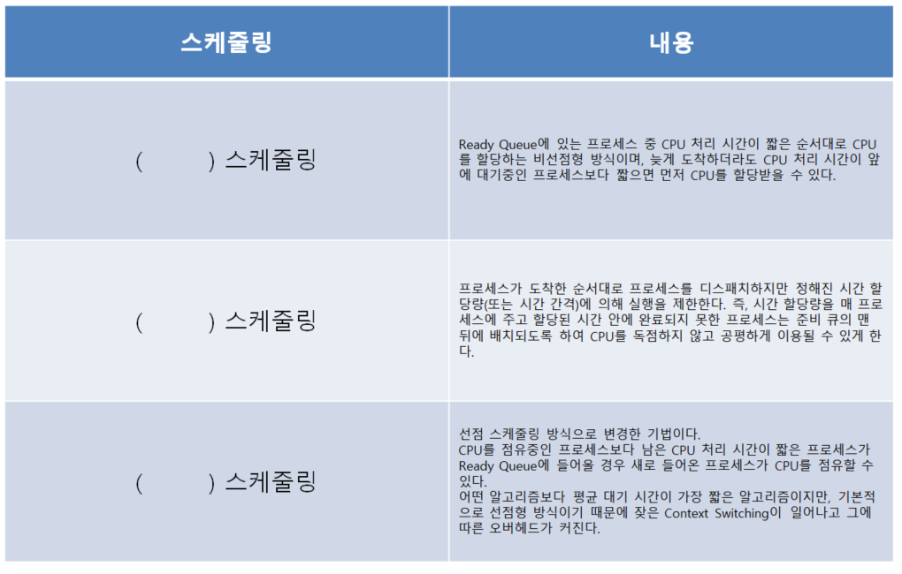

# 운영체제·리눅스 — 기출 기반 요약정리

> 범위: **2020년 1회 ~ 2026년 2회 중 이 영역 16문제**. 구성: A 출제 빈도 → B 개념 요약(🔥기출 위치 표시 + ⬜미출제 보충) → C 기출 키워드 → D 기출 원문.

## A. 출제 빈도 (많이 나온 순)

| 카테고리 | 횟수 | 출제 회차-번호 (최신순) |
|---|:--:|---|
| 스케줄링 | 6 | 26-2-08, 25-2-04, 25-2-13, 24-2-12, 22-3-16, 20-1-07 |
| 리눅스 명령어 | 3 | 25-3-03, 23-3-03, 20-2-15 |
| 페이지 교체 | 2 | 24-3-04, 24-1-09 |
| 안드로이드 | 1 | 20-2-11 |
| 프로세스 상태 | 1 | 20-4-13 |
| 유닉스 | 1 | 20-4-17 |
| IPC | 1 | 21-1-12 |
| RAID | 1 | 22-1-01 |

---

# B. 개념 요약
> 표기: 🔥 = 기출(최신 위치 + 추가 횟수), ⬜ = 아직 안 나온 보충 개념.

## 1. CPU 스케줄링 [🔥 26년 2회 8번](../2026년 2회/08.md) 외 5회
- 용어: **대기시간**(준비 큐에서 기다린 시간), **반환시간**(대기+실행), **시간 할당량(Time Quantum)**.
### 비선점(CPU를 빼앗지 못함, 일괄 처리) / 선점(우선순위 높은 프로세스가 빼앗음, 시분할)
| 알고리즘 | 선점 | 기준·단서 | 기출 |
|---|---|---|---|
| **FCFS** | 비선점 | **도착 순서** | ⬜ |
| **SJF** | 비선점 | **실행 시간 짧은** 순 (Shortest Next CPU Burst) | [🔥 25년 2회 4번](../2025년 2회/04.md) 외 1회 |
| **HRN** | 비선점 | **(대기시간+서비스시간)/서비스시간**, **SJF의 기아 보완**, 값 큰 순 | [🔥 20년 1회 7번](../2020년 1회/07.md) |
| **SRT** | **선점** | **남은 시간 가장 짧은** 순, SJF의 선점형, Context Switching 多 | [🔥 25년 2회 4번](../2025년 2회/04.md) 외 1회 |
| **RR** | **선점** | **시간 할당량**씩 순환, 공평, 시분할 | [🔥 22년 3회 16번](../2022년 3회/16.md) |
| 선점 우선순위 / 다단계 큐 / 다단계 피드백 큐 | 선점 | 우선순위·큐 분리, **에이징**으로 기아 방지 | ⬜ |
- **계산**: **대기시간 = 종료 − 도착 − 실행**. 간트 차트로 종료 시각을 구함. SRT는 새 도착마다 남은 시간 재비교, RR은 **새 도착 프로세스를 쫓겨난 프로세스보다 먼저** 큐에 삽입.
- 기출 데이터 (P1:0/8, P2:1/4, P3:2/9, P4:3/5): **SRT 평균 대기 6.5ms**, **RR(q=4) 11.75ms**.

## 2. 기억장치 관리
| 구분 | 내용 | 기출 |
|---|---|---|
| **반입 전략** | 언제 적재? **요구반입(Demand)** / **예상반입(Anticipatory)** | ⬜ |
| **배치 전략** | 어디에? **First Fit**(첫 빈 영역) / **Best Fit**(단편화 최소) / **Worst Fit**(최대) | ⬜ |
| **가상기억장치** | 보조기억장치를 주기억장치처럼, **페이징**(고정 크기 페이지/프레임) / **세그먼테이션**(가변 크기 논리 단위) | ⬜ |
| **페이지 부재** | 필요한 페이지가 주기억장치에 없음 | [🔥 24년 3회 4번](../2024년 3회/04.md) 외 1회 |
| **지역성** | **시간 지역성**(같은 페이지 집중) / **공간 지역성**(근처 페이지 집중) | ⬜ |
| **워킹 셋 / 스래싱** | 자주 참조하는 페이지 집합 / **페이지 교체 시간이 처리 시간보다 길어져 성능 급락** | ⬜ |

### 페이지 교체 알고리즘 [🔥 24년 3회 4번](../2024년 3회/04.md) 외 1회
| 알고리즘 | 교체 대상 | 기출 |
|---|---|---|
| **OPT** | 앞으로 **가장 오래 안 쓸** 페이지(이상적, 비실용) | ⬜ |
| **FIFO** | **가장 먼저 적재**된 페이지 (Belady 이상 현상) | ⬜ |
| **LRU** | **가장 오래 전에 사용**된 페이지 (**hit 시 최신으로 갱신**) | [🔥 24년 1회 9번](../2024년 1회/09.md) |
| **LFU** | **참조 횟수 최소**(동률은 먼저 들어온 것) | [🔥 24년 1회 9번](../2024년 1회/09.md) |
| **NUR** | **참조 비트·변형 비트**로 최근 미사용 | ⬜ |
| **SCR** | FIFO 보완, **두 번의 기회**(자주 쓰는 페이지 보호) | ⬜ |
- 풀이: **프레임 상태표**를 만들고 부재 횟수를 센다. 기출 `7 0 1 2 0 3 0 4 2 3 0 3 2 1 2 0 1 7 0 1`(프레임 3) LRU **12**, `1 2 3 1 2 4 1 2 5 7` LRU **6**/LFU **6**.

## 3. 프로세스·스레드·교착상태
| 용어 | 내용 | 기출 |
|---|---|---|
| **프로세스 상태** | **준비 →(디스패치)→ 실행 →(타이머 런아웃)→ 준비** / 실행 →(**입출력 발생**)→ **대기** →(**웨이크 업**)→ 준비 | [🔥 20년 4회 13번](../2020년 4회/13.md) |
| **PCB** | 프로세스 상태·레지스터·메모리·입출력 정보를 저장하는 제어 블록 | ⬜ |
| **스레드** | 프로세스 내 실행 단위(경량 프로세스) | ⬜ |
| **스풀링** | 입출력 데이터를 디스크에 모았다가 한꺼번에 처리 | ⬜ |
| **IPC** | **공유 메모리 / 메시지 큐 / 파이프·명명된 파이프 / 소켓 / 세마포어(동기화)** | [🔥 21년 1회 12번](../2021년 1회/12.md) |
| **교착상태** | 4조건 **상호배제·점유와 대기·비선점·환형 대기**. 해결: 예방·**회피(은행가 알고리즘)**·발견·회복 | ⬜ |

## 4. 운영체제 종류와 명령
| 용어 | 정답 단서 | 기출 |
|---|---|---|
| **UNIX** | 벨 연구소, **C언어 기반 → 이식성**, **다중 작업·다중 사용자**, **계층적 트리 파일 시스템**. **커널**(하드웨어 보호·프로세스·메모리 관리) / **쉘**(명령어 해석기) | [🔥 20년 4회 17번](../2020년 4회/17.md) |
| **Linux** | UNIX 기반, 리누스 토발즈, **소스 공개** | ⬜ |
| **Android** | **리눅스 커널 기반 모바일 OS**, 자바·코틀린, 바이트코드 구동 | [🔥 20년 2회 11번](../2020년 2회/11.md) |
| **chmod 8진수** | r=4, w=2, x=1 (소유자·그룹·기타) → **rwx r-x --x = 751** | [🔥 23년 3회 3번](../2023년 3회/03.md) 외 1회 |
| UNIX 명령 | **pwd**(현재 경로) / **ls** / **cd** / **cp** / mv / rm / mkdir / rmdir / cat / **ps**(프로세스) / **kill**(PID 종료) / **who**(접속자) / **fork**(프로세스 생성) | [🔥 25년 3회 3번](../2025년 3회/03.md) 외 2회 |
| Windows 명령 | **dir** 목록 / **ren** 이름 변경 / **md** 폴더 생성 / **cd** 이동 / **cls** 화면 지우기 / **chkdsk** 디스크 점검 / **format** 초기화 | ⬜ |
| 환경 변수 | **set, env, printenv, setenv**(UNIX 출력 명령) | ⬜ |
| crontab | `분 시 일 월 요일 명령어`, 요일 0=일요일, `*` 매번, `*/15` 15분마다 | ⬜ |
| **RAID** | **0=스트라이핑**(분산·빠름, 한 디스크 고장 시 전체 손실) / **1=미러링** / **5=패리티 분산** / 6 / 10 | [🔥 22년 1회 1번](../2022년 1회/01.md) |

> 참고 출처: velog choonbok22 #205(운영체제·기억장치), #206(스케줄링·명령어), #207(RAID·교착상태), velog m_ngyeong Utilization of application software technology(페이지 교체).

---

# C. 기출 키워드 → 정답 (한눈에)

| 회차-번호 | 카테고리 | 정답 |
|---|---|---|
| [26-2-08](../2026년 2회/08.md) | 스케줄링 | 6.5ms |
| [25-2-04](../2025년 2회/04.md) | 스케줄링 | (1) SJF (2) SRT |
| [25-2-13](../2025년 2회/13.md) | 스케줄링 | 11.75ms |
| [24-2-12](../2024년 2회/12.md) | 스케줄링 | 6.5 |
| [22-3-16](../2022년 3회/16.md) | 스케줄링 | SJF, RR, SRT |
| [20-1-07](../2020년 1회/07.md) | 스케줄링 | HRN 우선순위 = (대기 시간 + 서비스 시간) / 서비스 시간 |
| [25-3-03](../2025년 3회/03.md) | 리눅스 명령어 | 1. pwd / 2. ls / 3. cd / 4. cp |
| [23-3-03](../2023년 3회/03.md) | 리눅스 명령어 | (1) chmod (2) 751  → chmod 751 test.txt |
| [20-2-15](../2020년 2회/15.md) | 리눅스 명령어 | chmod 751 a.txt |
| [24-3-04](../2024년 3회/04.md) | 페이지 교체 | 12 |
| [24-1-09](../2024년 1회/09.md) | 페이지 교체 | (1) LRU = 6 (2) LFU = 6 |
| [20-2-11](../2020년 2회/11.md) | 안드로이드 | 안드로이드 (Android) |
| [20-4-13](../2020년 4회/13.md) | 프로세스 상태 | 1. 준비 2. 실행 3. 대기 |
| [20-4-17](../2020년 4회/17.md) | 유닉스 | 유닉스 (UNIX) |
| [21-1-12](../2021년 1회/12.md) | IPC | IPC (Inter-Process Communication) |
| [22-1-01](../2022년 1회/01.md) | RAID | 0 |

---

# D. 기출문제 원문

## 스케줄링 (6회)

### 2026년 2회 08번

[해설 보기](../2026년 2회/08.md)

다음 프로세스들을 SRT(Shortest Remaining Time) 스케줄링 기법으로 처리할 때, 평균 대기시간을 구하시오. (단위: ms)

**정답:** 6.5ms

### 2025년 2회 04번

[해설 보기](../2025년 2회/04.md)

스케줄링 알고리즘에 관한 다음 설명을 읽고 (1)과 (2)에 알맞은 스케줄링 알고리즘의 명칭을 각각 쓰시오.

(1) CPU burst 시간이 짧은 프로세스를 우선적으로 처리하는 스케줄링 방식이다. "Shortest Next CPU Burst"라고도 불리며 선점형 또는 비선점형으로 구현될 수 있다.

(2) 위의 스케줄링 방식을 선점형으로 구현한 형태로 실행 중인 프로세스보다 더 짧은 burst 시간을 가진 프로세스가 도착하면 현재 CPU를 선점한다.

**정답:** (1) SJF (2) SRT

### 2025년 2회 13번

[해설 보기](../2025년 2회/13.md)

라운드로빈(RR) 방식을 이용하고 아래 내용을 참고하여 평균대기시간을 구하시오.

운영체제에서 라운드로빈(Round Robin, RR) 스케줄링은 각 프로세스에 동일한 시간 할당량(타임 퀀텀)을 순차적으로 부여하며 CPU를 할당하는 방식이다.

다음은 4개의 프로세스가 서로 다른 시간에 도착하며 각기 다른 실행 시간을 가지는 상황이다. 이때 시간 할당량은 4ms이고 컨텍스트 스위칭 시간은 무시한다고 가정한다.

아래 정보를 바탕으로 라운드로빈(RR) 방식으로 CPU 스케줄링을 수행할 경우 모든 프로세스의 평균 대기시간(Average Waiting Time)은 얼마인가?

| 프로세스 | 도착 시간(ms) | 실행 시간(ms) |
|---|---|---|
| P1 | 0 | 8 |
| P2 | 1 | 4 |
| P3 | 2 | 9 |
| P4 | 3 | 5 |

**정답:** 11.75ms

### 2024년 2회 12번

[해설 보기](../2024년 2회/12.md)

아래의 표를 확인하여 SRT 스케줄링의 평균 대기시간을 계산하여 작성하시오.

| 프로세스 | 도착 시간 | 서비스 시간 |
|---|---|---|
| A | 0 | 8 |
| B | 1 | 4 |
| C | 2 | 9 |
| D | 3 | 5 |

**정답:** 6.5

### 2022년 3회 16번

[해설 보기](../2022년 3회/16.md)

다음은 스케줄링에 관한 내용이다. 괄호안에 알맞는 답을 작성하시오.

**정답:** SJF, RR, SRT

### 2020년 1회 07번

[해설 보기](../2020년 1회/07.md)

스케줄링 방식에서 HRN(Highest Response ratio Next) 우선순위 계산식을 쓰시오.

**정답:** HRN 우선순위 = (대기 시간 + 서비스 시간) / 서비스 시간

## 리눅스 명령어 (3회)

### 2025년 3회 03번

[해설 보기](../2025년 3회/03.md)

다음은 유닉스(Unix) 또는 리눅스(Linux) 환경에서 자주 사용하는 기본 명령어에 대한 설명이다.

각 설명에 맞는 명령어를 보기에서 골라 연결하시오.

1. 현재 작업 중인 디렉터리의 경로를 출력한다. (   )

2. 디렉터리의 내용(파일 및 하위 디렉터리)을 목록으로 표시한다. (   )

3. 다른 디렉터리로 이동한다. (   )

4. 파일을 복사한다. (   )

[보기]

ls, cd, cp, pwd

**정답:** 1. pwd / 2. ls / 3. cd / 4. cp

### 2023년 3회 03번

[해설 보기](../2023년 3회/03.md)

리눅스(Linux)에서 사용자에게 읽기/쓰기/실행 권한을 부여하고, 그룹에게는 읽기/실행을 부여하고, 그 이외에는 실행 권한을 test.txt 파일에 부여하는 위한 명령어는 다음과 같다. 빈칸에 들어갈 답을 작성하시오. (8진법 사용)

(    (1)    ) (    (2)    ) test.txt

**정답:** (1) chmod (2) 751  → chmod 751 test.txt

### 2020년 2회 15번

[해설 보기](../2020년 2회/15.md)

사용자에게 읽기 / 쓰기 / 실행 권한을 부여하고 그룹에게는 읽기 / 실행을 부여하고 그 이외에는 실행 권한을  a.txt에 부여하는 명령어를 한줄로 작성하시오 (8진법을 사용하시오)

**정답:** chmod 751 a.txt

## 페이지 교체 (2회)

### 2024년 3회 04번

[해설 보기](../2024년 3회/04.md)

다음은 운영체제 페이지 순서를 참고하여 할당된 프레임의 수가 3개일 때  LRU 알고리즘의 페이지 부재 횟수를 작성하시오.

페이지 참조 순서 : 7 0 1 2 0 3 0 4 2 3 0 3 2 1 2 0 1 7 0 1

**정답:** 12

### 2024년 1회 09번

[해설 보기](../2024년 1회/09.md)

다음은 운영체제 페이지 순서를 참고하여 할당된 프레임의 수가 3개일 때  LRU와 LFU 알고리즘의 페이지 부재 횟수를 작성하시오.

페이지 참조 순서 : 1, 2, 3, 1, 2, 4, 1, 2, 5, 7

(1) LRU :  
(2) LFU :

**정답:** (1) LRU = 6 (2) LFU = 6

## 안드로이드 (1회)

### 2020년 2회 11번

[해설 보기](../2020년 2회/11.md)

Linux 운영체제 위에서 구동하며 휴대폰 전화를 비롯한 휴대용 장치를 위한 운영체제와 미들웨어, 사용자 인터페이스 그리고 표준 응용프로그램(웹 브라우저 등) 등을 포함하고 있는 소프트웨어 스택이자 리눅스 모바일 운영체제로 개발자들이 자바와 코틀린 언어로 응용 프로그램을 작성할 수 있게 했고, 컴파일 된 바이트 코드를 구동할 수 있는 런타임 라이브러리를 제공하는 운영체제는 무언인지 쓰시오.

**정답:** 안드로이드 (Android)

## 프로세스 상태 (1회)

### 2020년 4회 13번

[해설 보기](../2020년 4회/13.md)

다음은 프로세스 상태 전이도이다. 1,2,3에 알맞은 상태를 쓰시오.

**정답:** 1. 준비 2. 실행 3. 대기

## 유닉스 (1회)

### 2020년 4회 17번

[해설 보기](../2020년 4회/17.md)

데니스 리치와 켄톰슨 등이 함께 벨 연구소를 통해 만든 운영체제이며, 90% 이상 C언어로 구현되어 있고, 시스템 프로그램이 모듈화되어 있어서 다른 하드웨어 기종으로 쉽게 이식 가능하며 계층적 트리 구조를 가짐으로써 통합적인 파일 관리가 용이한 운영체제는 무엇인가?

**정답:** 유닉스 (UNIX)

## IPC (1회)

### 2021년 1회 12번

[해설 보기](../2021년 1회/12.md)

공유메모리, 소켓, 세마포어, 메세지 큐 등 프로세스 간 통신하는 기술을 무엇이라고 하는지 쓰시오.

**정답:** IPC (Inter-Process Communication)

## RAID (1회)

### 2022년 1회 01번

[해설 보기](../2022년 1회/01.md)

아래 설명에 맞는 RAID 단계를 숫자로 작성하시오.

- Striping(스트라이핑) 구현 방식  
- I/O 로드의 분산으로 매우 빠른 속도  
- 데이터를 블럭으로 분할 저장하며, 각 블럭은 다른 디스크로 나뉘어 저장

**정답:** 0
