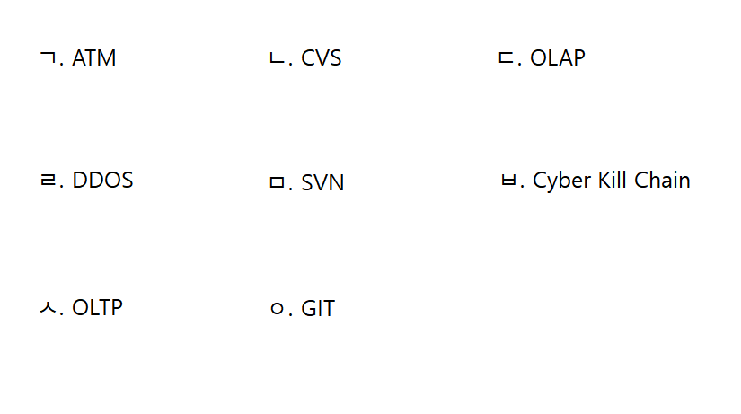

# 개발 방법론·형상 관리 — 기출 기반 요약정리

> 범위: **2020년 1회 ~ 2026년 2회 (21개 회차) 중 이 영역 12문제**. 출제 빈도 → 개념 요약 → 기출 키워드 → 기출 원문 순서. 해설은 각 문제 파일에서 확인.

## A. 출제 빈도 (많이 나온 순)

| 카테고리 | 횟수 | 출제 회차-번호 (최신순) |
|---|:--:|---|
| 형상 관리 | 3 | 22-3-11, 20-3-04, 20-2-20 |
| EAI | 2 | 21-1-13, 20-3-18 |
| 릴리스 노트 | 1 | 20-1-15 |
| 개발 기간 산정 | 1 | 20-1-16 |
| 재해 복구 | 1 | 20-2-01 |
| 애자일 | 1 | 20-2-04 |
| 리팩토링 | 1 | 20-3-01 |
| 식별자 표기법 | 1 | 20-3-11 |
| C++(생성자) | 1 | 20-3-19 |

---

# B. 개념 요약
## 1. 개발 방법론
| 모델 | 특징 |
|---|---|
| **폭포수** | 요구→설계→구현→테스트→배포 **순차적**, 변경 어려움, **절차·문서** 중심 |
| 프로토타입 | 시제품으로 요구 확인 |
| 나선형 | **위험 분석** 반복 |
| **애자일(Agile)** | **사람 중심**, 변화에 **유연·신속 적응**, **경량**, 짧은 반복, 고객 협력, **워터폴에 대비** |
- 애자일 가치: **개인·상호작용** > 프로세스·도구 / **동작하는 SW** > 포괄적 문서 / **고객 협력** > 계약 협상 / **변화 대응** > 계획 준수.
- **XP**(5가치: 의사소통·단순성·용기·존중·피드백, 짝 프로그래밍), **스크럼**(스프린트 2~4주, 일일 스크럼 15분, 회고).

## 2. 개발 규모·기간 산정 (기출 1회)
- **노력(인월 M/M) = LoC ÷ 1인당 월 생산 라인**, **개발 기간 = 노력 ÷ 투입 인원**. 기출: (30,000 / 300) / 5 = **20개월**.
- COCOMO(기본·중간·상세), PERT 예측치 = (낙관 + 4×기대 + 비관) / 6.

## 3. 형상(구성) 관리 (기출 3회)
- **형상 관리(SCM)**: 변경 사항을 **체계적으로 추적·관리**.
- **4활동**: **형상 식별**(대상 정의·식별) → **형상 통제**(**변경 요청 검토·승인, 형상통제위원회(CCB)**, 변경 활동 통제) → **형상 감사**(베이스라인 무결성 평가) → **형상 기록**(상태 보고).
- 도구: **CVS·SVN(중앙집중)**, **Git(분산)**. ※ ATM·OLAP·DDoS·Cyber Kill Chain·OLTP는 형상 관리 도구가 아님.

## 4. 리팩토링
**외부 동작은 유지**하고 내부 구조 개선 — **복잡한 코드 단순화·가독성 향상·유지보수성 향상**, 유연한 시스템, 생산성·품질 향상. 이후 회귀 테스트로 동작 확인.

## 5. 릴리스 노트
**헤더**(문서 이름·제품 이름·**버전 번호**·릴리스 날짜·노트 버전), 개요, 목적, 문제 요약, 재현 항목, 수정/개선 내용, 사용자 영향도, SW 지원 영향도, 노트, 면책 조항, 연락처.

## 6. 재해 복구(DR)
| 지표 | 의미 |
|---|---|
| **RTO** (Time) | 업무 중단 → **정상 가동까지 걸리는 목표 시간** |
| **RPO** (Point) | **데이터 손실 허용 시점**(얼마나 최근 데이터까지 복구) |
| RCO | 네트워크 복구 수준 |
| RSO | 복구 대상 시스템 선정(업무 중요도) |

## 7. 기타 개발 지식
- **식별자 표기법**: **카멜**(`goodMan`) / **파스칼**(`GoodMan`) / **스네이크**(`good_man`) / **헝가리안**(**접두어에 자료형**: `szGoodMan`).
- **EAI**(Enterprise Application Integration): 서로 다른 플랫폼·애플리케이션 **연계·통합**. 유형 **Point-to-Point**(1:1) / **Hub & Spoke**(중앙 허브) / **Message Bus**(미들웨어 버스) / **Hybrid**(그룹 내 허브 + 그룹 간 버스). (기출 2회)
- **C++ 생성자**: 객체 생성 시 **자동 호출**되는 특수한 메서드(클래스 이름과 동일, 반환형 없음).

---

# C. 기출 키워드 → 정답 (한눈에)

| 회차-번호 | 카테고리 | 정답 |
|---|---|---|
| [22-3-11](../2022년 3회/11.md) | 형상 관리 | CVS, SVN, GIT |
| [20-3-04](../2020년 3회/04.md) | 형상 관리 |  |
| [20-2-20](../2020년 2회/20.md) | 형상 관리 | 형상 관리 (Software Configuration Management) |
| [21-1-13](../2021년 1회/13.md) | EAI | EAI (Enterprise Application Integration) |
| [20-3-18](../2020년 3회/18.md) | EAI | 1. Point-to-Point 2. Hub & Spoke |
| [20-1-15](../2020년 1회/15.md) | 릴리스 노트 | 헤더 (Header) |
| [20-1-16](../2020년 1회/16.md) | 개발 기간 산정 | 프로젝트 개발 기간 = 20개월 / 계산식 = (30,000라인 ÷ 300라인) ÷ 5명 |
| [20-2-01](../2020년 2회/01.md) | 재해 복구 | RTO (Recovery Time Objective, 재해 복구 시간) |
| [20-2-04](../2020년 2회/04.md) | 애자일 | 애자일 방법론 (Agile) |
| [20-3-01](../2020년 3회/01.md) | 리팩토링 |  |
| [20-3-11](../2020년 3회/11.md) | 식별자 표기법 |  |
| [20-3-19](../2020년 3회/19.md) | C++(생성자) |  |

---

# D. 기출문제 원문

## 형상 관리 (3회)

### 2022년 3회 11번

[해설 보기](../2022년 3회/11.md)

다음 보기 중, 형상 관리 항목을 3가지 고르시오.

**정답:** CVS, SVN, GIT

### 2020년 3회 04번

[해설 보기](../2020년 3회/04.md)

형상 통제를 설명하시오.

**정답:** 

### 2020년 2회 20번

[해설 보기](../2020년 2회/20.md)

소프트웨어 개발 과정에서 변경 사항을 관리하는 기법은 (     ) 기법이라고 하며, (      ) 기법을 활용한 도구로는 CVS, SVN, Git 등이 있다. 빈칸에 알맞은 용어를 쓰시오.

**정답:** 형상 관리 (Software Configuration Management)

## EAI (2회)

### 2021년 1회 13번

[해설 보기](../2021년 1회/13.md)

시스템 통합에 사용되는 솔루션으로 구축 유형에는 Point to Point, Hub & Spoke, Message Bus가 있다. 기업에서 운영되는 서로 다른 플랫폼 및 애플리케이션 간의 정보를 전달, 연계 , 통합이 가능하도록 해주는 솔루션을 무엇이라고 하는지 쓰시오.

**정답:** EAI (Enterprise Application Integration)

### 2020년 3회 18번

[해설 보기](../2020년 3회/18.md)

EAI 유형에는 메세지 버스(Message bus), 하이브리드(Hybrid), (   1.  ), (   2.   ) 4가지가 있다.

**정답:** 1. Point-to-Point 2. Hub & Spoke

## 릴리스 노트 (1회)

### 2020년 1회 15번

[해설 보기](../2020년 1회/15.md)

다음이 설명하는 제품 패키지 릴리스 노트의 작성 항목은 무엇인가?

[보기]

문서 이름(릴리스 노트 이름), 제품 이름, 버전 번호, 릴리스 날짜, 참고 날짜, 노트 버전 등의 정보

**정답:** 헤더 (Header)

## 개발 기간 산정 (1회)

### 2020년 1회 16번

[해설 보기](../2020년 1회/16.md)

LoC(Line of Code)가 30,000라인이고, 개발자가 5명이며, 개발자가 월평균 300라인을 개발한다. 이때 프로젝트 개발 기간과 계산식을 쓰시오.

**정답:** 프로젝트 개발 기간 = 20개월 / 계산식 = (30,000라인 ÷ 300라인) ÷ 5명

## 재해 복구 (1회)

### 2020년 2회 01번

[해설 보기](../2020년 2회/01.md)

정보시스템 운영 중 서버가 다운되거나 자연재해나 시스템 장애 등의 이유로 고객에게 서비스가 불가능한 경우가 종종 발생한다. 이와 같은 상황에서 비상사태 또는 업무중단 시정부터 업무가 복구되어 다시 정상 가동될때까지의 시간을 의미하는 용어가 무엇인지 쓰시오.

**정답:** RTO (Recovery Time Objective, 재해 복구 시간)

## 애자일 (1회)

### 2020년 2회 04번

[해설 보기](../2020년 2회/04.md)

절차보다는 사람이 중심이 되어 변화에 유연하고 신속하게 적응하면서 효율적으로 시스템을 개발할 수 있는 신속 적응적 경량 개발방법론으로, 개발 기간이 짧고 신속하며, 워터폴에 대비되는 방법론으로 최근 회사에서 각광받는 방법론은 무엇인가?

**정답:** 애자일 방법론 (Agile)

## 리팩토링 (1회)

### 2020년 3회 01번

[해설 보기](../2020년 3회/01.md)

리팩토링의 목적에 대하여 서술하시오.

**정답:** 

## 식별자 표기법 (1회)

### 2020년 3회 11번

[해설 보기](../2020년 3회/11.md)

다음 중 헝가리안 표기법(Hungarian Case)에 대해서 서술하시오.

**정답:** 

## C++(생성자) (1회)

### 2020년 3회 19번

[해설 보기](../2020년 3회/19.md)

C++에서 생성자란 무엇인지 쓰시오.

**정답:** 
